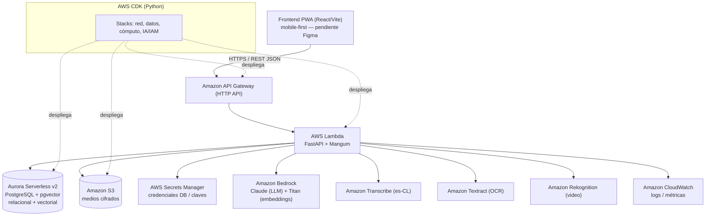
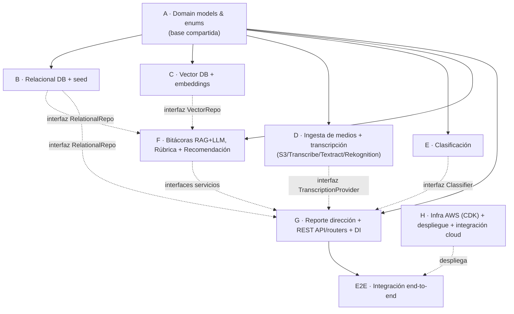
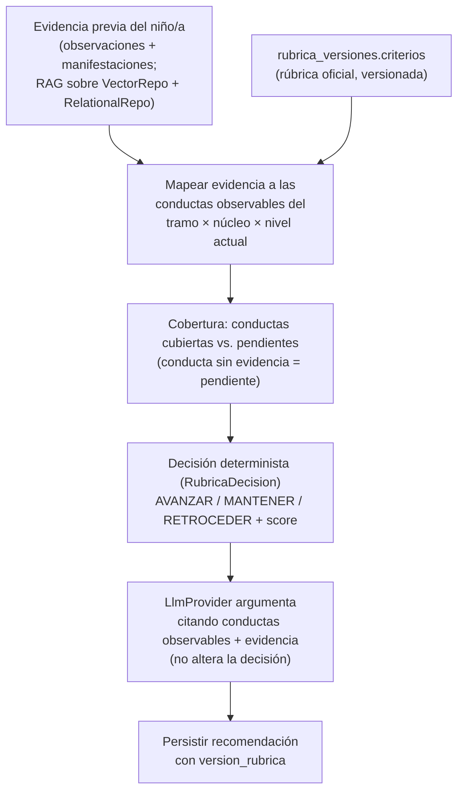
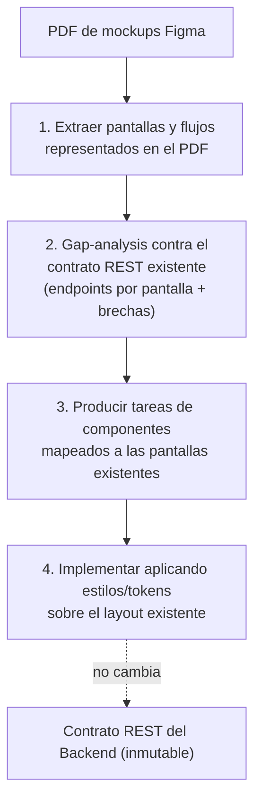
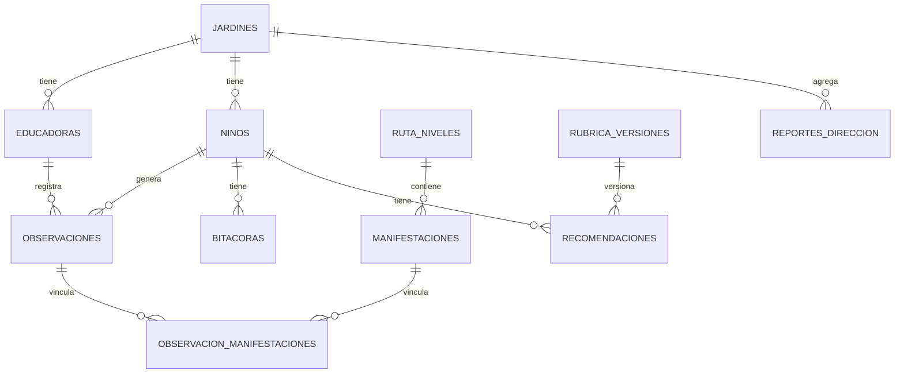
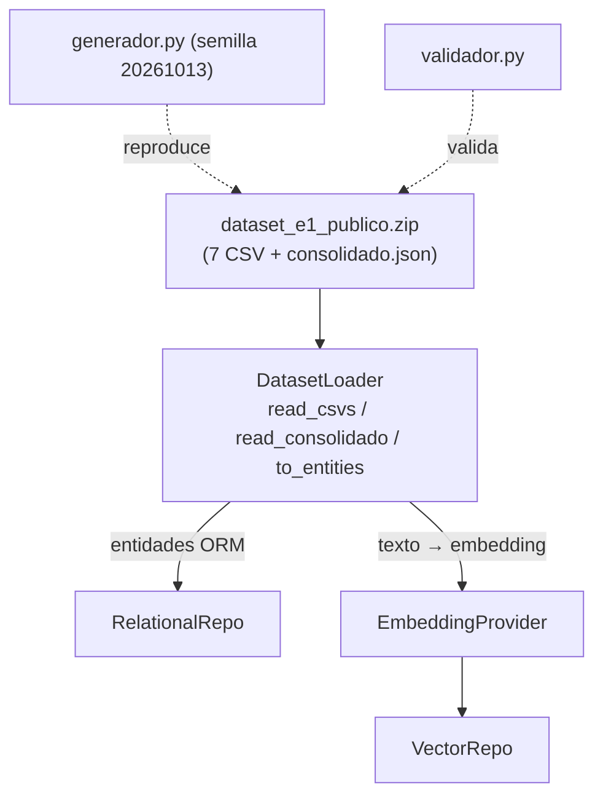

# Design — jAImes MVP

## Overview

jAImes es un sistema full-stack de 3 capas que transforma evidencia cruda (texto / audio / foto / video) que las educadoras de Fundación Integra ya generan, en observaciones estructuradas, bitácoras quincenales, recomendaciones de nivel y reportes de dirección. El KPI estrella es reducir el tiempo de documentación de ~4 h/semana a ~0 h: la educadora pasa de **redactar** a **revisar y aprobar**.

El backend (FastAPI, Python) concentra la lógica de negocio y expone una API REST; el frontend (React + Vite, PWA mobile-first) solo consume esa API y se construirá en una tarea posterior a partir de los mockups de Figma. La IA se integra mediante **puertos y adaptadores** (interfaces + implementaciones AWS/mock).

**Decisión central de este diseño: AWS es el camino primario y real, no una opción secundaria.** El despliegue objetivo es **serverless** sobre AWS, con Infraestructura como Código en **AWS CDK (Python)**. Los mocks siguen existiendo detrás de las mismas interfaces para pruebas locales y CI sin credenciales, pero el sistema está diseñado, documentado y probado contra servicios AWS reales. El objetivo del MVP es que el jurado vea una **arquitectura cloud real y básica** corriendo el servidor y haciendo demos en vivo.

Este diseño cubre los Requirements 1–11 y está deliberadamente **organizado en módulos independientes** para que un equipo de 4 personas trabaje en paralelo con máxima autonomía: los contratos (interfaces) se definen primero y cada módulo depende solo de interfaces, nunca de la implementación de otro.

### Alcance MVP (y lo que queda fuera)

**Dentro:** arquitectura cloud AWS real y básica, serverless, capaz de levantar el servidor y hacer demos en vivo con los 4 modelos de IA, las 2 bases de datos y el dataset E-1 sembrado.

**Fuera del MVP (explícito):**
- Endurecimiento avanzado de ciberseguridad (WAF fino, rotación automatizada de secretos avanzada, pentesting, hardening de red exhaustivo). Se aplica una base razonable (cifrado en reposo, seudonimización, mínimos privilegios IAM, secretos en Secrets Manager), pero no más.
- Manejo exhaustivo de casos borde y resiliencia de producción (reintentos sofisticados, colas de dead-letter avanzadas, multi-AZ tuning, autoescalado fino).
- Autenticación robusta / SSO institucional (en demo: selector de rol simple, sin auth real).
- Multi-tenant a escala, fine-tuning de modelos, apps nativas.

---

## Architecture

### Capas (3-tier) sobre AWS serverless

```
Capa 1 · Presentación      → Frontend React/Vite PWA (solo UI + llamadas REST)   [tarea posterior, desde Figma]
Capa 2 · Lógica de negocio → FastAPI envuelto por Mangum, corriendo en AWS Lambda
                             routers (API) → services (casos de uso)
                             → domain (modelos POO) → providers (puertos IA)
Capa 3 · Acceso a datos    → repositories: relacional + vectorial (Aurora/pgvector), storage (S3)
Infra externa (AWS)        → API Gateway, Lambda, Aurora Serverless v2 (pgvector),
                             S3, Bedrock (Claude + Titan), Transcribe, Textract,
                             Rekognition, Secrets Manager, CloudWatch
IaC                        → AWS CDK (Python)
```

### Diagrama cloud (serverless)



### Por qué estas elecciones (serverless)

- **Lambda + API Gateway + Mangum:** se despliega el mismo FastAPI que corre en local, sin reescribir la app. Costo cero en reposo, ideal para una demo de hackathon.
- **Aurora Serverless v2 PostgreSQL + extensión `pgvector`:** un solo motor cubre la base **relacional** (personas/entidades) y la **vectorial** (embeddings para RAG). Simplifica infraestructura y pruebas, y escala a cero/poco en reposo. El diseño permite migrar la parte vectorial a OpenSearch Serverless cambiando solo el adaptador `VectorRepo`.
- **Bedrock (Claude + Titan):** LLM gestionado para redacción de bitácoras/argumentos y embeddings Titan para RAG, sin administrar GPUs.
- **CDK en Python:** una sola lengua para backend e infraestructura; stacks versionados y reproducibles.

### Principios SOLID aplicados

- **SRP:** un servicio por caso de uso (transcribir, clasificar, embeber, bitácora, recomendación, reporte).
- **OCP:** nuevos proveedores de IA se agregan como adaptadores sin tocar los servicios.
- **LSP:** adaptadores AWS y mock son intercambiables tras la misma interfaz.
- **ISP:** interfaces pequeñas por capacidad (`TranscriptionProvider`, `LlmProvider`, `EmbeddingProvider`, repos).
- **DIP:** los servicios dependen de interfaces, inyectadas por un contenedor de DI simple que lee la configuración (`USE_MOCKS`, región, nombres de recursos).

### Selección de implementaciones (AWS primero, mock secundario)

Un contenedor de dependencias en `core/` lee la configuración y construye los adaptadores:
- **Por defecto (AWS):** adaptadores Bedrock/Transcribe/Textract/Rekognition/S3 y repositorios sobre Aurora+pgvector.
- **`USE_MOCKS=true` (local/CI):** adaptadores mock que derivan salidas plausibles del dataset E-1 y repositorios sobre SQLite + índice vectorial en memoria.

Los routers reciben los servicios por `Depends()` de FastAPI. El mismo contenedor sirve en Lambda (producción) y en `uvicorn` local.

---

## Modularidad para trabajo paralelo (clave del diseño)

El equipo de 4 personas trabaja en paralelo gracias a un enfoque **interface-first**: primero se congelan los contratos (modelos de dominio + interfaces de providers y repos + esquemas de API), y luego cada módulo se implementa y prueba de forma aislada contra esos contratos usando mocks/fakes. Ningún módulo importa la implementación de otro: todos dependen solo de interfaces del módulo A (shared) o de las interfaces de puertos.

### Mapa de módulos independientes



Las flechas punteadas representan **dependencia de interfaz, no de implementación**: el módulo consumidor programa contra el contrato y usa un fake mientras el proveedor real se construye en paralelo.

### Tabla de asignación y contratos

| Módulo | Responsable (sugerido) | Depende de (solo interfaces) | Entrega (contrato que expone) | Se prueba en aislamiento con |
|---|---|---|---|---|
| **A. Dominio** | Compartido / líder | — | `app/domain/models.py`, `rubrica.py` (modelos, enums, tipos) | Tests unitarios de validación Pydantic |
| **B. Relacional + seed** | Dev 1 | A | `RelationalRepo`, esquema SQLAlchemy, script de seed E-1 | SQLite in-memory + dataset E-1 |
| **C. Vector + embeddings** | Dev 2 | A | `VectorRepo`, `EmbeddingProvider` | Índice en memoria + `MockEmbeddingProvider` |
| **D. Ingesta + transcripción** | Dev 2/3 | A | `TranscriptionProvider`, `StorageRepo`, `IngestionService` | Mocks de Transcribe/Textract/Rekognition/S3 |
| **E. Clasificación** | Dev 3 | A | `Classifier` (estima nivel/dominio, vincula manifestaciones) | Fixtures de texto del dataset E-1 |
| **F. Bitácoras + Rúbrica + Recomendación** | Dev 3/4 | A, interfaces de B/C | `BitacoraService`, `RubricaDecision`, `RecommendationService`, `LlmProvider` | `MockLlmProvider`, fakes de repos |
| **G. Reporte + API + DI** | Dev 4 | A, interfaces de B/D/E/F | routers FastAPI, `DirectorReportService`, contenedor DI | `TestClient` con servicios fake |
| **H. Infra AWS (CDK)** | Dev 1/4 | contrato de despliegue (handler Lambda, env vars) | stacks CDK, pipeline de deploy, tests de integración cloud | `cdk synth`, deploy a cuenta sandbox |
| **E2E. Integración** | Todo el equipo | todos (vía interfaces) | ensamblaje final + demo | entorno AWS real + modo mock |

### Reglas que mantienen la independencia

1. **El módulo A se congela primero.** Modelos y enums son la única fuente de verdad compartida; cambios se coordinan explícitamente.
2. **Todo cruce de módulo pasa por una interfaz** definida en `providers/*/base.py` o `repositories/*/base.py`.
3. **Cada módulo trae su propio fake/mock** para no bloquearse esperando a otro.
4. **La capa E2E ensambla, no reescribe.** Solo cablea implementaciones reales mediante el contenedor DI; si algo no encaja, se corrige la interfaz (acordada por el equipo), no se crean dependencias cruzadas.

---

## Estructura de documentación (`docs/`)

Para que la documentación no quede dispersa, se organiza por módulo. Cada subcarpeta contiene notas de arquitectura y diagramas Mermaid de su área.

```
docs/
  MVP_BLUEPRINT.md          # visión global (ya existe)
  backend/                  # Capa 2: servicios, dominio, providers, DI, SOLID
    README.md               # mapa de módulos y contratos interface-first
    servicios.md            # un apartado por servicio (ingesta, clasificación, bitácora, recomendación, reporte)
    rubrica.md              # rúbrica determinista versionada y su contrato
    diagramas/*.mmd
  frontend/                 # Capa 1: estructura PWA + consumo de la API (pendiente Figma)
    README.md               # pantallas, routing por rol, capa de servicios API
    contrato-api.md         # cómo el cliente consume cada endpoint
  database/                 # Capa 3: modelo relacional + vectorial
    README.md               # diccionario de datos E-1 + tablas nuevas
    esquema.md              # tablas, PK/FK, tipos, nulabilidad
    vectorial.md            # pgvector, documento por observación, búsqueda semántica
    diagramas/*.mmd         # ER diagram
  cloud/                    # Infra AWS: arquitectura serverless + CDK + despliegue
    README.md               # arquitectura cloud y decisiones serverless
    cdk.md                  # stacks CDK, recursos, IAM mínimos privilegios
    despliegue.md           # pasos de deploy, variables de entorno, demo
    integracion.md          # pruebas de integración contra AWS real
    diagramas/*.mmd
```

| Subcarpeta | Documenta | Audiencia |
|---|---|---|
| `docs/backend/` | Lógica de negocio: servicios, dominio, puertos/adaptadores, DI, aplicación de SOLID, contratos interface-first para trabajo paralelo. | Devs de módulos A–G |
| `docs/frontend/` | Estructura de la PWA, pantallas por rol y, sobre todo, **cómo el cliente consume la API REST**. Marcado como pendiente del refinamiento de Figma. | Dev de frontend (tarea posterior) |
| `docs/database/` | Las dos bases: diccionario relacional E-1 + tablas nuevas, y el índice vectorial pgvector (documento por observación). Incluye diagrama ER. | Devs de módulos B y C |
| `docs/cloud/` | Arquitectura serverless AWS, stacks CDK, IAM, pasos de despliegue y pruebas de integración cloud reales. | Dev de módulo H y presentadores de la demo |

---

## Components and Interfaces

### Domain models (`app/domain/models.py`) — Módulo A

`Jardin`, `Educadora`, `Nino`, `NivelRuta`, `Manifestacion`, `Observacion`, `Bitacora`, `Recomendacion`, `ReporteDireccion` (Pydantic v2). Enums: `FormatoCaptura {texto,audio,foto,video}`, `Dominio {cognitivo,lenguaje_comunicacion,motor_fino,motor_grueso,socioemocional}`, `DecisionNivel {AVANZAR,MANTENER,RETROCEDER}`, `EstadoBitacora {borrador,aprobada}`, `Rol {educadora,directora}`. (Requirements 1.4, 3.1, 4.1, 8, 11.1 — sin nombres reales ni RUT.)

### Rúbrica (`app/domain/rubrica.py`) — Módulo F

`RubricaDecision` encapsula la **rúbrica oficial** versionada y es **puramente determinista** (la rúbrica decide, la IA argumenta, la educadora valida). Consume la rúbrica oficial directamente desde `rubrica_versiones.criterios` como **fuente de verdad** de los criterios de nivel (Requirements 6.2, 6.6, 21.1).

**Estructura de la rúbrica oficial** = tramo de sala × núcleo (multi-núcleo, el primero es "Identidad y Autonomía") × 8 niveles de progresión en orden fijo (1 Comenzando, 2 Explorando, 3 Desarrollando, 4 Afianzando, 5 Integrando, 6 Ampliando, 7 Consolidando, 8 Profundizando); cada nivel tiene un **descriptor esperado** y una lista de **conductas observables** (con ejemplos).

**Esquema (sketch ilustrativo) de `rubrica_versiones.criterios`** — es un *esquema de datos*, no código; multi-núcleo y extensible agregando núcleos/tramos como datos versionados, **sin cambios de código** (Requirements 21.1, 21.2):

```json
{
  "version": "ia-v1",
  "tramos": {
    "sala_cuna": {
      "rango_etario_meses": [0, 24],
      "nucleos": {
        "identidad_y_autonomia": {
          "niveles": [
            {"n": 1, "nombre": "Comenzando",     "descriptor": "...", "conductas_observables": ["...", "..."]},
            {"n": 2, "nombre": "Explorando",      "descriptor": "...", "conductas_observables": ["...", "..."]},
            {"n": 3, "nombre": "Desarrollando",   "descriptor": "...", "conductas_observables": ["...", "..."]},
            {"n": 4, "nombre": "Afianzando",      "descriptor": "...", "conductas_observables": ["...", "..."]},
            {"n": 5, "nombre": "Integrando",      "descriptor": "...", "conductas_observables": ["...", "..."]},
            {"n": 6, "nombre": "Ampliando",       "descriptor": "...", "conductas_observables": ["...", "..."]},
            {"n": 7, "nombre": "Consolidando",    "descriptor": "...", "conductas_observables": ["...", "..."]},
            {"n": 8, "nombre": "Profundizando",   "descriptor": "...", "conductas_observables": ["...", "..."]}
          ]
        }
      }
    },
    "nivel_medio": { "rango_etario_meses": [24, 48], "nucleos": { "identidad_y_autonomia": { "niveles": [ /* 8 niveles */ ] } } },
    "transicion":  { "rango_etario_meses": [48, 72], "nucleos": { "identidad_y_autonomia": { "niveles": [ /* 8 niveles */ ] } } }
  },
  "umbrales": {
    "cobertura_avanzar": 0.8,
    "nucleos_requeridos": ["identidad_y_autonomia"],
    "racha_retroceso": 3
  }
}
```

**Contrato `evaluar(...)`** (determinista; la IA nunca altera la decisión — Requirements 6.2, 6.5):

```python
evaluar(nino, observaciones_recientes, nivel_actual) -> ResultadoRubrica{
  tramo,                              # derivado del rango etario del niño/a
  nucleo,                             # núcleo evaluado (p. ej. "identidad_y_autonomia")
  nivel_actual,                       # nivel de progresión actual (1..8)
  decision,                           # AVANZAR | MANTENER | RETROCEDER
  score,                              # fracción de cobertura 0.00–1.00
  conductas_observables_cubiertas[],  # conductas del tramo×núcleo×nivel con evidencia
  conductas_observables_pendientes[], # conductas del tramo×núcleo×nivel sin evidencia
  evidencia[],                        # observaciones citadas por id_observacion
  version_rubrica                     # versión de rúbrica usada
}
```

**Lógica de cobertura determinista:**
1. **Derivar el tramo** del rango etario del niño/a (`rango_etario_meses` de cada tramo); seleccionar el núcleo y el `nivel_actual` dentro de `rubrica_versiones.criterios`.
2. **Mapear la evidencia previa** del niño/a (observaciones y manifestaciones del `RelationalRepo`, complementadas con la búsqueda semántica en `VectorRepo`) contra la lista de **conductas observables** del `tramo × núcleo × nivel_actual`: cada conducta se marca **cubierta** cuando la evidencia la respalda y **pendiente** cuando no la hay. Una conducta **sin evidencia cuenta como pendiente** — no se infiere cumplimiento (Requirement 21.6).
3. `score` = fracción de conductas observables cubiertas sobre el total del nivel actual.
4. **Decisión:**
   - **AVANZAR** cuando la fracción cubierta ≥ `umbrales.cobertura_avanzar` en los `nucleos_requeridos`.
   - **MANTENER** cuando la cobertura es parcial (por debajo del umbral).
   - **RETROCEDER** cuando existe evidencia sostenida por debajo del nivel actual: una racha de ≥ `umbrales.racha_retroceso` (por defecto 3) observaciones consecutivas con `nivel_estimado` bajo el nivel asignado.

El **tramo** se deriva del rango etario del niño/a; los **núcleos** son extensibles como datos versionados (Requirements 21.2, 21.3). El `LlmProvider` **solo argumenta** citando las conductas observables específicas y las observaciones previas; nunca cambia la decisión (Requirements 6.2, 6.7, 21.4).

**Flujo de recomendación de nivel (Modelo 3):**



### Provider interfaces (`app/providers/*/base.py`) — puertos de los módulos C, D, F

```python
TranscriptionProvider.transcribe(media_ref, formato) -> str          # Modelo 1
EmbeddingProvider.embed(text) -> list[float]                         # Titan
LlmProvider.generate(prompt, context) -> str                        # Claude
Classifier.classify(texto) -> ClasificacionPropuesta                # Módulo E
```

Adaptadores por cada puerto:
- **AWS (primario):** `aws_transcription.py` (Transcribe + Textract + Rekognition según formato), `bedrock_llm.py` (Claude), `titan_embeddings.py` (Titan).
- **Mock (secundario):** `mock_*.py`, derivan salidas plausibles del dataset E-1 para CI/local.

### Repository interfaces (`app/repositories/*/base.py`) — módulos B y C

- `RelationalRepo`: CRUD de todas las entidades + consultas agregadas para el reporte de dirección.
- `VectorRepo`: `index(doc)` y `search(query_embedding, filtros, k)`.
- `StorageRepo`: `put(file) -> ref`, `get_url(ref)`.

Implementaciones primarias sobre **Aurora Serverless v2 (Postgres + pgvector)** y **S3**; secundarias sobre SQLite + índice en memoria + almacenamiento local.

### Services (`app/services/`)

- `IngestionService` (Módulo D): orquesta carga → `StorageRepo` (S3) → `TranscriptionProvider` → `Classifier` → persistencia → embedding. **Idempotente** respecto al archivo subido.
- `TranscriptionService` (Módulo D): envuelve `TranscriptionProvider` según formato (Requirement 2).
- `ClassificationService` (Módulo E): estima nivel/dominio y vincula manifestaciones; produce clasificación **propuesta** para confirmación humana (Requirement 3).
- `EmbeddingService` (Módulo C): embebe texto e indexa en `VectorRepo` (Requirement 4.2).
- `BitacoraService` (Módulo F, Modelo 2): RAG (recupera evidencia) + `LlmProvider` → bitácora trazable en estado borrador (Requirement 5).
- `RecommendationService` (Módulo F, Modelo 3): recupera evidencia previa (RAG sobre `VectorRepo` + `RelationalRepo`) → `RubricaDecision` mapea esa evidencia a las **conductas observables** del tramo×núcleo×nivel actual y **decide** de forma determinista → pasa al `LlmProvider` como contexto las **conductas observables aplicables (cubiertas y pendientes) + la evidencia recuperada**, de modo que el `LlmProvider` **argumenta citándolas** sin alterar la decisión → persiste con `version_rubrica` (Requirements 6, 21.4). La decisión siempre proviene de la rúbrica; el LLM solo redacta el argumento legible.
- `DirectorReportService` (Módulo G, Modelo 4): agrega métricas vía `RelationalRepo` → `LlmProvider` (resumen ejecutivo) (Requirement 7).

### API (`app/api/routers/`) — Módulo G, contratos REST (JSON)

```
POST   /ninos/{id}/observaciones            # crear observación (multipart: medio o texto) → clasificación propuesta
PATCH  /observaciones/{id}/clasificacion    # confirmar/corregir clasificación
GET    /ninos/{id}/observaciones            # listar
GET    /ninos/{id}                          # ficha + trayectoria
GET    /ninos?sala=...                      # "Mi sala"
POST   /ninos/{id}/bitacoras                # generar bitácora quincenal (body: periodo)
GET    /ninos/{id}/bitacoras                # listar
PATCH  /bitacoras/{id}                      # editar / aprobar
POST   /ninos/{id}/recomendaciones          # generar recomendación de nivel
POST   /recomendaciones/{id}/decision       # registrar decisión de la educadora
GET    /jardines/{id}/reportes              # generar/obtener reporte de dirección (query: periodo)
GET    /ruta-niveles                        # rúbrica/ruta de referencia
GET    /health                              # salud para API Gateway / demo
```

La app FastAPI se envuelve con **Mangum** (`handler = Mangum(app)`) para ejecutarse en Lambda tras API Gateway, sin cambiar los routers. Errores en español, con códigos HTTP apropiados (400 formato no soportado, 404 no encontrado, 422 validación).

### Frontend (`frontend/src/`) — tarea posterior, pendiente Figma

Diseño **mínimo** por ahora: PWA React + Vite, mobile-first, con una capa de servicios API tipada que consume los endpoints anteriores, router por rol (educadora/directora) y los componentes transversales `SelectorRol`, `BannerDatosSinteticos`, `IndicadorCarga`. El estilo y las pantallas definitivas (`MiSala`, `Capturar`, `ConfirmarClasificacion`, `FichaNino`, `Bitacoras`, `DashboardDireccion`) se implementarán desde los mockups de Figma una vez refinados (Requirement 9.4). El cliente no contiene lógica de negocio: solo UI + llamadas REST (Requirement 9.5).

#### Ingesta de mockups de Figma (pipeline cuando llegue el PDF) — Requirement 20

Cuando el equipo entregue los **mockups refinados de Figma en formato PDF**, se ejecuta un pipeline de cuatro pasos que convierte el diseño visual en tareas concretas de frontend **sin tocar la lógica del backend**:



1. **Extraer** las pantallas y flujos representados en los mockups del PDF (Requirement 20.1).
2. **Gap-analysis** de pantallas y flujos contra el **contrato REST existente**, identificando qué endpoints consume cada pantalla y las brechas detectadas (Requirement 20.2).
3. **Producir componentes concretos** mapeados a las pantallas ya definidas: `MiSala`, `Capturar`, `ConfirmarClasificacion`, `FichaNino`, `Bitacoras`, `DashboardDireccion` (Requirement 20.3).
4. **Implementar** aplicando **estilos y tokens de diseño sobre la estructura existente**, sin alterar la lógica de negocio (Requirement 20.4).

**Invariante clave:** el **contrato de la API REST del Backend permanece sin cambios** como resultado de la ingesta de los mockups (Requirement 20.5). La ingesta de Figma es puramente una tarea de capa de presentación.

---

## Data Models

### Base relacional + vectorial sobre Aurora Serverless v2 (PostgreSQL + pgvector)

Un mismo clúster Aurora aloja ambas bases (Requirement 4). Las tablas del dataset E-1 (`jardines`, `educadoras`, `ninos`, `ruta_niveles`, `manifestaciones`, `observaciones`, `observacion_manifestaciones`) más las nuevas que persisten la salida de los Modelos 2–4:

- `bitacoras(id_bitacora PK, id_nino FK, id_educadora FK, periodo, texto_generado, estado, fecha)`
- `recomendaciones(id_recomendacion PK, id_nino FK, id_educadora FK, decision, score, dominios_cubiertos, dominios_pendientes, argumento_ia, version_rubrica FK, decision_educadora, fecha)`
- `rubrica_versiones(version_rubrica PK, criterios JSON, vigente_desde, descripcion)` — la columna `criterios` (JSON) **almacena la rúbrica oficial** como **fuente de verdad** de los criterios de decisión de nivel: la estructura tramo de sala × núcleo × 8 niveles de progresión × conductas observables (con descriptor esperado por nivel) más los umbrales de decisión, **versionada** y modificable sin cambios de código (Requirements 6.6, 21.1, 21.2). El seed carga como **versión inicial** al menos el núcleo "Identidad y Autonomía" para los tres tramos (Sala Cuna, Nivel Medio, Transición); núcleos adicionales se agregan como nuevas versiones sin tocar el código (Requirement 21.5).
- `reportes_direccion(id_reporte PK, id_jardin FK, periodo, metricas JSON, resumen_ejecutivo, fecha)`

Tipos y nulabilidad siguen el diccionario E-1 (fechas AAAA-MM-DD; `nota_breve` admite vacío; `nivel_estimado` y `edad_meses` opcionales hasta derivarse).

### Documento vectorial (tabla con columna `vector` de pgvector)

Un documento por observación en una tabla con columna `embedding vector(d)` + metadatos:
`{id_observacion, id_nino, texto_transcrito, embedding, dominio, nivel, fecha, formato}`. Búsqueda por similitud coseno (operador `<=>` de pgvector) + filtros de metadatos para el RAG (Requirement 5.1). En local se sustituye por índice en memoria tras la misma interfaz `VectorRepo`.

### Diagrama ER (resumen)



### Dataset oficial E-1 como fuente de verdad (seed) — Módulo B

El seed carga el **Dataset E-1 oficial** como **única fuente de verdad**, a partir de **siete CSV relacionales** más `consolidado.json`, en lugar de los archivos JSON por tabla usados hasta ahora. El cargador se adapta de "un JSON por tabla" a "leer los 7 CSV (+ `consolidado.json`)".

**Características del dataset oficial:**
- **Reproducible de forma determinista:** se regenera con `generador.py` y se valida con `validador.py` bajo **Python 3.12.15 (solo biblioteca estándar)**, con **semilla fija `20261013`**, **fecha de referencia `2026-10-13`**, codificación **UTF-8**, saltos de línea **LF** y **orden canónico**, de modo que una segunda ejecución limpia produce una salida **idéntica bit a bit** (hashes publicados coincidentes).
- **Escala:** **500 niños/as**, de los cuales **60 tienen solo 1–2 observaciones** (ingreso reciente) y **440 tienen entre 4 y 9**.
- **Distribución únicamente del zip público:** solo se usa y versiona `dataset_e1_publico.zip`; el **zip interno de validación NO se incluye** en el repositorio ni en los entregables.
- **Respaldo de pruebas:** el dataset reducido/casero permanece **solo como respaldo rápido de pruebas**, nunca como fuente de verdad.

**Nota de diseño — camino de abstención por datos insuficientes:** los **60 niños/as con 1–2 observaciones** ejercitan deliberadamente la ruta de **"datos insuficientes (<5 observaciones)"** del `RecommendationService`/`RubricaDecision` (Requirement 6.8): al cargarlos, el sistema debe abstenerse de emitir decisión para ellos sin producir error ni interrumpir el procesamiento del resto del dataset.

**Abstracción `DatasetLoader` (detrás de la frontera del seed):**

```python
DatasetLoader.load(ruta_zip) -> DatasetE1          # extrae y valida el zip público
DatasetLoader.read_csvs() -> dict[str, list[Row]]  # lee los 7 CSV relacionales
DatasetLoader.read_consolidado() -> dict            # lee consolidado.json
DatasetLoader.to_entities(rows) -> list[Entidad]    # mapea filas → entidades ORM (dominio A)
```

`DatasetLoader` lee los **7 CSV** (`jardines`, `educadoras`, `ninos`, `ruta_niveles`, `manifestaciones`, `observaciones`, `observacion_manifestaciones`) más `consolidado.json`, y **mapea cada fila a las entidades ORM** del dominio (Módulo A). Queda **encapsulado detrás de la frontera del seed** (`RelationalRepo`/`VectorRepo`), de modo que **cambiar de dataset** (oficial ↔ reducido casero) **no toca el código de los servicios**. El seed valida los conteos cargados contra `distribucion_y_validacion` y rechaza la carga con error en español si algún conteo no coincide (Requirements 10.8–10.9, 14.1–14.2).



---

## Error Handling

- Los providers lanzan excepciones tipadas (`TranscriptionError`, `LlmError`, `EmbeddingError`); los servicios las traducen a respuestas HTTP con mensaje en español, sin filtrar detalles sensibles.
- `IngestionService` es idempotente respecto al archivo subido (reintentos no duplican observaciones).
- Fallos de servicios AWS se registran en CloudWatch y degradan con mensaje claro al cliente; en modo mock no deberían ocurrir.
- Validación de entrada con Pydantic en los routers (422 en datos inválidos; 400 en formato de medio no soportado; 404 en recursos inexistentes).
- **MVP:** el manejo de casos borde avanzados (reintentos sofisticados, colas DLQ, backoff fino) queda fuera de alcance; se cubren los errores comunes de la demo.

---

## Seguridad y privacidad

Base razonable para el MVP (sin endurecimiento avanzado):
- `id_nino` seudónimo en todo el flujo; los prompts al LLM contienen solo texto despersonalizado + rúbrica (Requirements 11.1, 11.2).
- **S3 cifrado en reposo** y URLs prefirmadas de corta duración para servir medios (Requirement 11.3).
- Datos personales (relacional) y contenido (vectorial) separados lógicamente dentro de Aurora (esquemas/tablas distintas) manteniendo la frontera de la interfaz `VectorRepo` (Requirement 11.4).
- Credenciales de base de datos y claves en **AWS Secrets Manager**; roles IAM de Lambda con **mínimos privilegios** (solo los servicios que invoca).
- Banner permanente en la UI: datos sintéticos, uso pedagógico, no diagnóstico (Requirement 9.3).

Fuera de alcance MVP: WAF avanzado, rotación automatizada compleja de secretos, pentesting, segmentación de red exhaustiva.

---

## Infraestructura y despliegue (AWS CDK, Python) — Módulo H

Stacks CDK propuestos (una sola lengua, Python):
- **NetworkStack:** VPC mínima para Aurora + endpoints necesarios.
- **DataStack:** Aurora Serverless v2 (Postgres + `pgvector`), bucket S3, Secrets Manager.
- **ComputeStack:** función Lambda (imagen o zip) con FastAPI+Mangum, HTTP API en API Gateway, variables de entorno (región, nombres de recursos, `USE_MOCKS=false`).
- **AiIamStack:** permisos IAM mínimos para Bedrock, Transcribe, Textract, Rekognition.

Flujo de despliegue (documentado en `docs/cloud/despliegue.md`): `cdk synth` → `cdk deploy` → ejecutar seed del dataset E-1 contra Aurora → verificar `/health` → demo. El mismo artefacto corre en local con `uvicorn` y `USE_MOCKS=true`.

---

## Testing Strategy

Las pruebas se escriben **por módulo** (para habilitar el trabajo paralelo) y luego a nivel E2E.

- **Unit (A, F):** `RubricaDecision` determinista — cada rama AVANZAR/MANTENER/RETROCEDER con fixtures del dataset E-1; validación de modelos Pydantic.
- **Módulo (B, C, D, E):** repos relacional/vector contra SQLite + índice en memoria; ingesta/clasificación con mocks de providers; cada módulo prueba su contrato de forma aislada.
- **Service (F, G):** generación de bitácora/recomendación/reporte con `MockLlmProvider`; flujo de ingesta end-to-end con mocks.
- **Contract/API (G):** endpoints con `TestClient` de FastAPI (códigos, forma de respuesta, validación).
- **Seed:** verifica que el dataset E-1 carga y que los conteos coinciden con `distribucion_y_validacion`.
- **Integración cloud REAL (H):** pruebas que invocan Bedrock/Transcribe/Textract/S3/Aurora en una cuenta sandbox para confirmar que los adaptadores AWS funcionan de verdad (no solo mocks). Marcadas para correr bajo demanda (requieren credenciales), separadas de la suite rápida de CI.
- **Frontend (posterior):** smoke tests de render por pantalla y de la capa de servicios API, al construir desde Figma.

---

## Atributos de calidad (pilares de evaluación)

El diseño se alinea explícitamente con los **cinco pilares de evaluación** del desafío y sus pesos. La tabla muestra **cómo la arquitectura satisface cada pilar** y qué requisito lo respalda.

| Pilar | Peso | Cómo lo satisface el diseño | Requisito |
|---|---|---|---|
| **Innovación técnica** | 25% | Puertos y adaptadores + SOLID (OCP/ISP/DIP), POO con encapsulamiento. Agregar un proveedor/modelo = implementar una interfaz, con **cero ediciones a los servicios**. El **híbrido de 4 modelos** (rúbrica determinista que **decide** + LLM que **argumenta**, con RAG) es la novedad técnica central. | 15 |
| **Impacto social** | 25% | KPI de **4 h/semana → ~0 h** (de redactar a revisar/aprobar); **human-in-the-loop** (la educadora valida toda clasificación, bitácora y recomendación); KPI de tiempo ahorrado expuesto en el **reporte de dirección**; banner persistente de datos **sintéticos / no diagnóstico**; **trazabilidad anti-alucinación** (cada afirmación cita evidencia). | 16 |
| **Factibilidad y sustentabilidad** | 20% | **Serverless con escalado a cero** (bajo costo en reposo); **un solo flujo de IaC** (CDK Python); **modo mock local a costo cloud cero**; dependencias **fijadas (pinned)**; **dataset oficial reproducible** de forma determinista como base de pruebas. | 17 |
| **Escalabilidad** | 15% | **Lambda sin estado** (escala horizontal gestionada); **Aurora Serverless v2 con autoescalado** + **pgvector**; `VectorRepo` **sustituible por OpenSearch Serverless** sin tocar servicios; **ningún cambio de código** al apuntar a un dataset mayor. | 18 |
| **Calidad de la presentación** | 15% | **Demo mock de un solo comando** + **demo en vivo sobre AWS** (`/health`); **guion de demo en el README**; `docs/` **organizada por área** con diagramas **Mermaid**; **UX en español (Chile)** clara y consistente. | 19 |

**En breve:** la **innovación** nace de la separación estricta puertos/adaptadores y del patrón "la rúbrica decide, la IA argumenta, la educadora valida", que combina determinismo auditable con lenguaje natural. El **impacto social** es medible (KPI de tiempo) y seguro (human-in-the-loop + no diagnóstico). La **factibilidad/sustentabilidad** se apoya en serverless de bajo costo, un único flujo de despliegue y reproducibilidad del dataset. La **escalabilidad** es intrínseca al cómputo sin estado y a la capa de datos autoescalable, con el almacén vectorial intercambiable. La **calidad de presentación** se garantiza con demos de un comando, guion documentado y documentación por área con diagramas.

---

## Correctness Properties

Las siguientes propiedades de correctitud deben mantenerse en todo el sistema.

### Property 1: Determinismo de la rúbrica sobre conductas observables

Para una misma entrada `(nino, observaciones, nivel_actual, version_rubrica)`, `RubricaDecision.evaluar` devuelve siempre la misma `decision`, `score`, `conductas_observables_cubiertas` y `conductas_observables_pendientes`, calculados sobre las conductas observables del tramo×núcleo×nivel actual de la rúbrica oficial; la IA nunca altera la decisión (Requirement 6.2).

**Validates: Requirements 6.2**

### Property 2: Trazabilidad de bitácoras

Toda afirmación relevante de una bitácora referencia al menos una observación/manifestación existente (Requirement 5.3); no hay afirmaciones sin evidencia.

**Validates: Requirements 5.3**

### Property 3: Despersonalización

Ningún prompt enviado al LLM contiene nombre real ni RUT; solo `id_nino` seudónimo + texto + rúbrica (Requirements 11.1, 11.2).

**Validates: Requirements 11.1, 11.2**

### Property 4: Intercambiabilidad de adaptadores (LSP)

Cualquier test de servicio pasa indistintamente con el adaptador AWS o el mock inyectado, sin cambiar el código del servicio (Requirements 2.5, 4.3, 5.6, 10.4).

**Validates: Requirements 2.5, 4.3, 5.6, 10.4**

### Property 5: Idempotencia de ingesta

Subir el mismo archivo dos veces no crea dos observaciones.

**Validates: Requirements 1.1**

### Property 6: Separación de datos

Los datos personales y el contenido vectorial se acceden solo por sus repos respectivos (Requirement 11.4).

**Validates: Requirements 11.4**

### Property 7: Reproducibilidad del dataset oficial

Re-ejecutar `generador.py` con semilla `20261013` y fecha de referencia `2026-10-13` produce una salida **idéntica bit a bit** a la publicada (hashes coincidentes) y `validador.py` finaliza sin errores (Requirements 10.10, 14.5).

**Validates: Requirements 10.10, 14.5**

### Property 8: Abstención por datos insuficientes

Para todo niño/a con menos de 5 observaciones (incluidos los 60 de ingreso reciente del dataset oficial), `RecommendationService` se abstiene de decidir y no persiste recomendación, sin interrumpir el procesamiento del resto (Requirements 6.8, 14.3).

**Validates: Requirements 6.8, 14.3**

### Property 9: Sustituibilidad del almacén vectorial

Cambiar la implementación de `VectorRepo` (p. ej. pgvector → OpenSearch Serverless) no requiere modificar los servicios que la consumen (Requirement 18.5).

**Validates: Requirements 18.5**

### Property 10: Contrato REST invariante ante Figma

La ingesta de los mockups de Figma no altera el contrato de la API REST del Backend (Requirement 20.5).

**Validates: Requirements 20.5**

### Property 11: La decisión es función pura de (evidencia, versión de rúbrica)

Para todo niño/a, la decisión de recomendación (`decision`, `score` y las conductas observables cubiertas/pendientes) es **función pura** de la evidencia del niño/a y de la `version_rubrica`, calculada sobre las conductas observables de la rúbrica oficial: el argumento producido por el `LlmProvider` nunca cambia la decisión, y volver a invocar al LLM con la misma entrada no altera el resultado determinista (Requirements 6.4, 21.4).

**Validates: Requirements 6.4, 21.4**

### Property 12: Conducta sin evidencia cuenta como pendiente

Para toda conducta observable del tramo×núcleo×nivel evaluado, si la evidencia del niño/a no respalda esa conducta entonces `RubricaDecision` la cuenta como **pendiente** y nunca como cubierta; no se infiere cumplimiento sin evidencia que lo respalde (Requirement 21.6).

**Validates: Requirements 21.6**

---

## Trazabilidad Requirements → Diseño

| Requirement | Dónde se cubre | Módulo |
|---|---|---|
| 1 — Captura multi-formato | `IngestionService`, `StorageRepo` (S3), `POST /ninos/{id}/observaciones` | D, G |
| 2 — Transcripción (Modelo 1) | `TranscriptionProvider` AWS (Transcribe/Textract/Rekognition) + mock | D |
| 3 — Clasificación | `ClassificationService`/`Classifier`, `PATCH .../clasificacion` | E, G |
| 4 — Dos bases de datos | Aurora + pgvector; `RelationalRepo`, `VectorRepo`, `EmbeddingProvider` | B, C |
| 5 — Bitácora (Modelo 2, RAG+LLM) | `BitacoraService`, `LlmProvider` (Bedrock/Claude) | F |
| 6 — Recomendación (Modelo 3) | `RubricaDecision` mapea evidencia a **conductas observables** del tramo×núcleo×nivel y decide (determinista) + `LlmProvider` argumenta citando conductas observables y evidencia; `rubrica_versiones` | F |
| 7 — Reporte de dirección (Modelo 4) | `DirectorReportService` (SQL agrega) + `LlmProvider` (resumen) | G |
| 8 — Roles y navegación | Enum `Rol`, routing por rol en frontend, selector simple | A, Frontend |
| 9 — Frontend PWA | Estructura mínima + consumo API; estilo pendiente Figma | Frontend |
| 10 — Modo demo / seed | `USE_MOCKS`, seed E-1, deploy serverless con un flujo documentado | B, H |
| 11 — Resguardo de datos | Seudonimización, S3 cifrado, Secrets Manager, separación de almacenes | A, H, todos |
| 12 — Documentación por área | Estructura `docs/` (`backend/`, `frontend/`, `database/`, `cloud/`) con Markdown + Mermaid | Todos |
| 13 — Arquitectura modular interface-first | Mapa de 8 módulos independientes, contratos congelados, fakes por módulo, análisis estático de importaciones | A–H |
| 14 — Dataset oficial E-1 (fuente de verdad) | `DatasetLoader` (7 CSV + `consolidado.json`), seed con validación de conteos, verificación de reproducibilidad; 500 niños con ruta de abstención <5 obs | B |
| 15 — Innovación / arquitectura extensible | Puertos y adaptadores, SOLID, interfaces segregadas; sección "Atributos de calidad" | A, todos |
| 16 — Impacto social y seguridad pedagógica | KPI 4h→~0h, human-in-the-loop, banner no diagnóstico, trazabilidad; "Atributos de calidad" | F, G, Frontend |
| 17 — Factibilidad y sustentabilidad | Serverless scale-to-zero, un flujo IaC, mock sin costo, deps pinned, dataset reproducible; "Atributos de calidad" | H, B |
| 18 — Escalabilidad | Lambda sin estado, Aurora Serverless v2 + pgvector, `VectorRepo` sustituible; "Atributos de calidad" | H, C |
| 19 — Calidad de presentación / demo | Demo mock de un comando + demo AWS, guion en README, `docs/` por área; "Atributos de calidad" | H, Frontend, Todos |
| 20 — Ingesta de mockups de Figma | Pipeline extraer → gap-analysis → componentes → estilos sobre layout; contrato REST inmutable | Frontend, G |
| 21 — Rúbrica oficial (fuente de verdad de criterios de nivel) | Modelo oficial tramo×núcleo×8 niveles×conductas observables en `RubricaDecision`; esquema versionado en `rubrica_versiones.criterios` (multi-núcleo y extensible sin código); seed carga "Identidad y Autonomía" para los 3 tramos como versión inicial | F, B |

---

## Decisiones y notas

- **AWS primero, mock secundario:** la arquitectura real es serverless sobre AWS; los mocks existen tras las mismas interfaces para desarrollo local y CI, no como camino principal.
- **Un motor para dos bases:** Aurora Serverless v2 con `pgvector` cubre relacional y vectorial; migrable a OpenSearch Serverless cambiando `VectorRepo`.
- **La rúbrica decide, la IA argumenta, la educadora valida:** la decisión de nivel es determinista, versionada y auditable; el LLM solo redacta.
- **RAG, no fine-tuning:** la base vectorial alimenta el contexto del LLM; no se entrena ningún modelo.
- **Interface-first para paralelizar:** congelar contratos primero permite a 4 personas construir módulos aislados y ensamblarlos al final sin dependencias cruzadas.
- **MVP de hackathon:** foco en una arquitectura cloud real y básica demostrable en vivo; ciberseguridad avanzada y casos borde quedan fuera de alcance.
- **Figma:** el frontend se refinará al llegar los mockups; la estructura y los contratos de API no dependen del estilo visual.
