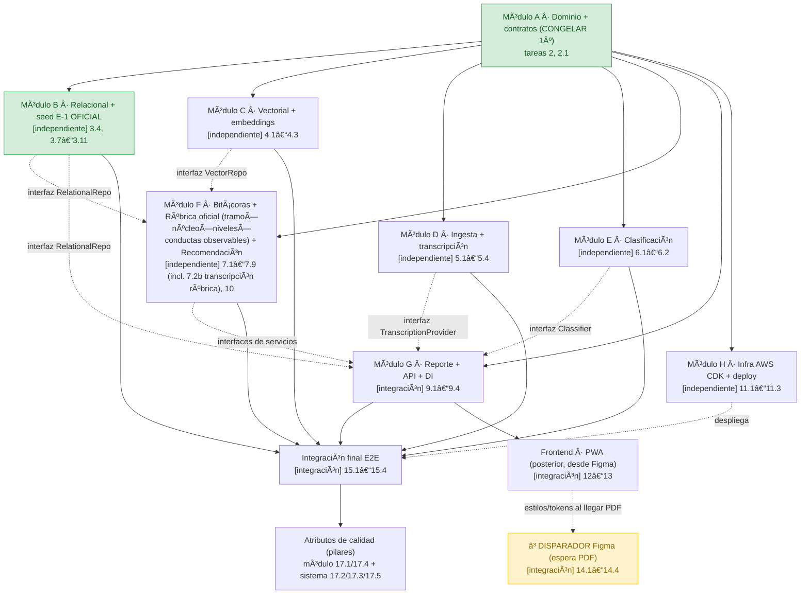

# Implementation Plan — jAImes MVP

## Overview

Este plan está organizado para que un equipo de **4 personas trabaje en paralelo con máxima independencia**. La estrategia es **interface-first**: primero se congela el **Módulo A (dominio + contratos)** como única fuente de verdad; una vez congelado, los módulos **B–H** dependen **solo de las interfaces de A** (nunca de la implementación concreta de otro módulo), por lo que pueden implementarse, probarse y mergearse a `main` de forma aislada.

Principios de ejecución:

- **Cada módulo es implementable y verificable en aislamiento.** Todo cruce de módulo pasa por una interfaz (`providers/*/base.py`, `repositories/*/base.py`) y cada módulo trae su propio **fake/mock** para no bloquearse esperando a otro.
- **AWS es el camino primario.** Los adaptadores reales (Bedrock Claude+Titan, Transcribe, Textract, Rekognition, S3, Aurora Serverless v2 + pgvector) son la implementación principal; los mocks son el camino secundario/local tras las mismas interfaces, seleccionados por `USE_MOCKS`.
- **Tests por módulo (requeridos) + sondas opcionales.** Cada módulo tiene subtareas de test que corren en aislamiento con fakes/mocks y "gatean" el módulo. Además hay subtareas de sonda marcadas `_Optional_` para que un desarrollador verifique rápido el módulo end-to-end dentro de su propia frontera.
- **Docs por módulo.** Cada módulo produce o actualiza su propia documentación en `docs/` (backend, database, cloud, frontend) con diagramas Mermaid, para que la documentación no quede dispersa.
- **Frontend es una tarea posterior**, construida desde los mockups de Figma; no bloquea los módulos de backend.
- **Integración final (E2E)** va al final: solo cablea implementaciones reales vía el contenedor DI y prueba el cruce entre módulos, sin romper la independencia de los módulos previos.

Estado actual: las tareas **1 (bootstrap), 2 (Módulo A) y 3.1–3.3 (Módulo B: esquema + `RelationalRepo` + seed inicial E-1)** ya están implementadas y marcadas `[x]`. El cierre del Módulo B migra el seed al **Dataset E-1 oficial** (3.7–3.11) y el resto está sin iniciar. Al final del plan se añade un bloque transversal de **atributos de calidad** (tarea 17, pilares de evaluación) y una **matriz legible de dependencias entre módulos** (independiente vs integración) en la sección *Task Dependency Graph*.

## Tasks

<!-- ============================================================= -->
<!-- BOOTSTRAP · Estructura y configuración base (COMPLETADO)       -->
<!-- ============================================================= -->

- [x] 1. Preparar estructura del proyecto y configuración base
  - Crear estructura `backend/app/{api,services,domain,providers,repositories,core}` y `frontend/`.
  - Configurar `pyproject`/requirements (FastAPI, pydantic, boto3, sqlalchemy, pgvector, uvicorn, mangum), `.env.example` con `USE_MOCKS`, y settings en `core/`.
  - Añadir `docker-compose` (backend + Postgres/pgvector) y README inicial con pasos de ejecución.
  - _Requirements: 10.9, 13.1_

<!-- ============================================================= -->
<!-- MÓDULO A · Dominio y modelos (base compartida) — CONGELAR 1º   -->
<!-- Responsable: líder / compartido. Depende de: nada.            -->
<!-- Debe congelarse antes de que B–H empiecen.                    -->
<!-- ============================================================= -->

- [x] 2. Módulo A — Definir modelos de dominio, enums y contratos compartidos
  - Implementar `domain/models.py` con las entidades (`Jardin`, `Educadora`, `Nino`, `NivelRuta`, `Manifestacion`, `Observacion`, `Bitacora`, `Recomendacion`, `ReporteDireccion`) y enums (`FormatoCaptura`, `Dominio`, `DecisionNivel`, `EstadoBitacora`, `Rol`), todos en Pydantic v2, usando solo `id_nino` seudónimo (sin nombre real ni RUT).
  - Escribir tests unitarios de construcción/validación de los modelos y enums.
  - _Requirements: 1.4, 1.5, 3.1, 4.1, 8.1, 11.1, 13.3_

- [x] 2.1 Módulo A — Alinear/congelar las interfaces de puertos y repos para el nuevo diseño
  - Declarar las interfaces base que consumirán B–H: `providers/transcription/base.py` (`TranscriptionProvider`), `providers/embeddings/base.py` (`EmbeddingProvider`), `providers/llm/base.py` (`LlmProvider`), `providers/classifier/base.py` (`Classifier`); `repositories/relational/base.py` (`RelationalRepo`), `repositories/vector/base.py` (`VectorRepo`), `repositories/storage/base.py` (`StorageRepo`).
  - Definir los tipos de retorno compartidos (`ClasificacionPropuesta`, `ResultadoRubrica`) y excepciones tipadas (`TranscriptionError`, `LlmError`, `EmbeddingError`).
  - Publicar como contrato estable: una vez acordado, no cambia de forma incompatible mientras B–H estén en desarrollo.
  - _Requirements: 13.1, 13.2, 13.3_

- [ ]* 2.2 Módulo A — Sonda de contratos (opcional)
  - _Optional_ — prueba de humo que importa todas las interfaces y construye cada modelo con datos del dataset E-1 para confirmar que los contratos son coherentes antes de que arranquen los demás módulos.
  - _Requirements: 13.3_

<!-- ============================================================= -->
<!-- MÓDULO B · Relacional + seed — Dev 1. Depende de: A.          -->
<!-- Núcleo COMPLETADO.                                            -->
<!-- ============================================================= -->

- [x] 3. Módulo B — Esquema relacional, RelationalRepo y seed del dataset E-1 **[independiente]**
- [x] 3.1 Crear el esquema SQLAlchemy de las tablas E-1 + nuevas (`bitacoras`, `recomendaciones`, `rubrica_versiones`, `reportes_direccion`)
  - Mapear tipos y nulabilidad según el diccionario de datos E-1.
  - _Requirements: 4.1_
- [x] 3.2 Implementar `RelationalRepo` (interfaz + implementación Postgres/SQLite) con CRUD y consultas base
  - _Requirements: 4.7, 13.2_
- [x] 3.3 Escribir el script de seed que carga el dataset E-1 y un test que valida conteos contra `distribucion_y_validacion`
  - _Requirements: 10.8, 11.5_
- [ ] 3.4 Módulo B — Añadir consultas agregadas para el reporte de dirección a `RelationalRepo`
  - Implementar consultas que el Módulo G consumirá vía interfaz: conteos subieron/mantuvieron/bajaron por sala, distribución por nivel y dominio, conteo de observaciones/bitácoras total y por educadora, alertas de retroceso y de inactividad (14 días).
  - _Requirements: 7.1, 7.3, 7.8_
- [x] 3.5 Módulo B — Tests de consultas agregadas con SQLite + dataset sembrado
  - Verificar cada agregación contra fixtures del seed; aislamiento total (sin otros módulos).
  - _Requirements: 7.1, 7.3_
- [ ]* 3.6 Módulo B — Documentación `docs/database/`
  - _Optional_ — escribir `docs/database/esquema.md` + `docs/database/README.md` (diccionario E-1 + tablas nuevas) con un diagrama ER en bloque ```mermaid```.
  - _Requirements: 12.4, 12.6_
- [x] 3.7 Módulo B — Implementar `DatasetLoader` del Dataset E-1 **oficial** (7 CSV + `consolidado.json`)
  - Leer los **siete CSV relacionales oficiales** (`jardines`, `educadoras`, `ninos`, `ruta_niveles`, `manifestaciones`, `observaciones`, `observacion_manifestaciones`) más `consolidado.json`; mapear cada fila a las entidades ORM del dominio (Módulo A) con `read_csvs()`, `read_consolidado()`, `to_entities()`.
  - Mantener `DatasetLoader` **encapsulado detrás de la frontera del seed** (`RelationalRepo`/`VectorRepo`), de modo que cambiar de dataset (oficial ↔ reducido casero) **no toque el código de los servicios**.
  - _Requirements: 10.8, 14.1_
- [x] 3.8 Módulo B — Adaptar el seed para cargar vía `DatasetLoader` (oficial E-1, 500 niños) y validar conteos
  - Sustituir la carga "un JSON por tabla" por la lectura del **zip público** `dataset_e1_publico.zip`; validar los conteos cargados contra `distribucion_y_validacion` y **rechazar con error en español** si algún conteo no coincide.
  - _Requirements: 10.8, 10.9, 14.1, 14.2_
- [x] 3.9 Módulo B — Verificación de reproducibilidad del Dataset E-1 oficial
  - Re-ejecutar `generador.py` con **semilla `20261013`** y **fecha de referencia `2026-10-13`** (Python 3.12.15, solo biblioteca estándar) y confirmar salida **idéntica bit a bit** / **hashes publicados coincidentes**, y que `validador.py` finaliza **sin errores**.
  - _Requirements: 10.10, 14.5_
- [ ]* 3.10 Módulo B — Test de carga completa del dataset oficial (500 niños) y ruta de abstención
  - _Optional_ — verificar que la carga procesa **sin error** a los 500 niños/as, incluidos los **60 con 1–2 observaciones** (ingreso reciente), y que los niños con **<5 observaciones** disparan la ruta de **abstención** del `RecommendationService` (datos insuficientes), sin interrumpir el procesamiento del resto; tratar nota/formato/manifestación ausente como ausencia de registro, no como dato inválido.
  - _Requirements: 14.2, 14.3, 14.4_
- [ ]* 3.11 Módulo B — Resguardo de distribución del dataset (solo zip público)
  - _Optional_ — asegurar (p. ej. test/chequeo de `.gitignore`) que **solo** `dataset_e1_publico.zip` se usa y versiona, que el **zip interno de validación NO** se incluye en el repositorio ni en los entregables, y que el dataset reducido/casero queda **solo como respaldo rápido de pruebas**, nunca como fuente de verdad.
  - _Requirements: 14.7, 10.11_

<!-- ============================================================= -->
<!-- MÓDULO C · Vectorial + embeddings — Dev 2. Depende de: A.     -->
<!-- ============================================================= -->

- [x] 4. Módulo C — Base vectorial y proveedor de embeddings (AWS primario) **[independiente]**
- [x] 4.1 Implementar `EmbeddingProvider`: adaptador **Titan (AWS, primario)** + adaptador mock (secundario)
  - `titan_embeddings.py` invoca Amazon Titan vía Bedrock; `mock_embeddings.py` deriva vectores deterministas del texto para CI/local. Selección por `USE_MOCKS`.
  - _Requirements: 4.2, 4.5_
- [x] 4.2 Implementar `VectorRepo`: implementación **pgvector sobre Aurora (primaria)** + índice en memoria (secundaria)
  - `index(doc)` y `search(query_embedding, filtros, k)` con similitud coseno (`<=>`), metadatos `id_observacion, id_nino, dominio, nivel, fecha, formato`.
  - _Requirements: 4.3, 4.6, 4.7, 11.5_
- [x] 4.3 Implementar `EmbeddingService` (embeber texto e indexar) con manejo de fallo de indexación
  - Si falla el embedding o la indexación, conservar la observación relacional sin registro vectorial y devolver error de indexación no completada.
  - _Requirements: 4.2, 4.4_
- [ ]* 4.4 Módulo C — Tests de aislamiento con mock embeddings + índice en memoria
  - Verificar que `search(id_observacion)` recupera exactamente un registro con los seis metadatos; intercambiabilidad de adaptadores.
  - _Requirements: 4.3, 4.5_
- [ ]* 4.5 Módulo C — Sonda del módulo (opcional)
  - _Optional_ — script que embebe N observaciones del dataset E-1 (modo mock) e imprime los vecinos más cercanos, para probar el módulo end-to-end dentro de su frontera.
  - _Requirements: 4.2, 4.3_
- [ ]* 4.6 Módulo C — Documentación `docs/database/vectorial.md`
  - _Optional_ — documentar el documento-por-observación, pgvector y la búsqueda semántica, con un diagrama ```mermaid```.
  - _Requirements: 12.4, 12.6_

<!-- ============================================================= -->
<!-- MÓDULO D · Ingesta + transcripción — Dev 2/3. Depende de: A.  -->
<!-- ============================================================= -->

- [x] 5. Módulo D — Storage, transcripción (Modelo 1) e ingesta (AWS primario) **[independiente]**
- [x] 5.1 Implementar `StorageRepo`: **S3 (AWS, primario)** + almacenamiento local (secundario)
  - `put(file) -> ref`, `get_url(ref)`; en AWS, cifrado en reposo y URLs prefirmadas de ≤300 s.
  - _Requirements: 1.2, 11.4_
- [x] 5.2 Implementar `TranscriptionProvider`: adaptador **AWS (Transcribe/Textract/Rekognition, primario)** + mock (secundario)
  - Enrutar por formato: audio/video → Transcribe (es-CL), foto → Textract (OCR), video → también metadatos de escena Rekognition. Reintentos ≤3 y marca de "pendiente de transcripción" si persiste el fallo.
  - _Requirements: 2.1, 2.2, 2.3, 2.4, 2.6, 2.7, 2.8_
- [x] 5.3 Implementar `TranscriptionService` que valida formato/tamaño y enruta por `formato_captura`
  - Texto directo 1–50.000 chars sin transcripción; validar límites de tamaño (100 MB general, 10 MB foto, 500 MB video); errores en español.
  - _Requirements: 1.4, 2.5, 2.6_
- [x] 5.4 Implementar `IngestionService` idempotente (orquesta dentro del módulo con fakes de E y repos)
  - Flujo: `StorageRepo` → `TranscriptionProvider` → (interfaz `Classifier`) → persistencia (interfaz `RelationalRepo`) → embedding (interfaz `EmbeddingService`). Subir el mismo archivo dos veces no crea dos observaciones.
  - _Requirements: 1.1, 1.3, 1.5_
- [ ]* 5.5 Módulo D — Tests por formato en modo mock (texto/audio/foto/video) + idempotencia
  - Usar fakes para `Classifier`, `RelationalRepo`, `EmbeddingService`; sin importar implementaciones hermanas.
  - _Requirements: 2.1, 2.2, 2.3, 2.4, 1.1_
- [ ]* 5.6 Módulo D — Sonda del módulo (opcional)
  - _Optional_ — script que ingesta un archivo de ejemplo de cada formato en modo mock y muestra la observación creada.
  - _Requirements: 1.1, 2.5_

<!-- ============================================================= -->
<!-- MÓDULO E · Clasificación — Dev 3. Depende de: A.              -->
<!-- ============================================================= -->

- [x] 6. Módulo E — Clasificación de observaciones **[independiente]**
- [x] 6.1 Implementar `Classifier` (adaptador basado en reglas/LLM) que estima `nivel_estimado` (1–9) y 1–5 dominios
  - Vincular 1–10 manifestaciones cuyo nivel = `nivel_estimado` y dominio ∈ dominios estimados; marcar baja confianza como "pendiente de clasificación manual".
  - _Requirements: 3.1, 3.2, 3.5_
- [x] 6.2 Implementar `ClassificationService`: devolver clasificación **propuesta** y soportar confirmación/corrección persistente
  - No persistir hasta que la educadora confirme/corrija; persistir vía interfaz `RelationalRepo`; conservar valores previos ante fallo de persistencia.
  - _Requirements: 3.3, 3.4, 3.6_
- [ ]* 6.3 Módulo E — Tests de clasificación y de vínculo con manifestaciones (fixtures E-1)
  - Aislamiento con fake de `RelationalRepo`.
  - _Requirements: 3.1, 3.2, 3.5_
- [ ]* 6.4 Módulo E — Sonda del módulo (opcional)
  - _Optional_ — script que clasifica textos de ejemplo del dataset E-1 e imprime nivel/dominios/manifestaciones propuestas.
  - _Requirements: 3.1_

<!-- ============================================================= -->
<!-- MÓDULO F · Bitácoras RAG+LLM + Rúbrica + Recomendación         -->
<!-- Dev 3/4. Depende de: A, interfaces de B y C.                 -->
<!-- ============================================================= -->

- [~] 7. Módulo F — Proveedor LLM, bitácoras, rúbrica y recomendación **[independiente]** (consume interfaces de B/C vía fakes)
- [x] 7.1 Implementar `LlmProvider`: adaptador **Bedrock Claude (AWS, primario)** + mock (secundario)
  - Selección por `USE_MOCKS`; excepción tipada `LlmError`.
  - _Requirements: 5.3, 5.10_
- [x] 7.2 Implementar `domain/rubrica.py` (`RubricaDecision`) **puramente determinista** que consume la **rúbrica oficial** desde `rubrica_versiones.criterios` (estructura tramo de sala × núcleo × 8 niveles de progresión × conductas observables + descriptor + umbrales)
  - Derivar el **tramo de sala** (Sala Cuna / Nivel Medio / Transición) del rango etario del niño/a; mapear la **evidencia previa** del niño/a a las **conductas observables** del tramo×núcleo×nivel actual (conducta **cubierta** si hay evidencia que la respalda, **pendiente** si no — sin inferir cumplimiento donde no hay evidencia).
  - Ramas de decisión sobre la cobertura de conductas observables: **AVANZAR** si la fracción cubierta ≥ umbral en los núcleos requeridos, **MANTENER** si la cobertura es parcial, **RETROCEDER** si hay racha ≥3 por debajo del nivel. Devolver `tramo, nucleo, nivel_actual, decision, score, conductas_observables_cubiertas, conductas_observables_pendientes, evidencia, version_rubrica`.
  - _Requirements: 6.2, 6.3, 6.4, 6.5, 21.3, 21.6_
- [x] 7.2b Transcribir la rúbrica oficial (PDF) a la estructura JSON versionada de `rubrica_versiones.criterios`
  - Transcribir la **rúbrica oficial** (PDF entregado: núcleo **Identidad y Autonomía** para **Sala Cuna, Nivel Medio y Transición**; 8 niveles de progresión con descriptor y conductas observables) a la estructura JSON versionada de `rubrica_versiones.criterios`.
  - Capturar las **conductas observables verbatim** por tramo×nivel para el núcleo Identidad y Autonomía en los 3 tramos; dejar el esquema **listo para agregar más núcleos como datos versionados** sin cambios de código.
  - _Requirements: 21.1, 21.2, 21.5_
- [x] 7.3 Sembrar la **versión inicial de la rúbrica oficial** en `rubrica_versiones` (vía interfaz `RelationalRepo`)
  - Sembrar al menos el núcleo **Identidad y Autonomía** para los 3 tramos (Sala Cuna, Nivel Medio, Transición), con sus **8 niveles de progresión** y conductas observables.
  - Criterios versionados, modificables **sin cambios de código**; núcleos adicionales se agregan como **nuevas versiones**.
  - _Requirements: 6.6, 21.1, 21.5_
- [ ]* 7.4 Módulo F — Property test del determinismo de la rúbrica
  - **Propiedad: Determinismo de la rúbrica** — misma entrada `(evidencia, version_rubrica)` ⇒ misma `decision` y `score` evaluados sobre las mismas conductas observables cubiertas/pendientes; el LLM nunca altera la decisión.
  - **Valida: Requirement 6.2**
  - _Requirements: 21.6_
- [ ]* 7.5 Módulo F — Tests unitarios exhaustivos de cada rama de la rúbrica (fixtures E-1)
  - AVANZAR/MANTENER/RETROCEDER impulsados por la **cobertura de conductas observables** del tramo×núcleo×nivel y por la **racha** de retroceso, con casos borde.
  - Incluir un test de que una **conducta observable sin evidencia cuenta como pendiente** (no se infiere cumplimiento donde no hay evidencia).
  - _Requirements: 6.3, 6.4, 21.6_
- [x] 7.6 Implementar `BitacoraService`: RAG (recuperar evidencia) + LLM con trazabilidad y estados
  - Recuperar observaciones del período (14 días) vía `RelationalRepo` + hasta 20 similares vía `VectorRepo`; abortar con 422 si no hay evidencia; abortar con 503 si el LLM falla/excede 60 s; cada afirmación cita ≥1 observación/manifestación; persistir en estado "borrador".
  - _Requirements: 5.1, 5.2, 5.3, 5.4, 5.5, 5.6_
- [x] 7.7 Soportar edición y aprobación de bitácora
  - Editar mientras está en "borrador"; aprobar cambia a "aprobada"; rechazar edición de "aprobada" con HTTP 409.
  - _Requirements: 5.7, 5.8, 5.9_
- [ ]* 7.8 Módulo F — Property test de trazabilidad de bitácoras
  - **Propiedad: Trazabilidad** — toda afirmación evaluativa referencia al menos una observación/manifestación existente de la evidencia recuperada.
  - **Valida: Requirement 5.5**
- [x] 7.9 Implementar `RecommendationService`: recuperar evidencia previa (RAG) → `RubricaDecision` (mapea a conductas observables y decide) → LLM (argumenta) → persistir con `version_rubrica`
  - Recuperar la **evidencia previa** del niño/a (RAG); `RubricaDecision` la mapea a las **conductas observables** del tramo×núcleo×nivel y produce la decisión; pasar al LLM como contexto las **conductas observables (cubiertas y pendientes)** + la evidencia, de modo que el LLM **argumente citando conductas observables y observaciones previas sin alterar la decisión**.
  - Responder en ≤10 s una de AVANZAR/MANTENER/RETROCEDER e incluir **tramo/núcleo/nivel** en la respuesta; abstenerse si <5 observaciones (indicador de datos insuficientes); conservar la decisión determinista si el LLM falla/excede 10 s; registrar `decision_educadora` (aceptó/rechazó/ajustó); sugerencia proactiva al cruzar el umbral.
  - _Requirements: 6.1, 6.4, 6.5, 6.7, 6.8, 6.9, 6.10, 6.11, 21.4_
- [ ]* 7.10 Módulo F — Tests de servicio con `MockLlmProvider` y fakes de repos
  - Verificar que la decisión proviene de la **cobertura de conductas observables de la rúbrica** (no del LLM) y que el **argumento del LLM cita conductas observables**; abstención por datos insuficientes; aislamiento total.
  - _Requirements: 6.2, 6.8, 6.9, 21.4_
- [ ]* 7.11 Módulo F — Sonda del módulo (opcional)
  - _Optional_ — script que genera una bitácora y una recomendación de un `id_nino` del dataset en modo mock.
  - _Requirements: 5.1, 6.1_
- [ ]* 7.12 Módulo F — Documentación `docs/backend/rubrica.md` y `servicios.md`
  - _Optional_ — documentar el **modelo de la rúbrica oficial** (tramo×núcleo×8 niveles×conductas observables) en `docs/backend/rubrica.md`, junto con la rúbrica versionada y los servicios RAG/recomendación, con un diagrama ```mermaid```.
  - _Requirements: 12.2, 12.6_

- [ ] 8. Checkpoint — Asegurar que pasan los tests de los módulos A–F
  - Ensure all tests pass, ask the user if questions arise.

<!-- ============================================================= -->
<!-- MÓDULO G · Reporte + API REST/routers + DI — Dev 4.           -->
<!-- Depende de: A, interfaces de B/D/E/F.                        -->
<!-- ============================================================= -->

- [ ] 9. Módulo G — Reporte de dirección, API REST y contenedor DI **[integración]** (cablea B/D/E/F vía DI; integración real requiere esos módulos funcionales)
- [ ] 9.1 Implementar `DirectorReportService` (Modelo 4): agrega métricas vía `RelationalRepo` + resumen ejecutivo vía `LlmProvider`
  - Conteos subieron/mantuvieron/bajaron (cada niño en exactamente una categoría), distribución por sala/dominio, conteos de observaciones/bitácoras, alertas, KPI de tiempo ahorrado determinista; validar rango de fechas (inicio ≤ fin); cero sin datos; métricas desde SQL (no inferidas por LLM); resumen opcional si el LLM falla.
  - _Requirements: 7.1, 7.2, 7.3, 7.4, 7.5, 7.6, 7.7, 7.8_
- [ ] 9.2 Implementar el contenedor de DI en `core/` que selecciona adaptadores/repos según `USE_MOCKS`
  - Mismo contenedor sirve en Lambda (producción) y `uvicorn` local; inyección por `Depends()`.
  - _Requirements: 10.3, 10.7, 13.5_
- [ ] 9.3 Implementar routers FastAPI (ninos, observaciones, bitacoras, recomendaciones, reportes, ruta-niveles, health) con validación Pydantic
  - Contratos REST del diseño; envolver la app con **Mangum** (`handler = Mangum(app)`) para Lambda sin cambiar routers.
  - _Requirements: 1.1, 3.3, 3.4, 5.7, 5.8, 6.1, 6.7, 7.1, 8.1_
- [ ] 9.4 Manejo de errores en español (400 formato, 404 no encontrado, 422 validación, 409 conflicto, 503 LLM)
  - Traducir excepciones tipadas de providers a respuestas HTTP sin filtrar detalles sensibles.
  - _Requirements: 1.3, 2.6, 5.2, 5.4, 5.9, 10.6_
- [ ]* 9.5 Módulo G — Tests de contrato con `TestClient` y servicios fake
  - Códigos de estado, forma de respuesta y validación; aislamiento con fakes de B/D/E/F.
  - _Requirements: 1.3, 7.1, 8.1_
- [ ]* 9.6 Módulo G — Tests de agregaciones del reporte con dataset sembrado
  - _Requirements: 7.1, 7.3, 7.4_
- [ ]* 9.7 Módulo G — Documentación `docs/backend/README.md`
  - _Optional_ — mapa de módulos, contratos interface-first, DI y aplicación de SOLID, con un diagrama ```mermaid```.
  - _Requirements: 12.2, 12.6_

<!-- ============================================================= -->
<!-- TRANSVERSAL · Resguardo de datos sensibles. Depende de: A.    -->
<!-- ============================================================= -->

- [ ] 10. Transversal — Resguardo de datos sensibles (despersonalización)
  - Garantizar seudonimización (`id_nino`) en BD y en prompts; separar personal (relacional) y contenido (vectorial); bloquear envío al LLM si el prompt contiene nombre/RUT/dirección/contacto, registrar el evento y devolver error.
  - _Requirements: 11.1, 11.2, 11.3, 11.5_
- [ ]* 10.1 Transversal — Property test de despersonalización
  - **Propiedad: Despersonalización** — ningún prompt enviado al LLM contiene nombre real ni RUT; solo `id_nino` + texto + rúbrica.
  - **Valida: Requirements 11.1, 11.2**

<!-- ============================================================= -->
<!-- MÓDULO H · Infraestructura AWS (CDK) + despliegue + integración -->
<!-- Dev 1/4. Depende de: contrato de despliegue (handler Lambda). -->
<!-- Requiere credenciales AWS configuradas (`aws configure`).     -->
<!-- ============================================================= -->

- [ ] 11. Módulo H — Infraestructura AWS CDK, despliegue e integración cloud real **[independiente]** (implementación/synth aislados; despliegue real requiere credenciales)
- [ ] 11.1 Instalar y configurar el tooling AWS (AWS CLI + CDK en Python)
  - Instalar AWS CLI v2 y AWS CDK; `cdk bootstrap`. **Prerrequisito del usuario:** configurar credenciales con `aws configure` usando la cuenta de la hackathon antes de desplegar o correr integración cloud.
  - _Requirements: 10.1_
- [ ] 11.2 Escribir los stacks CDK (Python): `NetworkStack`, `DataStack`, `ComputeStack`, `AiIamStack`
  - Network: VPC mínima + endpoints. Data: Aurora Serverless v2 (Postgres + pgvector), bucket S3 cifrado, Secrets Manager. Compute: Lambda (FastAPI+Mangum) + HTTP API en API Gateway + env vars (`USE_MOCKS=false`). AiIam: permisos mínimos para Bedrock/Transcribe/Textract/Rekognition.
  - _Requirements: 10.1, 11.4, 11.6_
- [ ] 11.3 Desplegar (`cdk synth` → `cdk deploy`), sembrar E-1 en Aurora y verificar `/health`
  - `/health` responde HTTP 200 en ≤5 s vía API Gateway; reporte de stack/recurso ante fallo de deploy dejando el entorno reintentar-able; registrar errores AWS en CloudWatch.
  - _Requirements: 10.2, 10.5, 10.6, 10.8_
- [ ]* 11.4 Módulo H — Pruebas de integración cloud REAL (bajo demanda)
  - _Optional_ — invocan Bedrock/Transcribe/Textract/S3/Aurora en cuenta sandbox (marcador dedicado, separadas de la suite rápida). **Requieren credenciales AWS (`aws configure`).**
  - _Requirements: 10.3, 10.4_
- [ ]* 11.5 Módulo H — Documentación `docs/cloud/`
  - _Optional_ — `README.md` (arquitectura serverless), `cdk.md` (stacks, IAM mínimos), `despliegue.md` (pasos + env vars), `integracion.md`, con un diagrama ```mermaid```.
  - _Requirements: 12.5, 12.6_

<!-- ============================================================= -->
<!-- FRONTEND · Tarea posterior (desde Figma). No bloquea backend. -->
<!-- ============================================================= -->

- [ ] 12. Frontend PWA — base y capa de servicios API (posterior) **[integración]** (consume la API REST que expone G)
  - Inicializar React + Vite como PWA (manifest, service worker), capa `api/` tipada, router por rol, `SelectorRol`, `BannerDatosSinteticos`, `IndicadorCarga`; mobile-first 320–1024 px, controles ≥44×44 px, español (Chile); indicador de progreso ≤100 ms; manejo de error/timeout 10 s sin descartar datos.
  - _Requirements: 8.2, 8.3, 8.4, 8.5, 8.6, 9.1, 9.2, 9.3, 9.4, 9.6, 9.7_
- [ ] 13. Frontend — pantallas de educadora y dashboard de dirección (estilo placeholder) **[integración]**
  - Educadora: MiSala, Capturar, ConfirmarClasificacion (con sugerencia proactiva), FichaNino (trayectoria + "¿Puede subir de nivel?" con 3 estados), Bitacoras (ver/editar/aprobar). Directora: DashboardDireccion (métricas, KPI, resumen). Estilos placeholder; sin lógica de negocio en el cliente.
  - _Requirements: 8.2, 8.3, 9.5, 9.6_
- [ ]* 13.1 Frontend — Documentación `docs/frontend/`
  - _Optional_ — `README.md` (pantallas, routing por rol) + `contrato-api.md`, marcado como pendiente de Figma, con un diagrama ```mermaid```.
  - _Requirements: 12.3, 12.6_

<!-- ============================================================= -->
<!-- DISPARADOR FIGMA · LISTO PARA ACTIVAR cuando llegue el PDF.    -->
<!-- No ejecutar hasta recibir los mockups refinados de Figma.     -->
<!-- No cambia la lógica de negocio ni el contrato REST (inmutable).-->
<!-- ============================================================= -->

- [ ] 14. ⏳ DISPARADOR (esperando PDF) — Ingesta de mockups de Figma al frontend **[integración]**
  - **Tarea-disparador: NO ejecutar hasta recibir el PDF de mockups refinados de Figma.** Al activarse, convierte el diseño visual en tareas concretas de frontend sin tocar el backend.
  - [ ] 14.1 Ingestar el PDF de Figma y extraer las pantallas y flujos representados en los mockups
    - _Requirements: 20.1_
  - [ ] 14.2 Gap-analysis de pantallas/flujos contra el **contrato REST existente**, identificando los endpoints que consume cada pantalla y las brechas detectadas
    - _Requirements: 20.2_
  - [ ] 14.3 Producir tareas de **componentes concretos** mapeados a las pantallas existentes
    - `MiSala`, `Capturar`, `ConfirmarClasificacion`, `FichaNino`, `Bitacoras`, `DashboardDireccion`.
    - _Requirements: 20.3_
  - [ ] 14.4 Implementar aplicando **estilos y tokens de diseño sobre la estructura existente**, sin alterar la lógica de negocio
    - **Invariante clave:** el **contrato de la API REST del Backend permanece sin cambios** como resultado de la ingesta de los mockups.
    - _Requirements: 20.4, 20.5_

<!-- ============================================================= -->
<!-- INTEGRACIÓN FINAL E2E · Depende de TODOS. Va al final.        -->
<!-- Solo cablea implementaciones reales vía DI; no reescribe.     -->
<!-- ============================================================= -->

- [ ] 15. Integración final E2E — ensamblar y verificar el cruce entre módulos **[integración]** (requiere TODOS los módulos completos y funcionales)
- [ ] 15.1 Cablear implementaciones concretas vía el contenedor DI y validar límites de interfaz
  - El ensamblaje falla e indica el módulo/importación prohibida si un módulo importa directamente la implementación concreta de otro (solo se permiten `base.py` de interfaz y el dominio A).
  - _Requirements: 13.5, 13.6_
- [ ]* 15.2 Property test de intercambiabilidad de adaptadores (LSP)
  - **Propiedad: Intercambiabilidad (LSP)** — cualquier test de servicio pasa indistintamente con el adaptador AWS o el mock inyectado, sin cambiar el código del servicio.
  - **Valida: Requirements 2.8, 4.5, 5.10, 10.3**
- [ ]* 15.3 Test E2E de ingesta en modo mock (texto/audio/foto/video)
  - Flujo completo storage → transcripción → clasificación → persistencia → embedding, idempotente.
  - _Requirements: 1.1, 2.1, 3.4, 4.3_
- [ ] 15.4 Verificación de la demo en modo mock (un solo comando) y actualización del README
  - Recorrer flujo educadora (capturar → clasificar → recomendación → bitácora → aprobar) y flujo directora (reporte) con tests automatizados; README con guion de demo y pasos AWS opcionales.
  - _Requirements: 10.7, 10.9_

- [ ] 16. Checkpoint final — Asegurar que pasan todos los tests
  - Ensure all tests pass, ask the user if questions arise.

<!-- ============================================================= -->
<!-- TRANSVERSAL · Atributos de calidad (pilares de evaluación).    -->
<!-- Mezcla de tareas de módulo (independientes) y de verificación  -->
<!-- del sistema ensamblado (integración). Verificable incremental. -->
<!-- ============================================================= -->

- [ ] 17. Atributos de calidad y escalabilidad (pilares de evaluación)
- [ ] 17.1 Test de análisis estático de importaciones (arquitectura) **[independiente]**
  - Probar que las clases de servicio importan **solo interfaces** (abstracciones) y **cero** implementaciones concretas de proveedores/repos hermanos; evidenciar OCP/ISP/DIP: agregar un proveedor/modelo nuevo se hace implementando una interfaz **sin editar servicios**.
  - _Requirements: 15.2, 15.5_
- [ ] 17.2 Verificación del KPI de impacto social y human-in-the-loop **[integración]**
  - Comprobar que el KPI de tiempo de documentación ahorrado (**~4 h/semana → ~0 h**) se **calcula de forma determinista** y se **expone en el reporte de dirección**, y que **ninguna** clasificación, bitácora o recomendación se aplica automáticamente sin **validación humana** (`decision_educadora` registrada antes de considerarla final).
  - _Requirements: 16.1, 16.2, 16.3, 16.5_
- [ ]* 17.3 Sonda de escalabilidad **[integración]**
  - _Optional_ — apuntar el sistema al **dataset completo de 500 niños** (y opcionalmente a un conjunto multiplicado mayor) y confirmar que **no requiere cambios de código ni de contratos de interfaz**; dejar nota de que `VectorRepo` es **sustituible por OpenSearch Serverless** sin tocar los servicios.
  - _Requirements: 18.1, 18.4, 18.5_
- [ ] 17.4 Chequeo de factibilidad y sustentabilidad **[independiente]**
  - Verificar **dependencias fijadas (pinned)** de modo que una instalación posterior reproduzca el mismo conjunto de versiones; **modo mock local a costo cloud cero** (sin llamadas de red a AWS con `USE_MOCKS=true`); **un único flujo de IaC** (AWS CDK Python).
  - _Requirements: 17.1, 17.2, 17.3_
- [ ] 17.5 Calidad de presentación — guion de demo y documentación por área **[integración]**
  - Escribir el **guion de demo en el README** (demo mock de un solo comando + demo en vivo sobre AWS con `/health`) y asegurar que `docs/` existe **organizada por área** (`backend/`, `frontend/`, `database/`, `cloud/`), cada una con al menos un Markdown y un diagrama ```mermaid```.
  - _Requirements: 19.1, 19.2, 19.3, 19.4_

## Notes

- **Prerrequisito AWS:** antes de desplegar (Módulo H) o correr las pruebas de integración cloud, el usuario debe configurar credenciales con `aws configure` usando la cuenta de la hackathon. Sin credenciales, todo el resto se desarrolla y prueba en modo mock (`USE_MOCKS=true`).
- **AWS primero, mock secundario:** los adaptadores AWS (Bedrock Claude+Titan, Transcribe, Textract, Rekognition, S3, Aurora+pgvector) son la implementación principal; los mocks viven tras las mismas interfaces para desarrollo local/CI sin credenciales.
- **Módulos independientes y verificables con mocks:** cada módulo (B–H) depende solo de las interfaces del Módulo A y trae su propio fake/mock, por lo que su suite de tests corre y pasa en aislamiento, sin importar la implementación concreta de otro módulo.
- **Tareas completadas:** 1 (bootstrap), 2 (Módulo A) y 3.1–3.3 (Módulo B: esquema + `RelationalRepo` + seed inicial E-1) ya están implementadas. 2.1 añade el alineamiento de contratos para las nuevas interfaces y 3.4 añade las consultas agregadas que faltaban para el reporte.
- **Dataset E-1 OFICIAL como fuente de verdad (reproducible):** el seed migra de "un JSON por tabla" (tarea 3.3, ya hecha) a cargar el **Dataset E-1 oficial** vía `DatasetLoader` (**7 CSV relacionales + `consolidado.json`**, 500 niños/as) con validación de conteos contra `distribucion_y_validacion` (tareas 3.7–3.8), verificación de **reproducibilidad bit a bit** (semilla `20261013`, fecha `2026-10-13`, Python 3.12 stdlib; tarea 3.9) y la ruta de **abstención** para los 60 niños con <5 observaciones (tarea 3.10). Solo se versiona `dataset_e1_publico.zip`; el **zip interno de validación NO** se incluye, y el dataset reducido/casero queda **solo como respaldo rápido de pruebas** (tarea 3.11).
- **Rúbrica oficial como fuente de verdad del nivel (Módulo F):** la **rúbrica oficial** (tramo de sala × núcleo × 8 niveles de progresión, con **conductas observables** por nivel) es la **fuente de verdad de la decisión de nivel**, versionada en `rubrica_versiones.criterios` (tareas 7.2b/7.3). `RubricaDecision` (7.2) mapea la evidencia previa a conductas observables y decide de forma determinista (AVANZAR/MANTENER/RETROCEDER); el **argumento de la recomendación cita conductas observables + evidencia previa** del niño/a para ahorrar tiempo a la educadora (**KPI**), sin que el LLM altere la decisión.
- **Pilares de evaluación de primera clase (tarea 17):** la **innovación técnica** (POO + encapsulamiento + puertos/adaptadores con SOLID: OCP/ISP/DIP), el **impacto social** (KPI 4 h→~0 h + human-in-the-loop), la **factibilidad/sustentabilidad** (serverless scale-to-zero, deps pinned, mock a costo cero, un flujo IaC), la **escalabilidad** (Lambda sin estado, Aurora+pgvector, `VectorRepo` sustituible por OpenSearch) y la **calidad de presentación** (demo de un comando + guion en README + `docs/` por área con Mermaid) se verifican de forma incremental.
- **Ingesta de Figma = disparador (tarea 14):** está **lista para activar y a la espera del PDF** de mockups refinados. Al llegar, ejecuta extraer → gap-analysis → componentes → estilos/tokens sobre el layout existente, **sin cambiar la lógica de negocio ni el contrato REST** (invariante del Requirement 20.5).
- **Independiente vs integración (ver matriz):** consulta la nueva **"Dependencias entre módulos (matriz legible)"** en la sección *Task Dependency Graph*. En resumen: **B, C, D, E, F, H son INDEPENDIENTES** (se implementan y prueban en aislamiento con fakes/mocks sobre los contratos de A), mientras que **G, el Frontend, las sondas de calidad del sistema (17.2/17.3/17.5) y la E2E (15) son de INTEGRACIÓN** y requieren que sus módulos fuente estén completos y funcionales.
- **Reparto sugerido entre 4 personas (tras congelar A):**
  - Dev 1 → Módulo B (cierre: 3.4–3.11, incl. `DatasetLoader` oficial + reproducibilidad) + Módulo H (infra/CDK).
  - Dev 2 → Módulo C (vectorial/embeddings) + Módulo D (ingesta/transcripción).
  - Dev 3 → Módulo E (clasificación) + parte de Módulo F.
  - Dev 4 → Módulo F (rúbrica/bitácora/recomendación) + Módulo G (reporte/API/DI).
  - El Frontend (12–14) y la Integración E2E (15) se toman cuando los módulos estén listos.
- **Flujo de merge por módulo:** cada dev trabaja su módulo en una rama, lo implementa con sus fakes/mocks, corre sus tests de aislamiento (y, si quiere, la sonda `_Optional_`), verifica en verde y mergea a `main`. La integración E2E (15) se hace al final y es la única que cruza módulos reales vía DI.
- **Tareas opcionales (`_Optional_`):** sondas de módulo y docs; dan confianza extra o cumplen Requirement 12 pero no gatean el módulo. Los tests requeridos (sin `_Optional_`) son los que validan cada módulo.
- **Checkpoints:** las tareas 8 y 16 son puntos de validación incremental.

## Task Dependency Graph

Módulo A es la raíz compartida (solo interfaces) de la que dependen todos. Una vez **congelado A (2 + 2.1)**, los módulos B–H pueden avanzar **en paralelo** (cada uno depende solo de los contratos de A). La integración E2E depende de todos.

```json
{
  "waves": [
    {
      "id": 0,
      "label": "Módulo A · Dominio + contratos (congelar primero)",
      "description": "Base compartida que debe congelarse antes de que arranquen B–H. Única fuente de verdad de interfaces y modelos.",
      "parallelizable": false,
      "tasks": ["2.1", "2.2"]
    },
    {
      "id": 1,
      "label": "Módulos B, C, D, E, F, H + transversal · en paralelo (4 personas) — INDEPENDIENTES",
      "description": "Una vez congelado A, estos módulos dependen solo de las interfaces de A y traen sus propios fakes/mocks, así que corren en paralelo sin bloquearse entre sí. Incluye el seed del dataset E-1 OFICIAL (DatasetLoader de 7 CSV + consolidado.json) y los tests de arquitectura/factibilidad de nivel módulo.",
      "parallelizable": true,
      "tasks": [
        "3.4", "3.5", "3.6", "3.7", "3.8", "3.9", "3.10", "3.11",
        "4.1", "4.2", "4.3", "4.4", "4.5", "4.6",
        "5.1", "5.2", "5.3", "5.4", "5.5", "5.6",
        "6.1", "6.2", "6.3", "6.4",
        "7.1", "7.2", "7.2b", "7.3", "7.4", "7.5", "7.6", "7.7", "7.8", "7.9", "7.10", "7.11", "7.12",
        "10.1",
        "11.1", "11.2", "11.3", "11.4", "11.5",
        "17.1", "17.4"
      ]
    },
    {
      "id": 2,
      "label": "Módulo G · Reporte + API REST + DI — INTEGRACIÓN",
      "description": "Cablea las interfaces de servicios de B/D/E/F vía el contenedor DI; depende de que esos módulos existan (al menos sus contratos implementados).",
      "parallelizable": true,
      "tasks": ["9.1", "9.2", "9.3", "9.4", "9.5", "9.6", "9.7"]
    },
    {
      "id": 3,
      "label": "Frontend + Integración final E2E + verificación del sistema ensamblado — INTEGRACIÓN",
      "description": "Dependen del sistema ensamblado. El frontend consume la API de G; la integración E2E cruza todos los módulos reales vía DI; las sondas de calidad verifican el sistema ensamblado (KPI, escalabilidad, presentación). La ingesta de Figma (14.x) es un disparador que espera el PDF.",
      "parallelizable": true,
      "tasks": ["13.1", "15.1", "15.2", "15.3", "17.2", "17.3", "17.5", "14.1", "14.2", "14.3", "14.4"]
    }
  ]
}
```

> Nota: dentro de cada wave las tareas son independientes y pueden repartirse entre las 4 personas del equipo; cada wave N solo arranca cuando terminan las waves 0..N-1. Las tareas de checkpoint (8, 16) y las tareas padre sin notación decimal no se incluyen en el grafo de waves.



> **Paralelismo explícito:** tras congelar A (tareas 2 y 2.1), 4 devs pueden tomar simultáneamente **B/H**, **C/D**, **E + parte de F**, y **F/G**. Las flechas punteadas son dependencias de **interfaz** (se usa un fake mientras el proveedor real se construye), no de implementación, así que no bloquean el trabajo en paralelo. El Frontend y la Integración E2E se ejecutan al final.

### Dependencias entre módulos (matriz legible)

Esta matriz deja **claro, módulo por módulo**, si se puede implementar y probar **solo** (con fakes/mocks) o si **depende de otros módulos completos y funcionales** para su **integración real**.

| Módulo | Tipo | Puede empezar cuando... | Depende de (funcional) para integrar | Tests propios (aislamiento) |
|---|---|---|---|---|
| **A · Dominio + contratos** | Base (se congela 1º) | Siempre — no depende de nadie | — (nadie; es la raíz) | Validación Pydantic de modelos/enums |
| **B · Relacional + seed E-1 oficial** | **INDEPENDIENTE** | A está **congelado** (interfaces) | — (solo contratos de A) | SQLite in-memory + dataset E-1 oficial; validación de conteos |
| **C · Vectorial + embeddings** | **INDEPENDIENTE** | A está congelado | — (solo contratos de A) | Índice en memoria + `MockEmbeddingProvider` |
| **D · Ingesta + transcripción** | **INDEPENDIENTE** | A está congelado | — (usa fakes de `Classifier`, `RelationalRepo`, `EmbeddingService`) | Mocks de Transcribe/Textract/Rekognition/S3 por formato |
| **E · Clasificación** | **INDEPENDIENTE** | A está congelado | — (fake de `RelationalRepo`) | Fixtures de texto del dataset E-1 |
| **F · Bitácoras + Rúbrica + Recomendación** | **INDEPENDIENTE** | A está congelado | — (fakes de B/C y `MockLlmProvider`) | `MockLlmProvider` + fakes de repos |
| **G · Reporte + API + DI** | **INTEGRACIÓN** | Existan los **contratos** de B/D/E/F | **B, D, E, F funcionales** para integración real | `TestClient` + servicios **fake** (aislamiento del router) |
| **H · Infra AWS (CDK)** | **INDEPENDIENTE** | A está congelado + contrato de handler Lambda | Credenciales AWS para **desplegar** (no para `cdk synth`) | `cdk synth` + tests de síntesis sin credenciales |
| **Calidad (17)** | Mixto | 17.1/17.4 con módulos; 17.2/17.3/17.5 con sistema | Sistema **ensamblado** (G + E2E) para 17.2/17.3/17.5 | 17.1 análisis estático; 17.4 deps/mock aislados |
| **Frontend (12–13)** | **INTEGRACIÓN** | **G expone la API REST** | **G funcional** (API en vivo) | Smoke tests de render + capa de servicios API |
| **Figma (14)** | Disparador | **Llega el PDF** de mockups refinados | Frontend base (12–13) + API REST (inmutable) | Verificación de que el contrato REST no cambia |
| **E2E (15)** | **INTEGRACIÓN** | **Todos** los módulos listos | **TODOS** los módulos completos y funcionales | Cruce real vía DI (única que integra módulos reales) |

**Leyenda — dos clases de tarea:**
- **(i) Tareas de módulo = INDEPENDIENTES.** Se implementan y prueban **en aislamiento** usando **fakes/mocks** de todo lo externo. Solo necesitan los **contratos (interfaces) de A**. Cada dev las construye, prueba y mergea **solo**, sin esperar a otro. Son B, C, D, E, F, H y los tests de módulo 17.1/17.4.
- **(ii) Tareas de INTEGRACIÓN = dependen de otros módulos reales.** Verifican el **sistema ensamblado** cruzando implementaciones reales: la parte real de G, el Frontend, la ingesta de Figma, las sondas de calidad 17.2/17.3/17.5 y la E2E (15). No pueden completarse hasta que los módulos de los que dependen estén **completos y funcionales**.

**Ejemplo concreto (en palabras del equipo):** *"A, B y C son independientes: cada uno se implementa y prueba solo con fakes/mocks sobre los contratos de A. En cambio, G para su test de integración requiere que B, D, E y F estén completos y funcionales (no basta el contrato), y la E2E (15) requiere que **todos** los módulos lo estén."* Dicho de otra manera, con las letras reales: **B, C, D, E, F, H son independientes** (fakes), mientras que **G y la E2E son de integración** y necesitan sus módulos fuente reales.
