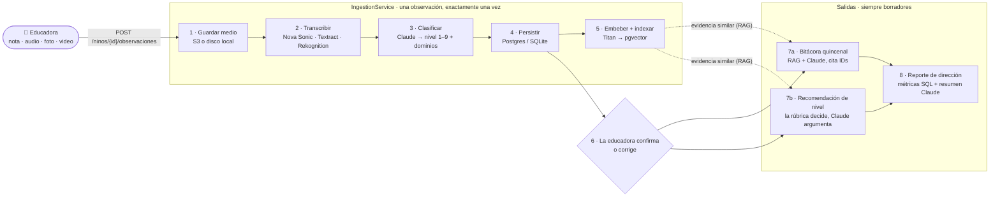
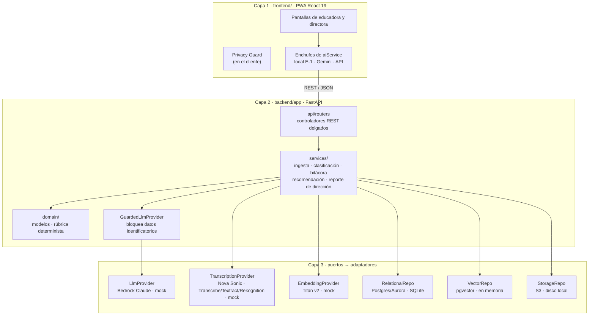
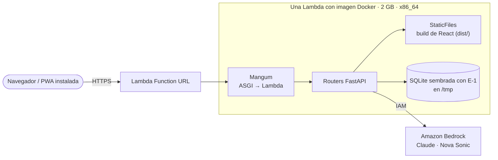
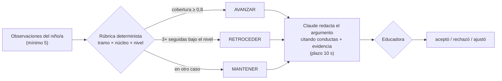

<div align="center">

[English](README.md) · **Español**

# Avista · De la observación a la acción

**IA que observa junto a la educadora y le devuelve tiempo para dedicarlo a los niños y niñas.**

Proyecto para el desafío **"IA para el Desarrollo Infantil"** de **Fundación Integra** en **AWS Breaking Barriers Chile 2026**.
Una PWA mobile-first y un backend FastAPI que convierten las notas, audios, fotos y videos que la educadora ya genera durante la jornada en
observaciones clasificadas, bitácoras quincenales, recomendaciones de nivel respaldadas con evidencia citada y un reporte para la dirección.


| ⏱️ Tiempo de documentación por educadora | 🧭 Quién decide |
|:---:|:---:|
| **~4 horas / semana → minutos de revisión** (meta) | **La rúbrica decide, la IA argumenta, la educadora valida** |

[Cómo funciona](#cómo-funciona) ·
[La app](#la-app) ·
[Arquitectura](#arquitectura) ·
[Decisiones de diseño](#decisiones-de-diseño) ·
[Correrlo en local](#correrlo-en-local)

</div>

> ⚠️ Todos los datos de este repositorio y de la demo son **sintéticos y seudonimizados** (dataset oficial E-1). Avista es una herramienta de apoyo **pedagógico**, no un instrumento clínico ni de diagnóstico.

---

## En 30 segundos

- **El problema:** las educadoras de párvulos en Chile dedican cerca de **4 horas a la semana**, fuera del aula, a escribir a mano fichas de observación, bitácoras quincenales e informes de progreso. Es tiempo que se le resta a los niños y niñas.
- **La solución:** Avista toma lo que la educadora ya registra durante el día (una nota rápida, un audio, una foto de un apunte o de un dibujo, un video corto) y lo convierte en:
  1. **Observaciones** clasificadas según el currículo (dominio de desarrollo + nivel).
  2. **Borradores de bitácora quincenal** por niño/a, redactados por un LLM que debe citar los IDs de observación detrás de cada afirmación.
  3. **Recomendaciones de nivel** (avanzar / mantener / retroceder) decididas por una **rúbrica determinista**; el LLM solo redacta el argumento.
  4. Un **reporte de dirección** con métricas calculadas en SQL y un resumen ejecutivo narrado por el LLM.
- **Lo que lo hace más que un prompt:** una **guardia de privacidad** que bloquea nombres, RUT, direcciones y contactos antes de que algo llegue a un modelo; **"enchufes" intercambiables** (puertos y adaptadores) que corren todo el sistema offline o en AWS sin cambiar código; **RAG** sobre la propia evidencia del niño/a; y la regla de **humano en el circuito**: nada es definitivo hasta que la educadora lo aprueba.

---

## Cómo funciona

### De una nota en la sala al escritorio de la directora



| Paso | Qué pasa | Dónde |
|---|---|---|
| **Captura** | La educadora elige un niño/a (seudónimo `id_nino`) y envía texto o un archivo. Si falta el niño/a o la educadora → `400`, no se guarda nada. | `api/routers/observaciones.py` |
| **Idempotencia** | Un SHA-256 de los bytes del archivo (o del texto) es la clave de contenido. Subir el mismo archivo dos veces devuelve la observación existente en vez de crear otra. | `services/ingestion_service.py` |
| **Transcripción** | Audio → **Amazon Nova Sonic** (voz a texto, es-CL). Foto → OCR con **Textract**. Video → transcripción + metadatos de escena con **Rekognition**. El texto se usa tal cual. | `providers/transcription/` |
| **Clasificación** | **Claude en Bedrock** devuelve JSON estricto: nivel (1–9), 1 a 5 dominios y una confianza. Bajo 0,5 de confianza la observación queda *pendiente de revisión* en vez de adivinar. Offline, un clasificador por reglas hace el mismo trabajo. | `providers/classifier/` |
| **Indexación** | El texto se embebe (**Titan Text Embeddings v2**) y se guarda en **pgvector** para búsqueda semántica. Si la indexación falla, la observación se conserva. | `services/embedding_service.py` |
| **Revisión humana** | La educadora confirma o corrige la clasificación propuesta (`PATCH /observaciones/{id}/clasificacion`). | `services/classification_service.py` |
| **Bitácora quincenal** | Observaciones del período + hasta 20 similares del **mismo niño/a** (RAG) + la rúbrica vigente van a Claude, que debe citar un ID de observación en cada afirmación evaluativa. Se guarda como **borrador**. | `services/bitacora_service.py` |
| **Recomendación** | La rúbrica mapea la evidencia a las conductas observables del tramo de edad × núcleo curricular × nivel actual y decide **AVANZAR / MANTENER / RETROCEDER**. Claude solo redacta el argumento. Con menos de 5 observaciones se abstiene. | `domain/rubrica.py`, `services/recommendation_service.py` |
| **Reporte de dirección** | 7 agregaciones SQL por jardín y período (cambios de nivel por sala, distribución por dominio, bitácoras por educadora, alertas de inactividad, tiempo ahorrado). Claude narra; nunca calcula un número. | `services/director_report_service.py` |

---

## La app

El frontend (`frontend/`) es una PWA instalable con el lenguaje visual de **"cuaderno de papel pergamino"**: papel crema (`#fdf9f4`), titulares serif (Lora) y un único acento naranja brasa (`#f67748`) en menos del 5 % de la pantalla. Tiene dos roles, **Tía de sala** y **Directora**.

| Pestaña | Qué hace | Motor hoy |
|---|---|---|
| **Párvulos** | La sala de un vistazo: 19 niños/as, observaciones por niño/a, estado de cobertura, búsqueda y filtros. | Dataset local |
| **Registrar observación** | Captura en 4 formatos con plantillas; el **Privacy Guard** sanitiza el texto antes de clasificar. | Reglas locales o Gemini (modo en vivo) |
| **Radar de zonas ciegas** | Detecta al *"niño invisible"*: días desde el último registro, huecos curriculares por niño/a, un **índice de equidad** de sala y 3 *misiones de observación* para hoy. | Cálculo local |
| **Andamiaje de aula** | Convierte una alerta de apoyo en una actividad lúdica concreta con materiales disponibles en la sala, un par mediador sugerido, 4 pasos de mediación y un criterio de éxito. | Prototipo (plantillas) |
| **Visión & garabateo** | Análisis de dibujos infantiles por estadio (Lowenfeld / BCEP): prensión, uso del espacio, intención simbólica; con un clic se convierte en observación. Incluye dictado rápido de 10–15 s. | Prototipo (análisis de muestra) |
| **Red Integra** | Banco compartido de prácticas validadas por otros jardines Integra, con búsqueda en lenguaje natural y la acción *"Adoptar en mi sala"*. | Prototipo (puntaje por palabras clave; pgvector planificado) |
| **Bitácoras** | Borradores de bitácora quincenal que la educadora edita en línea, aprueba o rechaza; imprimibles. | Plantilla local o Gemini |
| **Recomendaciones** | Avanzar / mantener / reforzar, con confianza y **tarjetas de evidencia citada** (ID de observación, fecha, cita, relevancia). | Rúbrica local |
| **Dirección** | Cobertura, horas devueltas, distribución curricular y alertas tempranas del jardín. | Dataset local |

Un interruptor en el encabezado (**Arquitectura & Enchufes**) cambia entre el **modo local E-1** (determinista, offline, sin claves) y el **modo IA en vivo** (Gemini 2.5 Flash, si `VITE_GEMINI_API_KEY` está configurada). La app se instala en Android, escritorio e iOS (con guía) y muestra un indicador cuando no hay conexión.

> **Estado de la integración.** El nuevo frontend hoy corre con su propia copia embebida de la sala de demo (`src/data/`). El backend FastAPI descrito abajo está completo y probado; el siguiente paso es conectar los enchufes del frontend a su API REST (el servidor de desarrollo de Vite ya redirige `/api` → `:8000`). Ver [Hoja de ruta](#hoja-de-ruta).

---

## Arquitectura

Tres capas, como la cocina de un restaurante: quien atiende las mesas (la app) nunca toca las ollas (los datos); todo pasa por la cocina (la lógica de negocio).



Cada capacidad de IA y cada almacén de datos está detrás de una **interfaz** (un puerto). `core/container.py` es el único lugar que decide qué adaptador enchufar, según la configuración:

| Puerto | Local / demo | AWS |
|---|---|---|
| `LlmProvider` | `MockLlmProvider` | **Bedrock · Claude** (`BEDROCK_MODEL_ID`), siempre envuelto por `GuardedLlmProvider` |
| `Classifier` | `RuleBasedClassifier` (reglas léxicas) | `LlmClassifier` (Claude, JSON estricto) |
| `TranscriptionProvider` | `MockTranscriptionProvider` | **Nova Sonic** (audio) · Transcribe / Textract / Rekognition |
| `EmbeddingProvider` | mock determinista | **Titan Text Embeddings v2** |
| `RelationalRepo` | SQLite | Postgres / **Aurora Serverless v2** |
| `VectorRepo` | índice en memoria | **pgvector** |
| `StorageRepo` | carpeta local | **S3** (cifrado) |

Lo controlan dos interruptores: `ENVIRONMENT=production` lleva almacenamiento, base de datos y vectores a AWS; `AI_ENABLED=true` (o una clave de Bedrock) activa Claude y Nova Sonic de forma independiente, para que la demo en la nube use IA real sobre SQLite.

### Despliegue (MVP)



`infra/stacks/jaimes_mvp_stack.py` (AWS CDK) crea **una sola Lambda** construida desde el `Dockerfile` raíz: la primera etapa compila la app React y la segunda instala el backend y deja pre-sembrado un archivo SQLite con el dataset E-1. FastAPI sirve la API y la PWA desde el **mismo origen**, así que no hay CORS ni API Gateway. La función solo tiene permiso para invocar modelos de Bedrock.

---

## Decisiones de diseño

<details>
<summary><b>"La rúbrica decide, la IA argumenta, la educadora valida"</b></summary>

<br>

Un LLM que decide si un niño/a de 2 años sube de nivel no es explicable ni reproducible. Por eso la decisión se separa:



- La rúbrica son **datos versionados** (`rubrica_versiones.criterios`): tramo de edad × núcleo curricular × 8 niveles de progresión × conductas observables + umbrales. Agregar un tramo o un núcleo es un cambio de datos, no de código.
- Misma entrada + misma versión de rúbrica → siempre la misma decisión. Sin reloj ni aleatoriedad.
- Si el LLM falla o pasa de 10 s, la decisión se entrega igual, con el argumento marcado como no disponible.
- Con menos de 5 observaciones el servicio **se abstiene** e indica cuántas faltan.

</details>

<details>
<summary><b>Privacidad: dos guardias, antes de que algo llegue a un modelo</b></summary>

<br>

- **Backend:** `GuardedLlmProvider` decora el LLM que esté activo. Antes de cada llamada pasa `GuardiaDespersonalizacion` sobre el prompt y el contexto; si encuentra un nombre real, RUT, dirección o contacto, **bloquea** la llamada, registra la categoría (no el valor) y lanza un error en español. Como envuelve el único puerto del LLM, bitácoras, recomendaciones y reportes quedan cubiertos sin repetir la validación.
- **Frontend:** el **Avista Privacy Guard** (`privacyService.ts`) reemplaza RUT, teléfonos, direcciones y nombres/apellidos conocidos por marcas como `[RUT_BLOQUEADO]` o `[NI-1001]` antes de clasificar, y le avisa a la educadora qué se protegió.
- Los niños/as solo existen como seudónimos (`id_nino`); los metadatos de identidad se guardan separados del contenido pedagógico.

</details>

<details>
<summary><b>Enchufes intercambiables: el mismo código offline y en AWS</b></summary>

<br>

Los servicios dependen de puertos (`LlmProvider`, `TranscriptionProvider`, `EmbeddingProvider`, `RelationalRepo`, `VectorRepo`, `StorageRepo`), nunca de clientes concretos. Eso le dio al equipo tres cosas: la demo completa corre en un notebook **sin internet ni cuenta de AWS**; la suite de pruebas corre en segundos con fakes deterministas; y cambiar un modelo (por ejemplo Claude por Nova) es una clase adaptadora. El frontend replica la idea con sus propios enchufes (motor local E-1 ↔ IA en vivo).

</details>

<details>
<summary><b>RAG con citas obligatorias para la bitácora quincenal</b></summary>

<br>

La bitácora no se genera desde un resumen del niño/a: Avista recupera las observaciones del período más hasta **20 observaciones semánticamente similares del mismo niño/a** dentro de la ventana (pgvector), pasa sus IDs en el contexto, y el prompt exige que cada afirmación evaluativa cite una. Sin evidencia en el período → no hay bitácora (`422`). Si el LLM falla o tarda más de 60 s → no queda un borrador a medias (`503`). El resultado siempre se guarda como **borrador** para que la educadora lo edite y apruebe.

</details>

<details>
<summary><b>Los números vienen de SQL, las palabras del LLM</b></summary>

<br>

El reporte de dirección ejecuta 7 consultas agregadas (niños/as que subieron / se mantuvieron / bajaron por sala, distribución por sala y dominio, bitácoras por educadora, alertas de retroceso e inactividad de 14 días) más un **KPI determinista de tiempo ahorrado** (10 min por observación, 45 min por bitácora). Recién ahí Claude redacta el resumen ejecutivo, solo a partir de esos agregados. Si el LLM falla, el reporte se entrega igual con sus métricas.

</details>

<details>
<summary><b>Una Lambda en vez de un stack serverless completo (para el MVP)</b></summary>

<br>

El código soporta Aurora + pgvector + S3 + Titan, pero para la demo de la hackathon el equipo desplegó lo mínimo que funciona: una Lambda de contenedor detrás de una Function URL, SQLite en `/tmp` restaurada desde un archivo pre-sembrado en cada cold start, y concurrencia limitada a 5. Sin VPC, sin NAT, sin una base de datos que pagar mientras está ociosa. Pasar al stack completo es un cambio de configuración (`ENVIRONMENT=production`), no una reescritura.

</details>

<details>
<summary><b>PWA offline-first para salas reales</b></summary>

<br>

Las educadoras trabajan de pie, con niños alrededor y a veces con mala conectividad. La app se instala como PWA (service worker generado por `vite-plugin-pwa`, sin cachear nunca la API), funciona completa en modo local sin red y deja la captura en pocos toques: elegir al niño/a, dictar o sacar foto, listo.

</details>

---

## API

| Método | Endpoint | Para qué |
|---|---|---|
| `GET` | `/health` | Estado y modo activo |
| `GET` | `/educadoras` · `/educadoras/{id}/ninos` | Educadoras y los niños/as de su jardín |
| `GET` | `/ninos?jardin=&sala=` · `/ninos/{id}` | "Mi sala" y ficha + trayectoria de un niño/a |
| `POST` | `/ninos/{id}/observaciones` | Crear una observación (texto o medio) → clasificación propuesta |
| `GET` | `/ninos/{id}/observaciones` | Listar las observaciones de un niño/a |
| `PATCH` | `/observaciones/{id}/clasificacion` | Confirmar o corregir la clasificación |
| `POST` · `GET` | `/ninos/{id}/bitacoras` | Generar / listar bitácoras quincenales |
| `PATCH` | `/bitacoras/{id}` | Editar o aprobar una bitácora |
| `POST` | `/ninos/{id}/recomendaciones` | Generar una recomendación de nivel |
| `POST` | `/recomendaciones/{id}/decision` | Registrar la decisión de la educadora |
| `GET` | `/jardines/{id}/reportes?fecha_inicio=&fecha_fin=` | Reporte de dirección para un período |
| `GET` | `/ruta-niveles` | Ruta de niveles de referencia + versión de la rúbrica |
| `GET` | `/docs` | Swagger UI |

---

## Estructura del proyecto

```text
Avista/
├── frontend/                 # Capa 1 · PWA React 19 + Vite 8 + Tailwind v4
│   ├── src/components/       # Pantallas: sala, radar, andamiaje, visión, red, bitácoras, recomendaciones, dirección
│   ├── src/services/         # aiService (enchufes: local E-1 / Gemini) · privacyService (Privacy Guard)
│   ├── src/data/             # Sala de demo embebida (dataset E-1, sala SG-A) y banco de prácticas
│   └── src/types/avista.ts   # Tipos compartidos (ámbitos, núcleos, observaciones, bitácoras, recomendaciones)
├── backend/                  # Capa 2 · FastAPI
│   ├── app/api/              # Routers, schemas, mappers, manejo de errores en español
│   ├── app/services/         # Ingesta, clasificación, bitácoras, recomendaciones, reporte de dirección
│   ├── app/domain/           # Modelos de dominio + rúbrica determinista
│   ├── app/providers/        # Enchufes: LLM, clasificador, transcripción, embeddings (AWS + mock)
│   ├── app/repositories/     # Relacional, vectorial, almacenamiento + seed E-1
│   ├── app/core/             # Configuración, contenedor DI, guardia de privacidad, bootstrap
│   └── tests/                # Suite pytest (corre 100 % offline)
├── infra/                    # App AWS CDK (JaimesMvpStack) + pruebas
├── deployment/               # Scripts de despliegue / verificación / smoke (PowerShell)
├── dataset_e1_publico/       # Dataset oficial sintético E-1 + diccionario de datos
├── docs/                     # Documentación por área: backend, base de datos, nube, frontend
├── Dockerfile                # Compila la PWA y la imagen Lambda de una vez
├── docker-compose.yml        # Backend + Postgres/pgvector
└── run_local.ps1             # Demo local en 1 comando (Windows)
```

> Internamente el código aún usa el primer nombre del proyecto, **jAImes** (nombres `jaimes_*` del stack, la BD y el logger).

---

## Correrlo en local

**Opción A · Solo frontend** (sin backend ni claves)

```bash
cd frontend
npm install
npm run dev            # http://localhost:5173
```

Opcional: copia `.env.example` a `.env` y define `VITE_GEMINI_API_KEY` para activar el modo IA en vivo. Todo valor `VITE_*` termina dentro del bundle del navegador, así que usa una clave de demo restringida.

**Opción B · Stack completo en 1 comando** (Windows, Python 3.12+ y Node 18+, sin cuenta de AWS)

```powershell
powershell -ExecutionPolicy Bypass -File run_local.ps1
```

Siembra SQLite con el dataset E-1, levanta la API en `http://localhost:8000/docs` y la app en `http://localhost:5173`.

**Opción C · Docker** (backend + Postgres con pgvector)

```bash
docker-compose up --build
```

<details>
<summary>Backend sin Docker + pruebas</summary>

```bash
cd backend
python -m venv .venv
.venv\Scripts\activate          # macOS/Linux: source .venv/bin/activate
pip install -r requirements-dev.txt
uvicorn app.main:app --reload   # http://localhost:8000
pytest
```

Para usar IA real en local, define `AWS_BEARER_TOKEN_BEDROCK` (o `AI_ENABLED=true` con credenciales AWS) en `backend/.env`; ver `backend/.env.example`.

</details>

<details>
<summary>Desplegar en AWS</summary>

```powershell
python -m venv .\infra\.venv
& .\infra\.venv\Scripts\python.exe -m pip install -r .\infra\requirements.txt
& .\infra\.venv\Scripts\python.exe -m pytest .\infra\tests
powershell -ExecutionPolicy Bypass -File .\deployment\deploy_mvp.ps1
powershell -ExecutionPolicy Bypass -File .\deployment\verify_mvp.ps1 -OutputsFile .\infra\cdk-outputs.json -AudioPath .\audio_testing\test1.mp3
```

Detalles en [`deployment/README.md`](deployment/README.md) y [`docs/cloud/`](docs/cloud/README.md).

</details>

---

## Hoja de ruta

| Área | Estado |
|---|---|
| Dominio, contratos, rúbrica determinista | ✅ Listo |
| BD relacional + seed del dataset E-1 · BD vectorial + embeddings | ✅ Listo |
| Captura y transcripción multiformato · clasificación | ✅ Listo |
| Bitácoras, recomendaciones con evidencia, reporte de dirección, API REST | ✅ Listo |
| Despliegue MVP en AWS (CDK, una Lambda) | ✅ Listo |
| Nueva PWA: sala, radar, andamiaje, visión, red, bitácoras, recomendaciones, dirección | ✅ Lista (datos de demo embebidos) |
| Conectar la nueva PWA a la API REST (enchufe API en `aiService`) | 🚧 Siguiente |
| Búsqueda real con pgvector para el banco de prácticas · visión con Bedrock para dibujos | 🗺️ Planificado |

---

## Privacidad y ética

1. **Seudonimización por diseño:** los niños/as se manejan solo con `id_nino`. Los nombres que aparecen en la demo son ficticios.
2. **Aislamiento de datos:** los metadatos de identidad se guardan separados de las observaciones pedagógicas.
3. **La decisión humana es obligatoria:** ningún algoritmo decide una promoción, un retroceso ni un diagnóstico. Avista propone y fundamenta; la educadora confirma o corrige.
4. **Solo datos sintéticos:** nada en este repositorio corresponde a una persona real.

---

<div align="center">

Hecho por el equipo **Avista** para Fundación Integra · AWS Breaking Barriers Chile 2026

</div>
