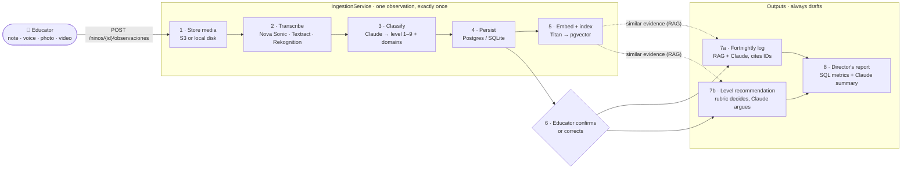
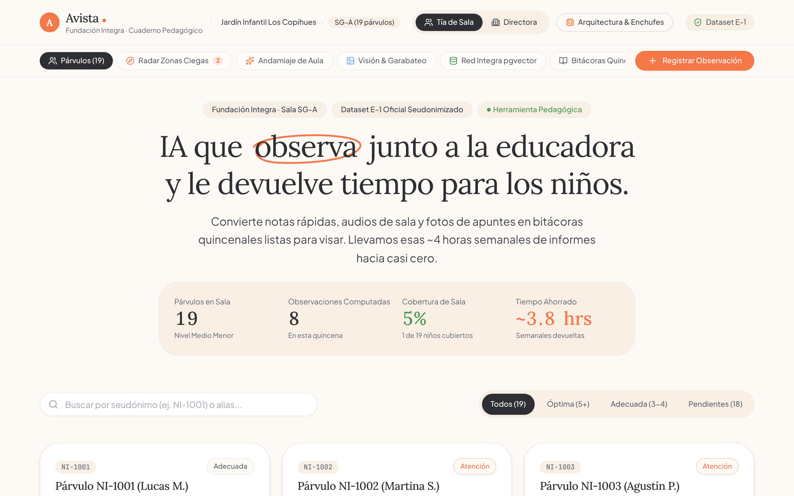
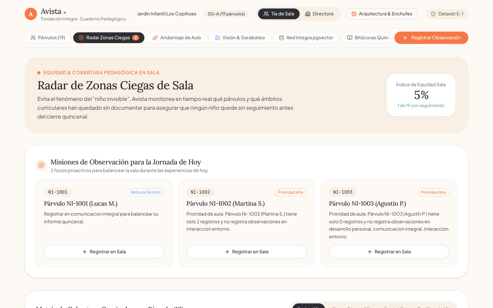
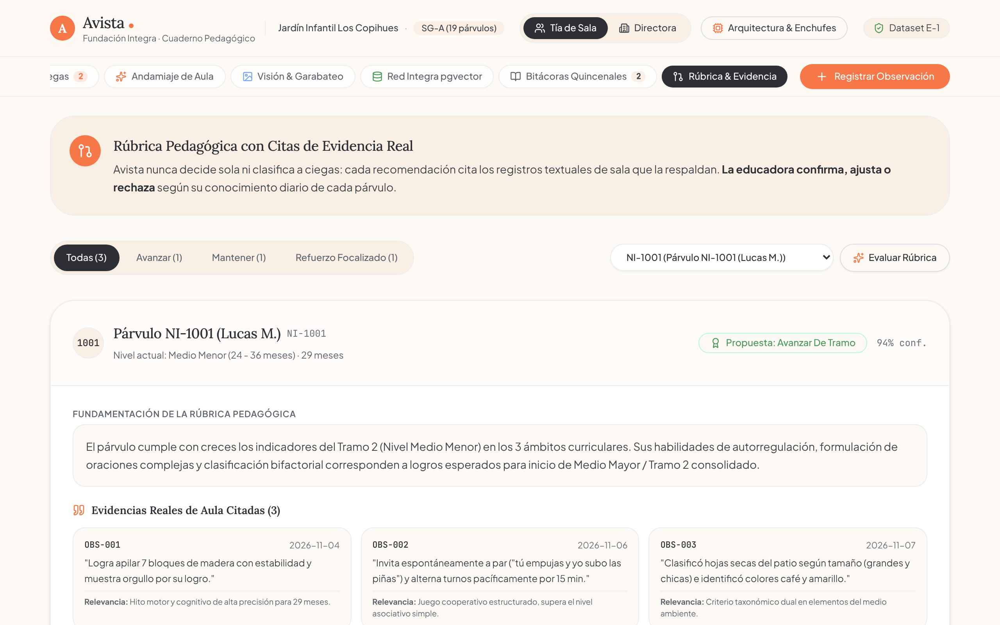
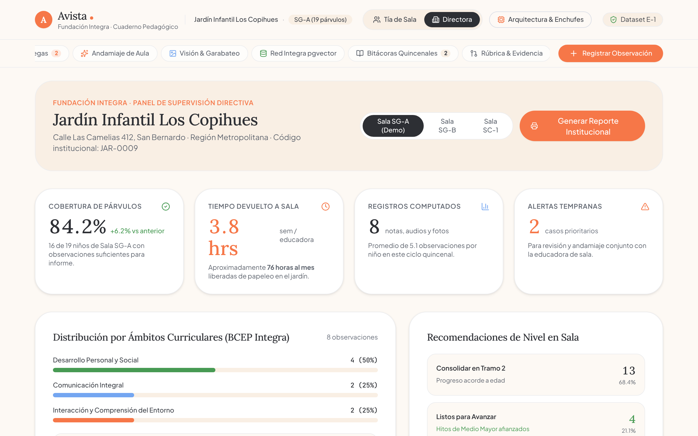
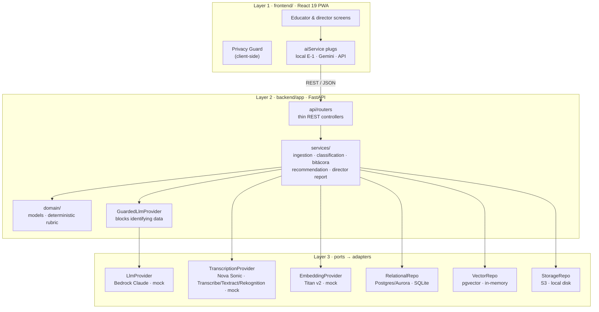
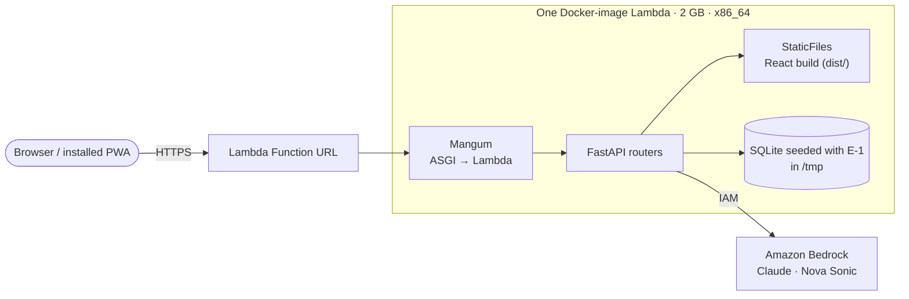
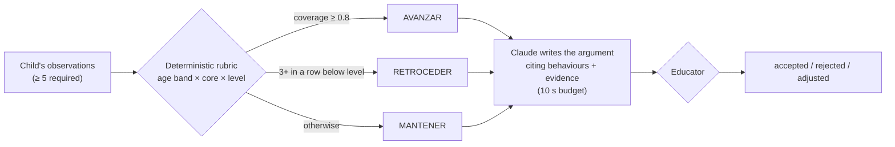

<div align="center">

**English** · [Español](README.es.md)

# Avista · From observation to action

**AI that observes alongside the early-childhood educator and gives her time back for the children.**

Built for the **"AI for Child Development"** challenge by **Fundación Integra** at **AWS Breaking Barriers Chile 2026**.
A mobile-first PWA and a FastAPI backend that turn the notes, voice memos, photos and videos an educator already produces during the day into
classified observations, fortnightly logs, level recommendations backed by cited evidence, and a director's report.


| ⏱️ Documentation time per educator | 🧭 Who decides |
|:---:|:---:|
| **~4 hours / week → minutes of review** (goal) | **The rubric decides, the AI argues, the educator validates** |

[How it works](#how-it-works) ·
[The app](#the-app) ·
[Architecture](#architecture) ·
[Design decisions](#design-decisions) ·
[Run it locally](#run-it-locally)

</div>

> ⚠️ All data in this repository and in the demo is **synthetic and pseudonymized** (official dataset E-1). Avista is a **pedagogical** support tool, not a clinical or diagnostic instrument.

---

## In 30 seconds

- **The problem:** early-childhood educators in Chile spend around **4 hours a week** outside the classroom writing observation records, fortnightly logs and progress reports by hand. That is time taken away from the children.
- **The solution:** Avista takes what the educator already captures during the day (a quick note, a voice memo, a photo of a handwritten note or a drawing, a short video) and turns it into:
  1. **Observations** classified against the curriculum (development domain + level).
  2. **Fortnightly log drafts** for each child, written by an LLM that must cite the observation IDs behind every claim.
  3. **Level recommendations** (advance / keep / step back) decided by a **deterministic rubric**, with the LLM only writing the argument.
  4. A **director's report** with metrics computed in SQL and an executive summary narrated by the LLM.
- **What makes it more than a prompt:** a **privacy guard** that blocks names, RUTs, addresses and contacts before anything reaches a model, **swappable "plugs"** (ports and adapters) that run the whole system offline or on AWS without code changes, **RAG** over the child's own evidence, and a **human-in-the-loop** rule: nothing is final until the educator approves it.

---

## How it works

### From a note in the classroom to the director's desk



| Step | What happens | Where |
|---|---|---|
| **Capture** | The educator picks a child (pseudonym `id_nino`) and sends text or a file. Missing child or educator → `400`, nothing is stored. | `api/routers/observaciones.py` |
| **Idempotency** | A SHA-256 of the file bytes (or the text) is the content key. Uploading the same file twice returns the existing observation instead of creating a second one. | `services/ingestion_service.py` |
| **Transcription** | Audio → **Amazon Nova Sonic** (speech-to-text, es-CL). Photo → **Textract** OCR. Video → transcription + **Rekognition** scene metadata. Text is used as is. | `providers/transcription/` |
| **Classification** | **Claude on Bedrock** returns strict JSON: level (1–9), 1–5 domains and a confidence. Below 0.5 confidence the observation is marked *pending review* instead of guessed. Offline, a rule-based classifier does the same job. | `providers/classifier/` |
| **Indexing** | The text is embedded (**Titan Text Embeddings v2**) and stored in **pgvector** for semantic search. If indexing fails the observation is kept. | `services/embedding_service.py` |
| **Human check** | The educator confirms or corrects the proposed classification (`PATCH /observaciones/{id}/clasificacion`). | `services/classification_service.py` |
| **Fortnightly log** | Observations of the period + up to 20 similar ones of the **same child** (RAG) + the active rubric go to Claude, which must cite an observation ID for each evaluative statement. Saved as a **draft**. | `services/bitacora_service.py` |
| **Recommendation** | The rubric maps evidence to the observable behaviours of the child's age band × curricular core × current level and decides **AVANZAR / MANTENER / RETROCEDER**. Claude only writes the argument. With fewer than 5 observations it abstains. | `domain/rubrica.py`, `services/recommendation_service.py` |
| **Director's report** | 7 SQL aggregations per kindergarten and period (level changes per room, domain distribution, logs per educator, inactivity alerts, time saved). Claude narrates; it never computes a number. | `services/director_report_service.py` |

---

## The app

The frontend (`frontend/`) is an installable PWA in the **"warm parchment notebook"** visual language: cream paper (`#fdf9f4`), serif headlines (Lora), a single ember-orange accent (`#f67748`) used on less than 5 % of the page. It has two roles, **Tía de sala** (educator) and **Directora**.

<table>
  <tr>
    <td><br><sub><b>Room</b> · children, coverage and time saved</sub></td>
    <td><br><sub><b>Blind-spot radar</b> · equity index and today's missions</sub></td>
  </tr>
  <tr>
    <td><br><sub><b>Rubric & evidence</b> · recommendation with cited observations</sub></td>
    <td><br><sub><b>Director</b> · kindergarten-wide metrics</sub></td>
  </tr>
</table>

| Tab | What it does | Engine today |
|---|---|---|
| **Párvulos** | The room at a glance: 19 children, observations per child, coverage state, search and filters. | Local dataset |
| **Registrar observación** | Capture in 4 formats with templates; the **Privacy Guard** sanitizes the text before classification. | Local rules or Gemini (live mode) |
| **Radar de zonas ciegas** | Finds the *"invisible child"*: days since last record, curricular gaps per child, a room **equity index**, and 3 *observation missions* for today. | Local computation |
| **Andamiaje de aula** | Turns a support alert into a concrete play-based activity using materials available in the room, a suggested peer mediator, 4 mediation steps and a success criterion. | Prototype (templated) |
| **Visión & garabateo** | Analysis of children's drawings by developmental stage (Lowenfeld / BCEP): grip, use of space, symbolic intent; one click turns it into an observation. Includes quick 10–15 s dictation. | Prototype (sample analyses) |
| **Red Integra** | A shared bank of practices validated by other Integra centers, searched in natural language, with an *"Adopt in my room"* action. | Prototype (keyword scoring; pgvector planned) |
| **Bitácoras** | Fortnightly log drafts the educator edits inline, approves or rejects; printable. | Local template or Gemini |
| **Recomendaciones** | Advance / keep / reinforce, with confidence and **cited evidence cards** (observation ID, date, quote, relevance). | Local rubric |
| **Dirección** | Coverage, hours returned, curricular distribution and early alerts for the kindergarten. | Local dataset |

A header switch (**Arquitectura & Enchufes**) toggles between the **local E-1 mode** (deterministic, offline, no keys) and the **live AI mode** (Gemini 2.5 Flash, if `VITE_GEMINI_API_KEY` is set). The app installs on Android, desktop and iOS (guided) and shows an offline indicator.

> **Integration status.** The new frontend currently runs on its own embedded copy of the demo room (`src/data/`). The FastAPI backend described below is complete and tested, and the next step is to point the frontend's plugs at its REST API (the Vite dev server already proxies `/api` → `:8000`). See [Roadmap](#roadmap).

---

## Architecture

Three layers, like a restaurant kitchen: whoever serves the tables (the app) never touches the pots (the data); everything goes through the kitchen (the business logic).



Every AI capability and every data store sits behind an **interface** (a port). `core/container.py` is the only place that decides which adapter to plug in, based on configuration:

| Port | Local / demo | AWS |
|---|---|---|
| `LlmProvider` | `MockLlmProvider` | **Bedrock · Claude** (`BEDROCK_MODEL_ID`), always wrapped by `GuardedLlmProvider` |
| `Classifier` | `RuleBasedClassifier` (lexical rules) | `LlmClassifier` (Claude, strict JSON) |
| `TranscriptionProvider` | `MockTranscriptionProvider` | **Nova Sonic** (audio) · Transcribe / Textract / Rekognition |
| `EmbeddingProvider` | deterministic mock | **Titan Text Embeddings v2** |
| `RelationalRepo` | SQLite | Postgres / **Aurora Serverless v2** |
| `VectorRepo` | in-memory index | **pgvector** |
| `StorageRepo` | local folder | **S3** (encrypted) |

Two switches drive it: `ENVIRONMENT=production` moves storage, database and vectors to AWS; `AI_ENABLED=true` (or a Bedrock key) turns on Claude and Nova Sonic independently, so the cloud demo can use real AI on top of SQLite.

### Deployment (MVP)



`infra/stacks/jaimes_mvp_stack.py` (AWS CDK) creates **one Lambda** built from the root `Dockerfile`: the first stage builds the React app, the second installs the backend and pre-seeds a SQLite file with dataset E-1. FastAPI serves both the API and the PWA from the **same origin**, so there is no CORS and no API Gateway. The function only has permission to invoke Bedrock models.

---

## Design decisions

<details>
<summary><b>"The rubric decides, the AI argues, the educator validates"</b></summary>

<br>

An LLM that decides whether a 2-year-old moves up a level is neither explainable nor reproducible. So the decision is split:



- The rubric is **versioned data** (`rubrica_versiones.criterios`): age band × curricular core × 8 progression levels × observable behaviours + thresholds. Adding a band or core is a data change, not a code change.
- Same input + same rubric version → always the same decision. No clock, no randomness.
- If the LLM fails or exceeds 10 s, the decision is still returned, with the argument marked as unavailable.
- With fewer than 5 observations the service **abstains** and says how many are missing.

</details>

<details>
<summary><b>Privacy: two guards, before anything reaches a model</b></summary>

<br>

- **Backend:** `GuardedLlmProvider` decorates whatever LLM is active. Before every call it runs `GuardiaDespersonalizacion` over prompt and context; if it finds a real name, RUT, address or contact, it **blocks** the call, logs the category (not the value) and raises a Spanish error. Because it wraps the single LLM port, logs, recommendations and reports are all covered without repeating the check.
- **Frontend:** the **Avista Privacy Guard** (`privacyService.ts`) replaces RUTs, phone numbers, addresses and known first/last names with tokens such as `[RUT_BLOQUEADO]` or `[NI-1001]` before classification, and tells the educator what was protected.
- Children only exist as pseudonyms (`id_nino`); identity metadata is stored apart from pedagogical content.

</details>

<details>
<summary><b>Swappable plugs: the same code offline and on AWS</b></summary>

<br>

Services depend on ports (`LlmProvider`, `TranscriptionProvider`, `EmbeddingProvider`, `RelationalRepo`, `VectorRepo`, `StorageRepo`), never on concrete clients. That gave the team three things: the full demo runs on a laptop with **no internet and no AWS account**; the test suite runs in seconds with deterministic fakes; and swapping a model (for example Claude for Nova) is one adapter class. The frontend mirrors the idea with its own plugs (local E-1 engine ↔ live AI).

</details>

<details>
<summary><b>RAG with mandatory citations for the fortnightly log</b></summary>

<br>

The log is not generated from a summary of the child: Avista retrieves the observations of the period plus up to **20 semantically similar observations of the same child** inside the window (pgvector), passes their IDs in the context, and the prompt requires every evaluative statement to cite one. No evidence in the period → no log (`422`). LLM failure or more than 60 s → no half-written draft (`503`). The result is always saved as a **draft** for the educator to edit and approve.

</details>

<details>
<summary><b>Numbers come from SQL, words come from the LLM</b></summary>

<br>

The director's report runs 7 aggregate queries (children who moved up / stayed / moved down per room, distribution by room and domain, logs per educator, regression and 14-day inactivity alerts) plus a deterministic **time-saved KPI** (10 min per observation, 45 min per log). Only then does Claude write the executive summary, from those aggregates alone. If the LLM fails, the report is still delivered with its metrics.

</details>

<details>
<summary><b>One Lambda instead of a full serverless stack (for the MVP)</b></summary>

<br>

The code supports Aurora + pgvector + S3 + Titan, but for the hackathon demo the team deployed the smallest thing that works: one container Lambda behind a Function URL, SQLite in `/tmp` restored from a pre-seeded file on cold start, concurrency capped at 5. No VPC, no NAT, no database to pay for while idle. Moving to the full stack is a configuration change (`ENVIRONMENT=production`), not a rewrite.

</details>

<details>
<summary><b>Offline-first PWA for real classrooms</b></summary>

<br>

Educators work standing up, with children around and sometimes with poor connectivity. The app installs as a PWA (service worker generated by `vite-plugin-pwa`, API calls never cached), works entirely in local mode without a network, and keeps capture to a few taps: pick a child, dictate or snap, done.

</details>

---

## API

| Method | Endpoint | Purpose |
|---|---|---|
| `GET` | `/health` | Status and active mode |
| `GET` | `/educadoras` · `/educadoras/{id}/ninos` | Educators and the children in their kindergarten |
| `GET` | `/ninos?jardin=&sala=` · `/ninos/{id}` | "My room" and a child's profile + trajectory |
| `POST` | `/ninos/{id}/observaciones` | Create an observation (text or media) → proposed classification |
| `GET` | `/ninos/{id}/observaciones` | List a child's observations |
| `PATCH` | `/observaciones/{id}/clasificacion` | Confirm or correct the classification |
| `POST` · `GET` | `/ninos/{id}/bitacoras` | Generate / list fortnightly logs |
| `PATCH` | `/bitacoras/{id}` | Edit or approve a log |
| `POST` | `/ninos/{id}/recomendaciones` | Generate a level recommendation |
| `POST` | `/recomendaciones/{id}/decision` | Record the educator's decision |
| `GET` | `/jardines/{id}/reportes?fecha_inicio=&fecha_fin=` | Director's report for a period |
| `GET` | `/ruta-niveles` | Reference level path + rubric version |
| `GET` | `/docs` | Swagger UI |

---

## Project structure

```text
Avista/
├── frontend/                 # Layer 1 · React 19 + Vite 8 + Tailwind v4 PWA
│   ├── src/components/       # Screens: room, radar, scaffolding, vision, network, logs, recommendations, director
│   ├── src/services/         # aiService (plugs: local E-1 / Gemini) · privacyService (Privacy Guard)
│   ├── src/data/             # Embedded demo room (dataset E-1, room SG-A) and practice bank
│   └── src/types/avista.ts   # Shared types (ámbitos, núcleos, observations, logs, recommendations)
├── backend/                  # Layer 2 · FastAPI
│   ├── app/api/              # Routers, schemas, mappers, Spanish error handlers
│   ├── app/services/         # Ingestion, classification, logs, recommendations, director report
│   ├── app/domain/           # Domain models + deterministic rubric
│   ├── app/providers/        # Plugs: LLM, classifier, transcription, embeddings (AWS + mock)
│   ├── app/repositories/     # Relational, vector, storage + E-1 seed
│   ├── app/core/             # Settings, DI container, privacy guard, bootstrap
│   └── tests/                # pytest suite (runs fully offline)
├── infra/                    # AWS CDK app (JaimesMvpStack) + tests
├── deployment/               # deploy / verify / smoke scripts (PowerShell)
├── dataset_e1_publico/       # Official synthetic dataset E-1 + data dictionary
├── docs/                     # Docs per area: backend, database, cloud, frontend
├── Dockerfile                # Builds the PWA and the Lambda image in one go
├── docker-compose.yml        # Backend + Postgres/pgvector
└── run_local.ps1             # One-command local demo (Windows)
```

> Internally the code still uses the project's first name, **jAImes** (`jaimes_*` stack, DB and logger names).

---

## Run it locally

**Option A · Frontend only** (no backend, no keys)

```bash
cd frontend
npm install
npm run dev            # http://localhost:5173
```

Optional: copy `.env.example` to `.env` and set `VITE_GEMINI_API_KEY` to enable the live AI mode. Any `VITE_*` value ends up in the browser bundle, so use a restricted demo key.

**Option B · Full stack in one command** (Windows, Python 3.12+ and Node 18+, no AWS account)

```powershell
powershell -ExecutionPolicy Bypass -File run_local.ps1
```

Seeds SQLite with dataset E-1, starts the API at `http://localhost:8000/docs` and the app at `http://localhost:5173`.

**Option C · Docker** (backend + Postgres with pgvector)

```bash
docker-compose up --build
```

<details>
<summary>Backend without Docker + tests</summary>

```bash
cd backend
python -m venv .venv
.venv\Scripts\activate          # macOS/Linux: source .venv/bin/activate
pip install -r requirements-dev.txt
uvicorn app.main:app --reload   # http://localhost:8000
pytest
```

To use real AI locally, set `AWS_BEARER_TOKEN_BEDROCK` (or `AI_ENABLED=true` with AWS credentials) in `backend/.env`; see `backend/.env.example`.

</details>

<details>
<summary>Deploy to AWS</summary>

```powershell
python -m venv .\infra\.venv
& .\infra\.venv\Scripts\python.exe -m pip install -r .\infra\requirements.txt
& .\infra\.venv\Scripts\python.exe -m pytest .\infra\tests
powershell -ExecutionPolicy Bypass -File .\deployment\deploy_mvp.ps1
powershell -ExecutionPolicy Bypass -File .\deployment\verify_mvp.ps1 -OutputsFile .\infra\cdk-outputs.json -AudioPath .\audio_testing\test1.mp3
```

Details in [`deployment/README.md`](deployment/README.md) and [`docs/cloud/`](docs/cloud/README.md).

</details>

---

## Roadmap

| Area | Status |
|---|---|
| Domain, contracts, deterministic rubric | ✅ Done |
| Relational DB + dataset E-1 seed · vector DB + embeddings | ✅ Done |
| Multi-format capture and transcription · classification | ✅ Done |
| Logs, recommendations with evidence, director's report, REST API | ✅ Done |
| AWS MVP deployment (CDK, one Lambda) | ✅ Done |
| New PWA: room, radar, scaffolding, vision, network, logs, recommendations, director | ✅ Done (embedded demo data) |
| Connect the new PWA to the REST API (API plug in `aiService`) | 🚧 Next |
| Real pgvector search for the practice bank · Bedrock vision for drawings | 🗺️ Planned |

---

## Privacy and ethics

1. **Pseudonymization by design:** children are handled only through `id_nino`. Names shown in the demo are fictional.
2. **Data isolation:** identity metadata is stored separately from pedagogical observations.
3. **Human decision is mandatory:** no algorithm decides a promotion, a step back or a diagnosis. Avista proposes and justifies; the educator confirms or corrects.
4. **Synthetic data only:** nothing in this repository corresponds to a real person.

---

<div align="center">

Built by the **Avista** team for Fundación Integra · AWS Breaking Barriers Chile 2026

</div>
