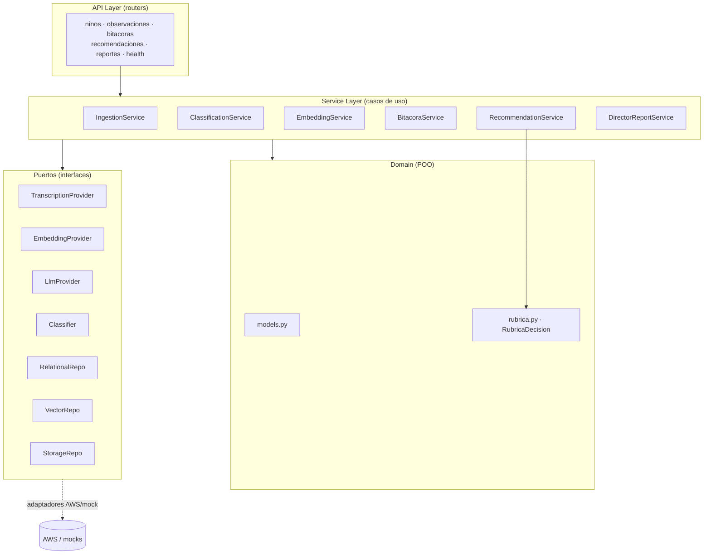

# Documentación — Backend (Capa 2: Lógica de negocio)

> Parte de la documentación por área de jAImes. Ver también: [`../database/`](../database/README.md), [`../cloud/`](../cloud/README.md), [`../frontend/`](../frontend/README.md) y el [MVP Blueprint](../MVP_BLUEPRINT.md).

El backend (FastAPI, Python) concentra la lógica de negocio y expone una API REST. Está construido con **POO + SOLID** en **3 capas** y usa **puertos y adaptadores** (interfaces + implementaciones AWS/mock) para desacoplar la IA y los datos. **AWS es el camino primario**; los mocks viven tras las mismas interfaces para desarrollo local y CI.

## Estrategia modular interface-first (clave para 4 personas en paralelo)

Primero se congela el **Módulo A (dominio + contratos)**. Luego los módulos B–H dependen **solo de las interfaces de A**, nunca de la implementación concreta de otro módulo. Cada módulo trae su propio fake/mock y se prueba en aislamiento, así que 4 personas pueden implementarlos y mergearlos a `main` en paralelo.

| Módulo | Responsabilidad | Contrato que expone | Depende de (solo interfaces) |
|---|---|---|---|
| A · Dominio | Modelos Pydantic + enums + interfaces base | `domain/models.py`, `rubrica.py`, `providers/*/base.py`, `repositories/*/base.py` | — |
| B · Relacional + seed | Persistencia relacional y seed E-1 | `RelationalRepo` | A |
| C · Vectorial + embeddings | Embeddings e índice vectorial (RAG) | `VectorRepo`, `EmbeddingProvider` | A |
| D · Ingesta + transcripción | S3 + Transcribe/Textract/Rekognition | `StorageRepo`, `TranscriptionProvider`, `IngestionService` | A |
| E · Clasificación | Estima nivel/dominio y vincula manifestaciones | `Classifier`, `ClassificationService` | A |
| F · Bitácoras + Rúbrica + Recomendación | RAG+LLM, rúbrica determinista, recomendación | `BitacoraService`, `RubricaDecision`, `RecommendationService`, `LlmProvider` | A, interfaces de B/C |
| G · Reporte + API + DI | Reporte de dirección, routers REST, contenedor DI | routers FastAPI, `DirectorReportService` | A, interfaces de B/D/E/F |
| H · Infra AWS | CDK, despliegue, integración cloud | stacks CDK, deploy | contrato de despliegue |

## SOLID aplicado

- **SRP** — un servicio por caso de uso (transcribir, clasificar, embeber, bitácora, recomendación, reporte).
- **OCP** — nuevos proveedores de IA se agregan como adaptadores sin tocar los servicios.
- **LSP** — adaptadores AWS y mock intercambiables tras la misma interfaz.
- **ISP** — interfaces pequeñas por capacidad (`TranscriptionProvider`, `LlmProvider`, `EmbeddingProvider`, repos).
- **DIP** — los servicios dependen de interfaces, inyectadas por un contenedor de DI que lee `USE_MOCKS`.

## Los 4 modelos de IA

| # | Servicio | Qué hace | Decide / Argumenta |
|---|---|---|---|
| 1 | Transcripción | medio → texto (Transcribe/Textract/Rekognition) | — |
| 2 | Bitácora quincenal | narrativa por niño/a (RAG + LLM Bedrock/Claude) | IA redacta |
| 3 | Recomendación de nivel | AVANZAR/MANTENER/RETROCEDER | **la rúbrica decide**, la IA argumenta, la educadora valida |
| 4 | Reporte de dirección | agregados del jardín + resumen ejecutivo | SQL agrega, IA redacta |

## Diagrama de componentes



## Contratos de las interfaces (puertos)

```
TranscriptionProvider.transcribe(media_ref, formato) -> str      # Modelo 1
EmbeddingProvider.embed(text) -> list[float]                     # Titan
LlmProvider.generate(prompt, context) -> str                     # Claude
Classifier.classify(texto) -> ClasificacionPropuesta             # Módulo E
RelationalRepo: CRUD + consultas agregadas
VectorRepo: index(doc), search(query_embedding, filtros, k)
StorageRepo: put(file) -> ref, get_url(ref)
```

La rúbrica es **determinista**: `evaluar(nino, observaciones_recientes, nivel_actual) -> ResultadoRubrica{decision, score, dominios_cubiertos, dominios_pendientes, evidencia, version_rubrica}`. El LLM solo redacta el argumento; nunca altera la decisión. Detalle en [`rubrica.md`](rubrica.md).
