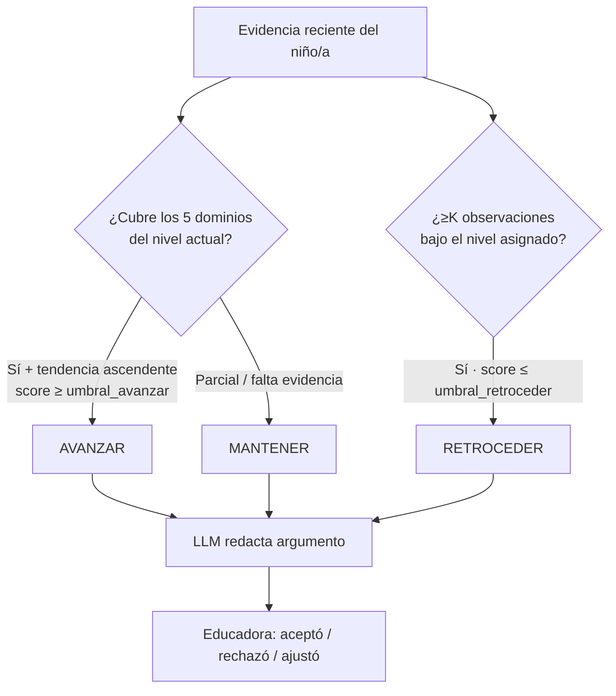

# Rúbrica de decisión determinista (Módulo F)

> Principio rector: **la rúbrica decide, la IA argumenta, la educadora valida.**

La recomendación de nivel (Modelo 3) separa tres responsabilidades:

1. **`RubricaDecision` decide** — reglas y umbrales estrictos, 100% deterministas. Para la misma entrada y la misma `version_rubrica`, siempre devuelve la misma `decision` y `score`.
2. **El LLM argumenta** — traduce el resultado de la rúbrica a lenguaje claro para la educadora. No altera la decisión.
3. **La educadora valida** — tiene la última palabra (acepta / rechaza / ajusta).

## Contrato

```
evaluar(nino, observaciones_recientes, nivel_actual) -> ResultadoRubrica {
  decision: AVANZAR | MANTENER | RETROCEDER,
  score: float (0.00–1.00),
  dominios_cubiertos: [Dominio],
  dominios_pendientes: [Dominio],
  evidencia: [id_observacion],
  version_rubrica: str
}
```

## Criterios (versionados en `rubrica_versiones.criterios`, JSON)

- `n_observaciones_consistentes` — ventana N (por defecto 5).
- `dominios_requeridos` — por defecto los 5 (cognitivo, lenguaje_comunicacion, motor_fino, motor_grueso, socioemocional).
- `umbral_score_avanzar`, `umbral_score_retroceder`.
- regla de retroceso — ≥K observaciones consecutivas (por defecto 3) bajo el nivel asignado.

Los criterios se editan sin tocar código: se crea una nueva fila en `rubrica_versiones` y cada recomendación guarda la `version_rubrica` con la que se calculó (auditable).

## Lógica de decisión



## Disparadores

- **Botón "¿Puede subir de nivel?"** en la ficha del niño/a → respuesta en ≤10 s.
- **Automático** al registrar nueva evidencia: si el `score` cruza el umbral, se muestra una **sugerencia proactiva** de avance (≤5 s tras el registro).

## Propiedades de correctitud

- **Determinismo:** misma entrada + misma `version_rubrica` ⇒ misma `decision` y `score` (Requirement 6.2).
- **Datos insuficientes:** con <5 observaciones, la rúbrica se abstiene e indica cuántas faltan (Requirement 6.8).
- **Degradación del LLM:** si el LLM falla, se conserva y devuelve la decisión determinista sin argumento (Requirement 6.9).
