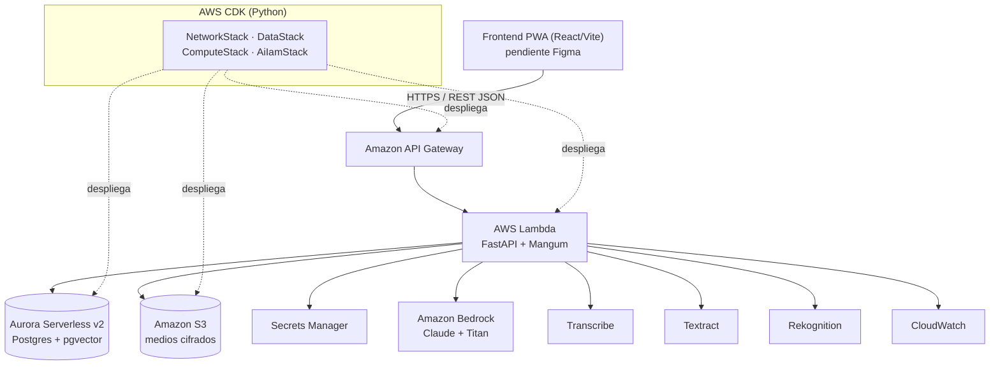

# Documentación — Cloud (Infraestructura AWS serverless)

> Parte de la documentación por área. Ver también: [`../backend/`](../backend/README.md), [`../database/`](../database/README.md). Detalle: [`cdk.md`](cdk.md), [`despliegue.md`](despliegue.md), [`integracion.md`](integracion.md).

**AWS es el camino primario y real** de jAImes. El despliegue objetivo es **serverless**, con Infraestructura como Código en **AWS CDK (Python)**. El objetivo del MVP es que el jurado vea una arquitectura cloud real y básica corriendo el servidor y haciendo demos en vivo.

> Alcance MVP: ciberseguridad avanzada (WAF fino, pentesting, rotación compleja de secretos) y casos borde de producción quedan **fuera**. Se aplica una base razonable: cifrado en reposo, seudonimización, IAM de mínimos privilegios, secretos en Secrets Manager.

## Servicios AWS

| Servicio | Rol en jAImes |
|---|---|
| API Gateway (HTTP API) | Entrada REST pública |
| AWS Lambda | FastAPI + Mangum (`handler = Mangum(app)`) |
| Aurora Serverless v2 (Postgres + pgvector) | BD relacional + vectorial en un solo motor |
| Amazon S3 | Medios cifrados + URLs prefirmadas |
| Amazon Bedrock | Claude (LLM) + Titan (embeddings) |
| Amazon Transcribe | Audio/video → texto (es-CL) |
| Amazon Textract | OCR de fotos de notas manuscritas |
| Amazon Rekognition | Metadatos de escena de video |
| AWS Secrets Manager | Credenciales de BD / claves |
| Amazon CloudWatch | Logs y métricas |

## Diagrama de arquitectura serverless

## Por qué serverless

- **Lambda + API Gateway + Mangum:** se despliega el mismo FastAPI que corre en local, sin reescribir. Costo cero en reposo.
- **Aurora Serverless v2 + pgvector:** un solo motor para relacional y vectorial; escala a poco en reposo.
- **Bedrock:** LLM y embeddings gestionados, sin administrar GPUs.
- **CDK en Python:** una sola lengua para backend e infraestructura.

**Prerrequisito:** configurar credenciales con `aws configure` (cuenta de la hackathon) antes de desplegar o correr integración cloud.
