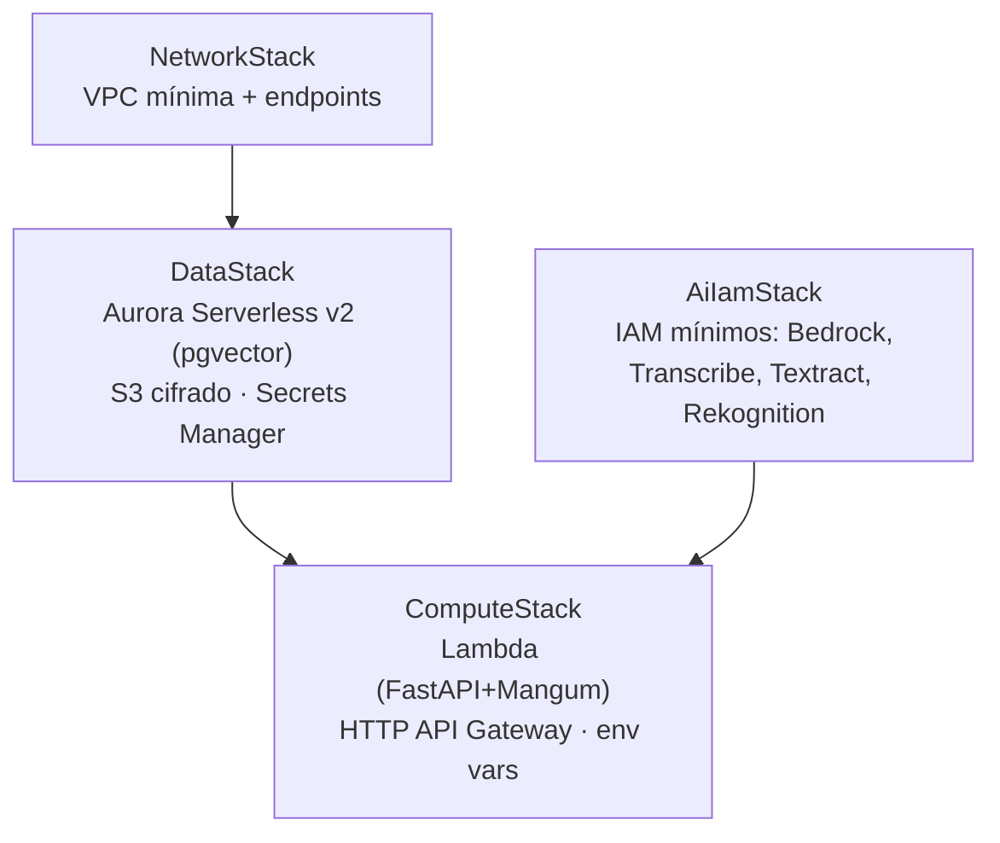

# Stacks CDK (AWS CDK, Python)

La infraestructura se define como código con **AWS CDK en Python**, en cuatro stacks de responsabilidad acotada.

| Stack | Recursos | Notas |
|---|---|---|
| `NetworkStack` | VPC mínima, subredes, endpoints necesarios | Lo justo para Aurora + Lambda |
| `DataStack` | Aurora Serverless v2 (Postgres + `pgvector`), bucket S3 cifrado, secretos | S3 con cifrado en reposo; credenciales en Secrets Manager |
| `ComputeStack` | Función Lambda (FastAPI+Mangum), HTTP API en API Gateway, variables de entorno (`USE_MOCKS=false`, región, nombres de recursos) | Mismo artefacto que corre en local con uvicorn |
| `AiIamStack` | Roles/políticas IAM de **mínimos privilegios** para Bedrock, Transcribe, Textract, Rekognition | Solo los servicios que la Lambda invoca |

IAM de mínimos privilegios y secretos fuera del código (Requirement 11.6). Base razonable de MVP, no endurecimiento avanzado.
