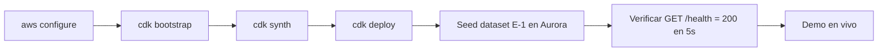

# Despliegue y demo

> Prerrequisito: `aws configure` con las credenciales de la cuenta de la hackathon.

## Flujo de despliegue

## Pasos

1. **Credenciales:** `aws configure` (access key, secret, región de la hackathon).
2. **Bootstrap (una vez):** `cdk bootstrap`.
3. **Sintetizar:** `cdk synth` (genera el CloudFormation; valida que los stacks compilan).
4. **Desplegar:** `cdk deploy --all`. Ante fallo, CDK/CloudFormation reporta el stack y recurso que falló y deja el entorno reintentar-able (Requirement 10.5).
5. **Seed:** ejecutar el script de seed del dataset E-1 contra Aurora.
6. **Verificar:** `GET /health` debe responder HTTP 200 en 5 s o menos vía API Gateway.
7. **Demo:** flujo educadora (capturar, clasificar, recomendación, bitácora, aprobar) y flujo directora (reporte).

## Variables de entorno (ComputeStack)

| Variable | Valor en AWS | Valor local |
|---|---|---|
| `USE_MOCKS` | `false` (servicios AWS reales) | `true` (mocks) |
| región / nombres de recursos | inyectados por CDK | `.env` local |

## Ejecución local (camino secundario)

Levantar la pila local con Docker Compose (`USE_MOCKS=true`) arranca backend + Postgres/pgvector para desarrollo y demo offline sin credenciales AWS.
