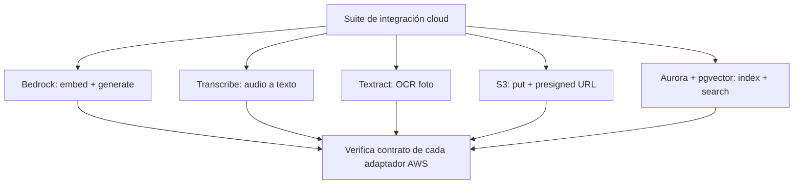

# Pruebas de integración cloud (AWS real)

Las pruebas de integración cloud invocan servicios AWS **reales** en una cuenta sandbox para confirmar que los adaptadores funcionan de verdad (no solo los mocks). Son el camino principal demostrable ante el jurado.

- Cubren: Bedrock (Claude + Titan), Transcribe, Textract, S3 y Aurora+pgvector.
- Se ejecutan **bajo demanda** mediante un marcador/comando dedicado (p. ej. `pytest -m cloud`), separadas de la suite rápida de CI que corre con mocks.
- **Requieren credenciales** (`aws configure`) y recursos desplegados.

Property relacionada — **Intercambiabilidad (LSP):** cualquier test de servicio pasa indistintamente con el adaptador AWS o el mock inyectado, sin cambiar el código del servicio (Requirements 2.8, 4.5, 5.10, 10.3).
