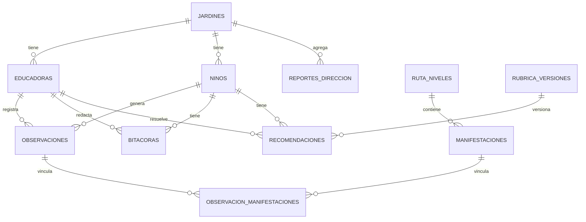

# Documentación — Bases de datos (Capa 3)

> Parte de la documentación por área. Ver también: [`../backend/`](../backend/README.md), [`../cloud/`](../cloud/README.md).

jAImes usa **dos bases de datos lógicas** que, en el camino AWS primario, residen sobre un mismo clúster **Aurora Serverless v2 (PostgreSQL + pgvector)**. En modo mock se sustituyen por **SQLite + índice vectorial en memoria** tras las mismas interfaces (`RelationalRepo`, `VectorRepo`).

- **BD relacional** — personas y entidades (dataset E-1 + tablas nuevas). Ver [`esquema.md`](esquema.md).
- **BD vectorial** — transcripciones y embeddings para RAG. Ver [`vectorial.md`](vectorial.md).

Privacidad (Requirement 11): los niños/as se identifican solo por `id_nino` seudónimo; no hay nombre real ni RUT. Datos personales (relacional) y contenido (vectorial) se mantienen separados.

## Tablas

Del dataset E-1: `jardines`, `educadoras`, `ninos`, `ruta_niveles`, `manifestaciones`, `observaciones`, `observacion_manifestaciones`.
Nuevas (salida de los Modelos 2–4): `bitacoras`, `recomendaciones`, `rubrica_versiones`, `reportes_direccion`.

## Diagrama ER

El esquema SQLAlchemy real está en `backend/app/repositories/schema.py` (estilo declarativo 2.0, enums compartidos con el dominio, JSON portable entre SQLite y Postgres).
