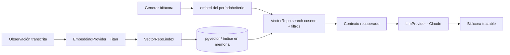

# Base vectorial (pgvector / RAG)

La base vectorial soporta la **búsqueda semántica** que alimenta el RAG de las bitácoras (Modelo 2). En AWS vive como una tabla en Aurora con una columna `embedding vector(d)` de la extensión **pgvector**; en modo mock es un índice en memoria tras la misma interfaz `VectorRepo`.

## Documento por observación

```
{ id_observacion, id_nino, texto_transcrito, embedding, dominio, nivel, fecha, formato }
```

## Interfaz `VectorRepo`

```
index(doc)                                   # indexa un documento-observación
search(query_embedding, filtros, k) -> [doc] # similitud coseno + filtros de metadatos
```

En Postgres la similitud usa el operador `<=>` de pgvector (distancia coseno). Los metadatos (`id_nino`, `dominio`, `nivel`, `fecha`, `formato`) permiten filtrar la recuperación por período y dominio al armar el contexto del LLM.

## Flujo RAG



## Propiedades

- `search` por `id_observacion` recupera exactamente un registro con sus seis metadatos (Requirement 4.3).
- Si falla el embedding o la indexación, la observación se conserva en la relacional sin registro vectorial y se devuelve error de indexación (Requirement 4.4).
- Migrable a OpenSearch Serverless cambiando solo el adaptador `VectorRepo`.
