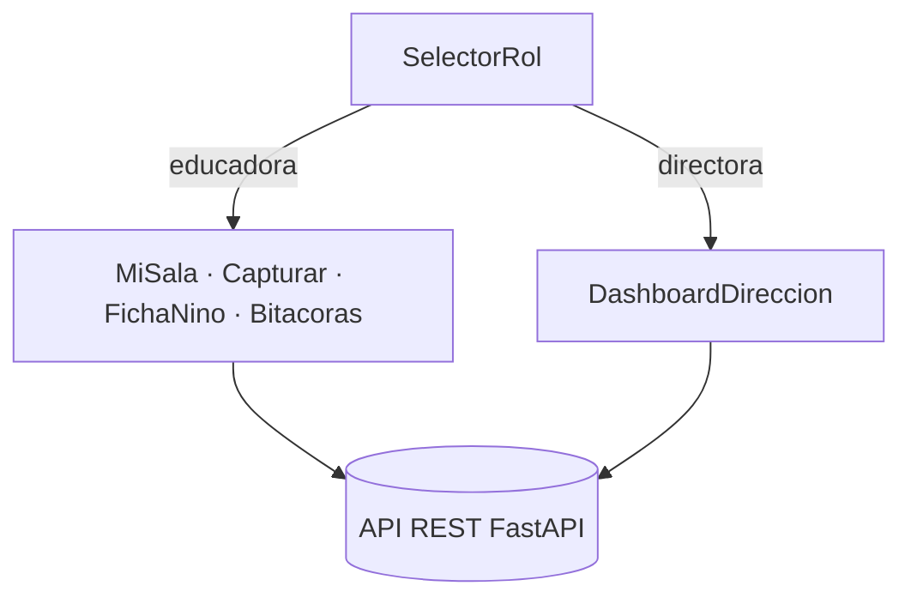

# Documentación — Frontend (Capa 1: Presentación)

> **Estado: pendiente del refinamiento de los mockups de Figma.** El frontend es una tarea posterior; esta nota define la estructura y, sobre todo, cómo el cliente consume la API. El estilo visual definitivo se aplicará desde Figma sin cambiar la lógica.

PWA **mobile-first** (React + Vite). El cliente **no contiene lógica de negocio**: solo UI y llamadas a la API REST (Requirement 9.5). Router por rol: `educadora` / `directora` (selector simple, sin auth real en la demo).

## Pantallas

| Rol | Pantallas |
|---|---|
| Educadora | MiSala · Capturar · ConfirmarClasificacion (sugerencia proactiva) · FichaNino (trayectoria + "¿Puede subir de nivel?" con 3 estados) · Bitacoras (ver/editar/aprobar) |
| Directora | DashboardDireccion (métricas, KPI, resumen ejecutivo) |
| Transversal | SelectorRol · BannerDatosSinteticos · IndicadorCarga |

## Routing por rol

## Capa de servicios API

Una capa `api/` tipada consume los endpoints del backend (ver [`../backend/README.md`](../backend/README.md) y los contratos REST del diseño). Requisitos de UX: controles ≥44×44 px, viewport 320–1024 px, español (Chile), indicador de progreso ≤100 ms, banner permanente de datos sintéticos, manejo de error/timeout de 10 s sin descartar lo que la educadora ingresó.
