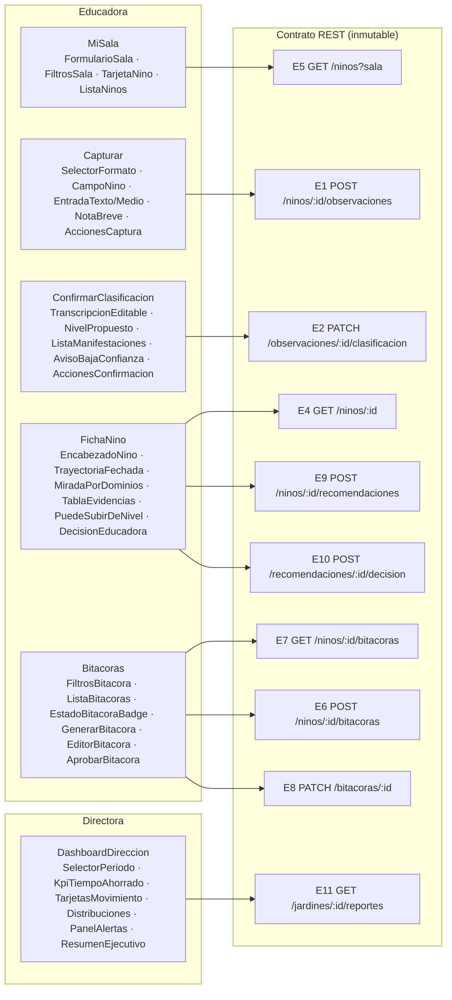

# Tareas de componentes concretos por pantalla (ingesta Figma)

> **Tarea 14.3 del spec `jaimes-mvp`** — _Requirement 20.3_: producir las tareas
> de **componentes concretos** mapeados a las pantallas existentes del diseño:
> `MiSala`, `Capturar`, `ConfirmarClasificacion`, `FichaNino`, `Bitacoras`,
> `DashboardDireccion`.
>
> **Invariante clave (Requirement 20.5):** el **contrato de la API REST del
> backend es INMUTABLE**. Estas tareas descomponen cada pantalla en componentes
> de **capa de presentación** sobre la estructura ya existente
> (`frontend/src/screens/**`) y la capa de servicios tipada ya implementada
> (`frontend/src/api/`). **No** crean endpoints, **no** tocan la lógica de
> negocio ni el backend. Las brechas se resuelven con las adaptaciones de
> frontend acordadas en el gap-analysis (14.2).
>
> **Idioma / contexto:** español (Chile).

## 1. De dónde salen estas tareas

| Insumo | Ubicación | Rol |
| --- | --- | --- |
| Pantallas/flujos extraídos de Figma | [`figma-pantallas.md`](./figma-pantallas.md) (14.1) | Qué componentes/microcopys muestra cada pantalla |
| Gap-analysis vs. contrato REST | [`gap-analysis-figma.md`](./gap-analysis-figma.md) (14.2) | Mapa pantalla→endpoint + resoluciones frontend de cada brecha |
| Pantallas ya implementadas (placeholder) | `frontend/src/screens/{educadora,directora}/*.tsx` (tarea 13) | Estructura existente sobre la que se construyen los componentes |
| Capa de servicios tipada | `frontend/src/api/endpoints.ts` + `types.ts` | Contrato inmutable reflejado 1:1 en el cliente |
| Componentes transversales | `frontend/src/components/*.tsx` | `BannerDatosSinteticos`, `IndicadorCarga`, `MensajeError`, `SelectorRol` reutilizables |

**Principio de descomposición:** cada pantalla objetivo ya existe como un
componente de página (p. ej. `MiSala.tsx`). 14.3 define los **subcomponentes de
presentación** en los que se descompone cada página para absorber los
microcopys, filtros, estados y layout de los mockups, **sin** mover lógica al
cliente y **sin** ampliar el contrato REST. La implementación de estilos/tokens
sobre estos componentes es la tarea 14.4.

**Ubicación sugerida de los nuevos componentes:** co-locados por pantalla en
`frontend/src/screens/<rol>/<Pantalla>/` (p. ej.
`frontend/src/screens/educadora/MiSala/` con `MiSala.tsx` + sus subcomponentes),
o en `frontend/src/components/` cuando sean reutilizables entre pantallas.

## 2. Principios transversales que todo componente debe respetar

Derivados de los principios de UX del tablero (14.1 §5) y de los Requirements
8, 9, 11:

- **Human-in-the-loop:** la IA propone; la educadora edita/decide/aprueba.
  Ningún componente aplica una clasificación/decisión automáticamente.
- **Sin registro ≠ sin aprendizaje:** ante ausencia de datos, mostrar `—` o un
  vacío neutro; **nunca** inferir déficit, estancamiento ni nivel.
- **Nada se descarta:** errores/timeout (10 s) conservan lo ingresado y ofrecen
  reintento (`MensajeError` con `onReintentar`).
- **Pseudonimización:** mostrar siempre `id_nino` (p. ej. `nino-0001`), nunca
  nombre ni RUT.
- **Mobile-first 320–1024 px**, controles táctiles `≥44×44 px`
  (clase `touch-target`), indicador de progreso `≤100 ms` (`IndicadorCarga`).
- **Banner permanente** de datos sintéticos (`BannerDatosSinteticos`).
- **Sin lógica de negocio en el cliente:** los componentes solo componen
  llamadas a `api/` y presentan datos tipados.

> **Convención de las tareas:** `[ ]` pendiente · `[-]` en progreso ·
> `[x]` hecha. Cada tarea lista los **componentes concretos**, los **endpoints**
> que consume (según 14.2) y el **Requirement** asociado. Las subtareas marcadas
> `_Opcional_` dan refinamiento pero no gatean la pantalla.

## 3. Tareas de componentes por pantalla

### 14.3.1 `MiSala` (educadora) — _Requirements 8.2, 9.6_

Pantalla existente: `frontend/src/screens/educadora/MiSala.tsx`.
Endpoint: **E5** `GET /ninos?sala=` (`api.listarNinosPorSala`). Brechas 14.2:
**S-1** (estado de documentación / último registro / filtros) → derivado en
cliente, sin ampliar E5.

- [ ] 14.3.1 Componentes de `MiSala`
  - [ ] `FormularioSala` — input de sala + botón "Ver sala" (`touch-target`),
    estados cargando/error con reintento. Ya presente en la página; extraer como
    subcomponente controlado.
  - [ ] `FiltrosSala` — segmentos _Todos / Con registros / Sin registro /
    Ingreso reciente_ (mockup). **Filtrado puramente en cliente** sobre la lista
    ya recibida de E5; sin parámetros nuevos de API.
  - [ ] `TarjetaNino` — tarjeta/fila por niño/a con `id_nino`, `sala`, `tramo?`,
    columnas "estado de documentación" y "último registro" mostradas como `—`
    cuando E5 no las provee (**S-1**, sin inferir déficit). Enlace a `FichaNino`.
  - [ ] `ListaNinos` / `EstadoVacioSala` — contenedor de tarjetas + mensaje
    neutro cuando la sala no tiene niños/as.
  - [ ]* _Opcional_ `ResumenSala` — contador local de registros/pendientes
    derivado de E5 (+ E7 por niño/a si se adopta). No crea endpoint (**G-1**).

### 14.3.2 `Capturar` (educadora) — _Requirements 8.2, 9.6, 2.x_

Pantalla existente: `frontend/src/screens/educadora/Capturar.tsx`.
Endpoint: **E1** `POST /ninos/{id}/observaciones` (multipart, `api.crearObservacion`).
Brechas 14.2: **G-5** captura grupal → N llamadas E1 en cliente; **G-3** cola
offline → PWA local (fuera del contrato).

- [ ] 14.3.2 Componentes de `Capturar`
  - [ ] `SelectorFormato` — Texto / Audio / Foto / Video (`FormatoCaptura`),
    con `accept` por formato. Ya presente; extraer como subcomponente.
  - [ ] `CampoNino` — input de `id_nino` seudónimo con texto de ayuda de
    pseudonimización.
  - [ ] `EntradaTexto` — textarea de observación (límite 1–50.000 validado por
    backend; el cliente solo compone).
  - [ ] `EntradaMedio` — selector de archivo audio/foto/video con nombre del
    adjunto seleccionado.
  - [ ] `NotaBreve` — nota opcional `≤280` caracteres con contador (microcopy
    del mockup).
  - [ ] `AccionesCaptura` — "Enviar y clasificar" + "Guardar borrador"
    (borrador = estado local PWA, **G-3**, sin endpoint); al recibir la
    `Observacion` navega a `ConfirmarClasificacion` por estado de navegación.
  - [ ]* _Opcional_ `CapturaGrupal` — relato compartido + selección de
    participantes de la sala; itera **N × E1** (una `POST .../observaciones` por
    participante) y luego N × E2. "Sin nivel común" (**G-5**); el contrato trata
    cada observación de forma individual.
  - [ ]* _Opcional_ `GrabadorAudioMovil` — grabación con límite propuesto 60 s +
    vista previa de transcripción en streaming (`IndicadorCarga`); el audio se
    conserva aunque se pase a texto (principio "nada se descarta").

### 14.3.3 `ConfirmarClasificacion` (educadora) — _Requirements 3.3, 3.4, 9.5_

Pantalla existente: `frontend/src/screens/educadora/ConfirmarClasificacion.tsx`.
Endpoint: **E2** `PATCH /observaciones/{id}/clasificacion`
(`api.confirmarClasificacion`); recibe la propuesta de E1 por estado de
navegación. Brechas 14.2: **S-3** cubierto por el contrato
(`confianza_baja` / `pendiente_clasificacion_manual`).

- [ ] 14.3.3 Componentes de `ConfirmarClasificacion`
  - [ ] `TranscripcionEditable` — muestra/edita el texto propuesto (edición es
    corrección de la educadora, no reclasificación en cliente).
  - [ ] `NivelPropuesto` — "nivel propuesto (no aprobado)" con los 1–9 niveles;
    editable antes de confirmar.
  - [ ] `ListaManifestaciones` — 1–5 manifestaciones del nivel con checkbox
    _conservar / revisar_ (microcopy del mockup); valida selección 1–5.
  - [ ] `AvisoBajaConfianza` — banner cuando `confianza_baja` /
    `pendiente_clasificacion_manual` (estado "baja confianza" del mockup,
    **S-3**).
  - [ ] `SugerenciaProactiva` — aviso proactivo "al cruzar el umbral" (si la
    propuesta lo trae), human-in-the-loop.
  - [ ] `AccionesConfirmacion` — "Aprobar evidencia y guardar" → **E2**;
    conserva valores previos ante fallo de persistencia (`MensajeError`).

### 14.3.4 `FichaNino` (educadora) — _Requirements 8.2, 6.x, 9.6_

Pantalla existente: `frontend/src/screens/educadora/FichaNino.tsx`.
Endpoints: **E4** `GET /ninos/{id}`; **E9** `POST /ninos/{id}/recomendaciones`;
**E10** `POST /recomendaciones/{id}/decision`. Opcional **E3**
`GET /ninos/{id}/observaciones` para separar trayectoria; **E12** `GET /ruta-niveles`
como referencia. Brechas 14.2: **S-2** (agrupación por dominio) y **S-4**
(3 estados + abstención) cubiertas por el contrato.

- [ ] 14.3.4 Componentes de `FichaNino`
  - [ ] `EncabezadoNino` — `id_nino`, `sala`, `tramo` desde E4; acción
    "Registrar observación" → `Capturar`.
  - [ ] `TrayectoriaFechada` — línea temporal de observaciones de E4
    (opcionalmente E3); "entre fechas no se infiere un nivel".
  - [ ] `MiradaPorDominios` — agrupa `observaciones` por `Dominio` (los 5
    dominios del enum existente) **en el cliente** (**S-2**, **D-1**).
  - [ ] `TablaEvidencias` — tabla con autoría/formato/nivel por observación
    (`formato_captura`, `clasificacion.nivel_estimado`, dominios).
  - [ ] `DetalleEvidencia` — panel de detalle de la evidencia seleccionada.
  - [ ] `PuedeSubirDeNivel` — bloque "¿Puede subir de nivel?" con **3 estados**
    (avanzar / mantener / retroceder) + `tramo`/`nucleo`/`nivel_actual` desde
    **E9**; muestra `argumento`; estado de **abstención** cuando
    `datos_insuficientes` (<5 observaciones) sin inferir déficit (**S-4**).
  - [ ] `DecisionEducadora` — registrar aceptó/rechazó/ajustó → **E10**
    (`registrarDecisionRecomendacion`), human-in-the-loop.

### 14.3.5 `Bitacoras` (educadora) — _Requirements 5.7, 5.8, 5.9, 9.6_

Pantalla existente: `frontend/src/screens/educadora/Bitacoras.tsx`.
Endpoints: **E7** `GET /ninos/{id}/bitacoras`; **E6** `POST /ninos/{id}/bitacoras`;
**E8** `PATCH /bitacoras/{id}` (editar y aprobar). Brechas 14.2: **S-6** 4
etiquetas de mockup → mapear a los 2 estados del enum (`borrador`/`aprobada`);
**G-2** InformeBimensual fuera de alcance (no se crea endpoint).

- [ ] 14.3.5 Componentes de `Bitacoras`
  - [ ] `FiltrosBitacora` — filtros por fecha/autor/formato y estado;
    **las etiquetas de mockup "En revisión"/"Dataset" son presentación** sobre
    `borrador`/`aprobada` (**S-6**), sin ampliar el enum del backend.
  - [ ] `ListaBitacoras` — listado filtrable (E7) con fecha, autor, formato,
    `EstadoBitacoraBadge`.
  - [ ] `EstadoBitacoraBadge` — insignia que mapea `EstadoBitacora` a la
    etiqueta visual del mockup (2 estados reales).
  - [ ] `GenerarBitacora` — acción "Generar bitácora" (body: periodo) → **E6**.
  - [ ] `DetalleBitacora` — contenido con trazabilidad (cada afirmación cita
    ≥1 observación/manifestación) en modo lectura/edición.
  - [ ] `EditorBitacora` — edición permitida solo en `borrador` → **E8**;
    rechazar edición de `aprobada` presentando el 409 traducido.
  - [ ] `AprobarBitacora` — "Aprobar" cambia a `aprobada` → **E8**.
  - [ ]* _Opcional_ `VistaPreviaInforme` — reutiliza bitácoras **aprobadas**
    (E7/E8) como contenido base de una vista previa; **el envío/entrega a
    familias NO tiene endpoint y NO se implementa** (**G-2**, invariante 20.5).

### 14.3.6 `DashboardDireccion` (directora) — _Requirements 7.x, 8.2, 9.6_

Pantalla existente: `frontend/src/screens/directora/DashboardDireccion.tsx`.
Endpoint: **E11** `GET /jardines/{id}/reportes` (`api.obtenerReporteDireccion`).
Brechas 14.2: **S-5** — KPI y métricas núcleo cubiertos; "composición por
formato", "entrega diaria" y conteos de red **no están** en `ReporteDireccion`
→ se **omiten** del MVP (no se inventan métricas en el cliente; las métricas
vienen de SQL).

- [ ] 14.3.6 Componentes de `DashboardDireccion`
  - [ ] `SelectorPeriodo` — rango de fechas (`PeriodoReporte`) con validación de
    forma (inicio ≤ fin) solo para la consulta; la validación de negocio es del
    backend.
  - [ ] `KpiTiempoAhorrado` — KPI central de tiempo de documentación
    (`kpi_tiempo_ahorrado_horas`, base 4 h → meta 0 h), **calculado por backend**
    (no en cliente).
  - [ ] `TarjetasMovimiento` — conteos `subieron` / `mantuvieron` / `bajaron`
    (cada niño/a en exactamente una categoría), desde E11.
  - [ ] `DistribucionPorSala` y `DistribucionPorDominio` — visualización de
    `distribucion_por_sala` / `distribucion_por_dominio`.
  - [ ] `ContadoresGlobales` — `total_observaciones` / `total_bitacoras`.
  - [ ] `PanelAlertas` — alertas de retroceso e inactividad (14 días) desde E11.
  - [ ] `ResumenEjecutivo` — `resumen_ejecutivo?`; si el LLM falló, el reporte
    llega sin resumen y la UI lo oculta con gracia.
  - [ ]* _Opcional_ `VistasOmitidasMVP` — nota/placeholder que documenta en la
    propia UI que "composición por formato / entrega diaria / conteos de red"
    quedan **fuera del MVP** por no estar en `ReporteDireccion` (**S-5**); no se
    amplía el contrato.

## 4. Trazabilidad pantalla → componentes → endpoint (contrato intacto)

## 5. Resumen y próximos pasos

- **Cobertura:** las 6 pantallas objetivo se descomponen en componentes
  concretos de presentación, cada uno mapeado a los endpoints que ya expone el
  contrato (14.2). Los componentes transversales (`BannerDatosSinteticos`,
  `IndicadorCarga`, `MensajeError`, `SelectorRol`) se reutilizan tal cual.
- **Contrato REST:** ✅ **inmutable** (Requirement 20.5). Ninguna tarea crea ni
  modifica endpoints. Las brechas se resuelven en el frontend (composición de
  llamadas, estado/vista local, mapeo de etiquetas) o quedan **fuera de alcance
  del MVP** (InformeBimensual/envío a familias, admin. local, métricas de red no
  presentes en `ReporteDireccion`).
- **14.4 (siguiente):** implementar **estilos y tokens de diseño** sobre estos
  componentes y la estructura existente, sin alterar la lógica de negocio ni el
  contrato REST (Requirements 20.4, 20.5).
- **Invariante respetada:** esta tarea es de **capa de presentación**
  (planificación de componentes); no toca backend, contrato REST ni lógica de
  negocio.
