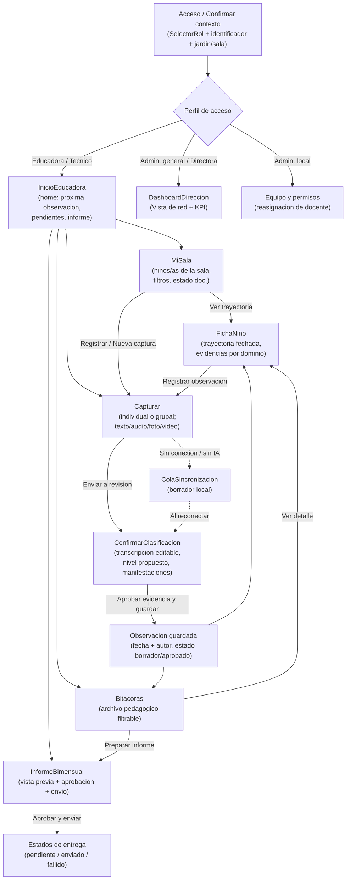
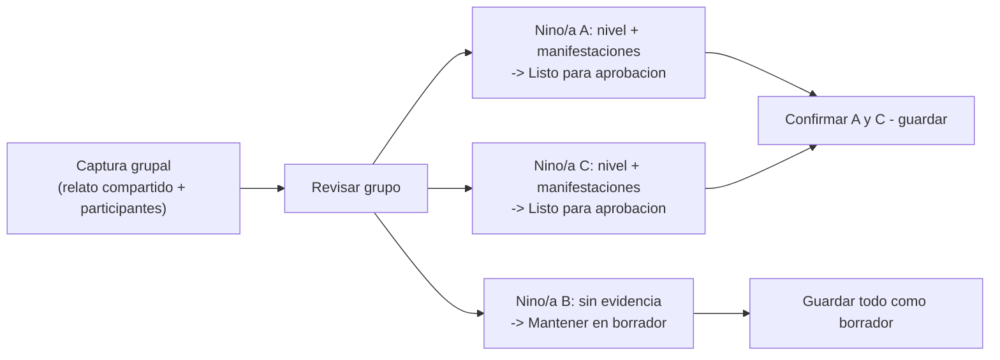

# Extracción de pantallas y flujos — Mockups de Figma (jAImes / "Bitácora")

> **Tarea 14.1 del spec `jaimes-mvp`** — _Requirement 20.1_: ingestar el PDF de
> Figma y extraer las pantallas y flujos representados en los mockups.
>
> **Alcance de este documento:** extracción y documentación **solo de capa de
> presentación**. No modifica el contrato REST ni la lógica de negocio del
> backend. El gap-analysis contra la API (14.2), las tareas de componentes
> (14.3) y la implementación (14.4) se abordan en tareas posteriores.
>
> **Idioma / contexto:** español (Chile). El producto se presenta en los
> mockups bajo el nombre conceptual **"Bitácora — Seguimiento pedagógico"**
> (propuesta conceptual del desafío E-1, no un producto oficial de Integra).

## 1. Fuente ingerida

Los mockups llegaron como seis PDF en `mockups/`. Se extrajo su texto de forma
programática con `pypdf` (script reproducible en `scripts/extract_mockups.py`,
volcado íntegro en `scripts/mockups_extract.txt`). **El texto de los PDF es
seleccionable y se extrajo correctamente** (no son imágenes rasterizadas), por
lo que la extracción de pantallas, componentes y microcopys es fiable.

| PDF | Páginas | Contenido |
| --- | --- | --- |
| `Sin ttulo-1-4.pdf` | 4 | Acceso/login, Inicio (home educadora), Mi sala, Ficha/Trayectoria del niño/a |
| `Sin ttulo-5-7.pdf` | 3 | Nueva captura individual, Nueva captura grupal, Revisión individual (IA) |
| `Sin ttulo-8-10.pdf` | 3 | Bitácora (archivo pedagógico), Informe bimensual a familias, Acceso local (equipo/permisos) |
| `Sin ttulo-11-13.pdf` | 3 | Panel de administración general (red/KPI), Home móvil, Capturar audio (móvil) |
| `Sin ttulo-14.pdf` | 1 | Revisar grupo (móvil) |
| `Sin ttulo-15-16_compressed.pdf` | 2 | Guardados y conexión (móvil), **Tablero UX** (mapa de alcance, decisiones y preguntas abiertas) |

El propio tablero UX (página 16) se autodescribe como **"11 pantallas de
escritorio · 4 flujos móviles · 1 tablero UX"**, lo que coincide con lo
extraído.

## 2. Contexto transversal observado en todas las pantallas

Elementos presentes de forma persistente en los mockups, que mapean a los
**componentes transversales** ya definidos en el diseño:

- **Banner de datos sintéticos / disclaimer** (→ `BannerDatosSinteticos`):
  aparece en todas las pantallas con variantes del texto _"Datos ficticios · Uso
  pedagógico, no diagnóstico. Bitácora es una propuesta conceptual, no un
  producto oficial de Integra."_ y la cinta superior _"ENTORNO DEMO · DATOS
  FICTICIOS"_.
- **Selector/identificador de rol y contexto** (→ `SelectorRol`): el login pide
  **identificador institucional** (p. ej. `EDU-0035`, "no corresponde a un RUT")
  y permite elegir **perfil de acceso** (Docente/Educadora, Técnico, Admin.
  local, Admin. general) y **jardín + sala** asignados.
- **Indicadores de carga / estado asíncrono** (→ `IndicadorCarga`): estados de
  _streaming_ de transcripción ("texto provisional"), "guardado localmente",
  "pendiente de sincronización", "propuesta de IA disponible".
- **Pseudonimización**: en toda la UI se usan identificadores (`NINO-00002`,
  `DEMO-A`, `EDU-0035`) y se recalca que "un identificador infantil no es un
  nombre ni un RUT" — consistente con el Requirement 11 (despersonalización).
- **Navegación por rol**:
  - Escritorio educadora/técnico: `Inicio · Niños y niñas · Nueva captura ·
    Revisión humana · Bitácora · Informes`.
  - Móvil educadora: barra inferior `Inicio · Capturar · Revisar · Cola`.
  - Admin. general: `Vista de red · Sincronización · Accesos · Configuración`.
  - Admin. local: `Equipo y permisos · Reasignaciones · Salas · Actividad`.

## 3. Mapa de pantallas de los mockups → pantallas conocidas del diseño

Las pantallas objetivo del diseño son: `MiSala`, `Capturar`,
`ConfirmarClasificacion`, `FichaNino`, `Bitacoras`, `DashboardDireccion` + los
transversales `SelectorRol`, `BannerDatosSinteticos`, `IndicadorCarga`.

| Pantalla en el mockup | Rol | Mapea a pantalla del diseño | Observación |
| --- | --- | --- | --- |
| **Acceso / Confirmar contexto de acceso** (1-4 p.1) | — | `SelectorRol` (ampliado a login+contexto) | Login con identificador + selección de perfil, jardín y sala. En el diseño actual el rol se elige sin autenticación; el mockup añade identificador y contexto jardín/sala. |
| **Inicio / Home educadora** (1-4 p.2) | educadora | _(nueva)_ `InicioEducadora` | Dashboard de entrada: "tu próxima observación", accesos a nueva captura, revisión humana, informe pendiente y registros recientes. No existe hoy en el frontend. |
| **Mi sala · SG-A** (1-4 p.3) | educadora | `MiSala` | Lista de niños/as de la sala con filtros (Todos / Con registros / Sin registro / Ingreso reciente), estado de documentación, último registro y acción "Ver trayectoria / Registrar". Incluye flujo "crear registro grupal". |
| **Niños y niñas / Trayectoria** (1-4 p.4) | educadora | `FichaNino` | Ficha + trayectoria fechada, evidencias del último registro, "mirada por dominios", tabla de las 6 observaciones con autoría/formato/nivel, detalle de evidencia. |
| **Nueva observación · Captura individual** (5-7 p.1) | educadora/técnico | `Capturar` | Pasos `Capturar → Revisar → Guardar`; destinatario individual, formato (Texto/Audio/Foto/Video), descripción, nota breve opcional (≤280), adjunto autorizado, "Guardar borrador / Enviar a revisión". |
| **Nueva observación / misma sala · Captura grupal** (5-7 p.2) | educadora/técnico | `Capturar` (modo grupal) | Relato compartido + selección de participantes de la sala + observación individual editable por participante. "Sin nivel común". |
| **Revisión / ejemplo individual** (5-7 p.3) | educadora | `ConfirmarClasificacion` | Transcripción editable, **nivel propuesto (no aprobado)**, evidencias (manifestaciones) propuestas con checkbox conservar/revisar, selección 1–5 manifestaciones del nivel, "Aprobar evidencia y guardar". |
| **Archivo pedagógico · Bitácora** (8-10 p.1) | educadora | `Bitacoras` | Listado filtrable de registros (individuales/grupales) con fecha, autor, formato y estado (Borrador/En revisión/Aprobado/Dataset). Detalle del registro seleccionado. |
| **Comunicación con familias · Informe bimensual** (8-10 p.2) | educadora | _(nueva)_ `InformeBimensual` | Vista previa + aprobación explícita + destinatarios + estados de entrega. No existe hoy; se relaciona con bitácoras aprobadas. |
| **Acceso local · Equipo y permisos / Cambio de docente** (8-10 p.3) | admin. local | _(nueva, fuera de los 2 roles del diseño)_ | Gestión de equipo, matriz de permisos, reasignación de docente conservando autoría histórica. |
| **Administración general · Vista de red / KPI** (11-13 p.1) | admin. general / directora | `DashboardDireccion` | Panorama del dataset (500 niños/as, 20 jardines, 80 educadoras, 2.950 observaciones), **KPI central de tiempo de documentación** (base 4 h → meta 0 h, "medición pendiente"), composición por formato, alcance del catálogo, entrega diaria, casos para lectura responsable. |
| **Home móvil** (11-13 p.2) | educadora (móvil) | `InicioEducadora` (móvil) | Variante móvil del home: grabar observación, borradores por revisar, última actividad, guardado offline. |
| **Capturar audio (móvil)** (11-13 p.3) | educadora (móvil) | `Capturar` (móvil, audio) | Individual/Grupal, grabación con límite propuesto 60 s, vista previa de transcripción en streaming, guardado offline. |
| **Revisar grupo (móvil)** (14 p.1) | educadora (móvil) | `ConfirmarClasificacion` (móvil, grupal) | Una evidencia por participante; aprobar A y C, dejar B en borrador sin nivel. |
| **Guardados y conexión (móvil)** (15-16 p.1) | educadora (móvil) | _(nueva)_ `ColaSincronizacion` | Borradores locales, por enviar/sincronizados, resolución de conflicto de versiones, permiso de micrófono denegado. |
| **Tablero UX** (15-16 p.2) | — | _(documento de trabajo, no es pantalla)_ | Mapa de roles, ruta principal, estados, matriz de casos UX, semántica de datos ausentes, ruta sintética (9 niveles / 5 dominios), decisiones a validar. |

### 3.1 Cobertura de las pantallas conocidas

Las 6 pantallas objetivo del diseño **están todas representadas** en los
mockups:

- `MiSala` ✔ · `Capturar` ✔ (individual + grupal + móvil) ·
  `ConfirmarClasificacion` ✔ (individual + grupal) · `FichaNino` ✔ ·
  `Bitacoras` ✔ · `DashboardDireccion` ✔ (como "Administración general").
- Transversales `SelectorRol` ✔ · `BannerDatosSinteticos` ✔ · `IndicadorCarga`
  ✔.

### 3.2 Pantallas / flujos adicionales detectados (no previstos en el diseño)

Los mockups introducen pantallas y perfiles que **exceden el alcance del MVP
actual** (dos roles `educadora`/`directora`). Se documentan aquí como insumo
para el gap-analysis (14.2); **no implican** cambios de backend en esta tarea:

1. **Login con identificador institucional + contexto jardín/sala** (hoy el rol
   se elige sin autenticación).
2. **InicioEducadora** (home/dashboard de entrada de la educadora).
3. **InformeBimensual** (comunicación a familias con aprobación y envío).
4. **ColaSincronizacion / Guardados y conexión** (soporte offline, resolución
   de conflictos, reintentos).
5. **Perfiles de administración**: `Técnico de párvulos`, `Administración
   local` (equipo/permisos/reasignación) y `Administración general` (red/KPI).
   El tablero UX los marca explícitamente como _"perfiles de acceso
   solicitados, no roles del dataset"_ y _"propuesta sujeta a validación"_.
6. **Captura grupal** como flujo de primera clase (el diseño actual trata la
   observación individualmente; el mockup aclara que "la captura grupal es un
   flujo propuesto, no una entidad del dataset").
7. **Estados operativos independientes** (almacenamiento local, servidor/entrega
   diaria, IA/transcripción, revisión docente) que la UI muestra por separado.

> **Nota de discrepancia señalada por el propio mockup (tablero UX, sección
> 06):** la PPT menciona "8 niveles y 10 núcleos" mientras el dataset
> CSV/diccionario usa **9 niveles y 5 dominios**. El mockup resuelve usar la
> ruta del dataset (9 niveles / 5 dominios), que es la que ya implementa el
> backend. Esto se registra para el gap-analysis.

## 4. Flujo de navegación principal (educadora)

El tablero UX define la ruta principal como
`Capturar → Revisar → Guardar → Trayectoria fechada → Informe aprobado`, con un
"desvío seguro" para guardar borrador sin conexión/IA. El siguiente diagrama
resume la navegación observada:

### 4.1 Flujo de revisión grupal (una evidencia por participante)

## 5. Principios de UX a respetar en la implementación

Extraídos literalmente del tablero UX y las pantallas (relevantes para 14.3 /
14.4, consistentes con los Requirements 8, 9, 11, 18):

- **"Capturar más fácilmente no significa automatizar el juicio pedagógico."**
  La IA propone; la educadora edita, decide y aprueba (human-in-the-loop).
- **La aprobación docente es distinta de la sincronización** y del estado de la
  IA. Son ejes de estado independientes.
- **Sin registro ≠ sin aprendizaje.** No se infiere déficit, estancamiento ni
  nivel por ausencia de datos. "Entre fechas no se infiere un nivel".
- **Nunca se envía un correo antes de la aprobación explícita** de la educadora.
- **Nada se descarta:** sin conexión o sin IA, se guarda borrador local y se
  continúa con texto; el audio se conserva aunque se use texto manual.
- Cada registro conserva **ID, fecha, autor y 1–5 manifestaciones únicas** del
  nivel elegido; nota opcional ≤ 280 caracteres.
- **Mobile-first** con barra inferior `Inicio · Capturar · Revisar · Cola` y
  objetivos táctiles amplios.

## 6. Trazabilidad y próximos pasos

- **Entregable de esta tarea (14.1):** este documento + el volcado de texto
  `scripts/mockups_extract.txt` y el script reproducible
  `scripts/extract_mockups.py`.
- **14.2 (siguiente):** gap-analysis de cada pantalla contra el contrato REST
  existente (`backend/app/api/routers/*`), identificando endpoints consumidos y
  brechas (p. ej. InicioEducadora, InformeBimensual, ColaSincronizacion,
  perfiles admin., captura grupal).
- **Invariante respetada:** esta tarea no toca backend, contrato REST ni lógica
  de negocio. Es extracción/documentación de capa de presentación.
