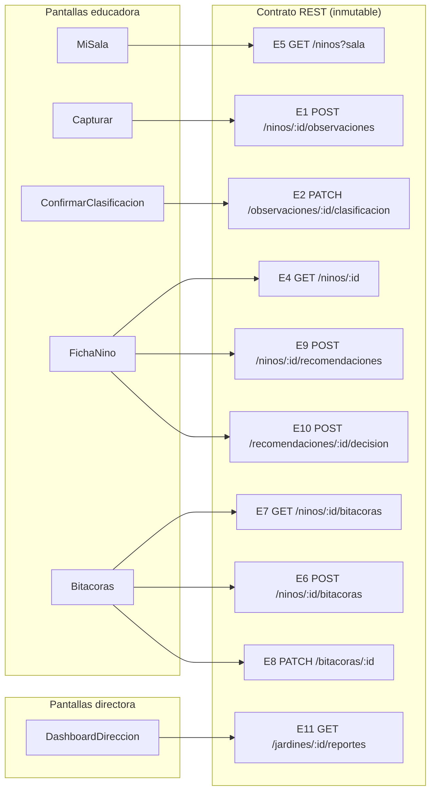

# Gap-analysis de pantallas/flujos vs. contrato REST existente

> **Tarea 14.2 del spec `jaimes-mvp`** — _Requirement 20.2_: gap-analysis de las
> pantallas y flujos extraídos de los mockups de Figma (tarea 14.1) contra el
> **contrato REST existente**, identificando qué endpoints consume cada pantalla
> y las brechas detectadas.
>
> **Invariante clave (Requirement 20.5):** el **contrato de la API REST del
> backend es INMUTABLE**. Este análisis identifica brechas, pero **no propone
> cambiar la API**. Toda brecha se resuelve como **adaptación del lado del
> frontend** (composición de llamadas, estado local de UI) o se **registra
> explícitamente** como fuera del alcance del MVP cuando no existe endpoint y
> crearlo exigiría tocar el backend.
>
> **Idioma / contexto:** español (Chile).

## 1. Fuentes de este análisis

| Insumo | Ubicación | Rol en el análisis |
| --- | --- | --- |
| Pantallas/flujos extraídos de Figma | [`figma-pantallas.md`](./figma-pantallas.md) (tarea 14.1) | Qué pantallas y flujos hay que soportar |
| Contrato REST (fuente de verdad) | `design.md` → _"API (`app/api/routers/`) — Módulo G"_ | Endpoints disponibles (inmutables) |
| Capa de servicios tipada ya implementada | `frontend/src/api/endpoints.ts` + `frontend/src/api/types.ts` | Espejo 1:1 del contrato en el cliente |
| Pantallas ya implementadas (placeholder) | `frontend/src/screens/{educadora,directora}/*.tsx` | Qué endpoints consume hoy cada pantalla |

> **Nota sobre "existente":** los routers FastAPI (`backend/app/api/routers/`)
> aún no están implementados (tarea 9.3 pendiente). El **contrato** que se toma
> como "existente e inmutable" es el **definido en `design.md`**, que ya está
> **reflejado 1:1** en la capa `frontend/src/api/` (13 funciones tipadas). Ese es
> el contrato contra el que se hace el gap-analysis.

## 2. Contrato REST existente (inmutable) — inventario de endpoints

Los 13 endpoints del diseño, con la función de la capa de servicios que ya los
expone en el cliente:

| # | Método + ruta | Función en `endpoints.ts` | Propósito |
| --- | --- | --- | --- |
| E1 | `POST /ninos/{id}/observaciones` | `crearObservacion` | Crear observación (multipart: medio o texto) → clasificación propuesta |
| E2 | `PATCH /observaciones/{id}/clasificacion` | `confirmarClasificacion` | Confirmar/corregir clasificación |
| E3 | `GET /ninos/{id}/observaciones` | `listarObservaciones` | Listar observaciones de un niño/a |
| E4 | `GET /ninos/{id}` | `obtenerFichaNino` | Ficha + trayectoria |
| E5 | `GET /ninos?sala=...` | `listarNinosPorSala` | "Mi sala" |
| E6 | `POST /ninos/{id}/bitacoras` | `generarBitacora` | Generar bitácora quincenal (body: periodo) |
| E7 | `GET /ninos/{id}/bitacoras` | `listarBitacoras` | Listar bitácoras |
| E8 | `PATCH /bitacoras/{id}` | `editarBitacora` | Editar / aprobar bitácora |
| E9 | `POST /ninos/{id}/recomendaciones` | `generarRecomendacion` | Generar recomendación de nivel |
| E10 | `POST /recomendaciones/{id}/decision` | `registrarDecisionRecomendacion` | Registrar decisión de la educadora |
| E11 | `GET /jardines/{id}/reportes` | `obtenerReporteDireccion` | Reporte de dirección (query: periodo) |
| E12 | `GET /ruta-niveles` | `obtenerRutaNiveles` | Rúbrica/ruta de referencia |
| E13 | `GET /health` | `obtenerSalud` | Salud para API Gateway / demo |

## 3. Mapa pantalla → endpoints consumidos

Para cada pantalla objetivo del diseño (`MiSala`, `Capturar`,
`ConfirmarClasificacion`, `FichaNino`, `Bitacoras`, `DashboardDireccion`) y los
transversales (`SelectorRol`, `BannerDatosSinteticos`, `IndicadorCarga`), qué
endpoints consume y qué consume **hoy** la pantalla ya implementada.

| Pantalla (diseño) | Endpoints que consume | Verificado en código actual |
| --- | --- | --- |
| **MiSala** | E5 `GET /ninos?sala=` | `MiSala.tsx` → `api.listarNinosPorSala` ✔ |
| **Capturar** | E1 `POST /ninos/{id}/observaciones` | `Capturar.tsx` → `api.crearObservacion` ✔ |
| **ConfirmarClasificacion** | E2 `PATCH /observaciones/{id}/clasificacion` (recibe la propuesta vía estado de navegación desde E1) | `ConfirmarClasificacion.tsx` → `api.confirmarClasificacion` ✔ |
| **FichaNino** | E4 `GET /ninos/{id}`; E9 `POST /ninos/{id}/recomendaciones`; E10 `POST /recomendaciones/{id}/decision` | `FichaNino.tsx` → `obtenerFichaNino` + `generarRecomendacion` + `registrarDecisionRecomendacion` ✔ |
| **Bitacoras** | E7 `GET /ninos/{id}/bitacoras`; E6 `POST /ninos/{id}/bitacoras`; E8 `PATCH /bitacoras/{id}` (editar y aprobar) | `Bitacoras.tsx` → `listarBitacoras` + `generarBitacora` + `editarBitacora` ✔ |
| **DashboardDireccion** | E11 `GET /jardines/{id}/reportes` | `DashboardDireccion.tsx` → `obtenerReporteDireccion` ✔ |
| **SelectorRol** (transversal) | — (sin backend: elección de rol local) | `SeleccionarRol.tsx` / `RolContext` — sin llamada REST ✔ |
| **BannerDatosSinteticos** (transversal) | — (estático) | Componente de presentación, sin REST ✔ |
| **IndicadorCarga** (transversal) | — (refleja estado de cualquier llamada) | Componente de presentación, sin REST ✔ |

Endpoints del contrato **no consumidos aún** por ninguna pantalla objetivo:
`E3 GET /ninos/{id}/observaciones` (disponible para la trayectoria si se separa
de E4), `E12 GET /ruta-niveles` (referencia de rúbrica, útil en
`ConfirmarClasificacion`/`FichaNino`), `E13 GET /health` (demo/diagnóstico).
**No son brechas**: son endpoints disponibles que las pantallas pueden adoptar
sin cambiar el contrato.

### 3.1 Diagrama pantalla → endpoint

## 4. Brechas detectadas

Las brechas provienen de que los mockups (14.1) proponen pantallas, flujos y
perfiles **adicionales** a los 2 roles y 6 pantallas del MVP. Se clasifican por
tipo y, para cada una, se indica la **resolución del lado frontend** sin tocar
el backend.

### 4.1 Pantallas/flujos adicionales sin endpoint propio

| ID | Pantalla/flujo del mockup | ¿Hay endpoint? | Tipo de brecha | Resolución (frontend, contrato intacto) |
| --- | --- | --- | --- | --- |
| G-1 | **InicioEducadora** (home: próxima observación, pendientes, informe) | No específico | Pantalla nueva sin endpoint de "dashboard educadora" | **Componer** con endpoints existentes: E5 (sala) + E7 (bitácoras por niño/a) para derivar "pendientes" en el cliente. Vista de **agregación local**; no requiere endpoint nuevo. Si se quisiera un resumen server-side sería un endpoint nuevo → **fuera de alcance MVP** (no se crea). |
| G-2 | **InformeBimensual** (comunicación a familias: vista previa + aprobación + envío + estados de entrega) | No | Flujo nuevo (envío a familias) sin endpoints de "informe"/"entrega" | **Fuera de alcance del MVP.** El contrato no modela informes a familias ni envío de correo. En el frontend se puede **reutilizar `Bitacoras` aprobadas** (E7/E8) como contenido base de una vista previa, pero el envío/entrega **no tiene endpoint** y **no se crea** (invariante 20.5). Documentar como pendiente de un futuro requirement. |
| G-3 | **ColaSincronizacion / Guardados y conexión** (borradores offline, por enviar/sincronizados, conflictos) | No | Soporte offline / cola local | **Puramente cliente (PWA):** borradores en almacenamiento local + reintento de E1 al reconectar. El contrato REST no cambia (E1 ya acepta la observación cuando hay conexión). Alinea con el principio UX "nada se descarta". |
| G-4 | **Acceso local · Equipo y permisos / reasignación de docente** | No | Perfil admin. local, no modelado | **Fuera de alcance del MVP** (solo roles `educadora`/`directora`). El mockup lo marca como _"perfil solicitado, no rol del dataset"_. No se crea endpoint. |
| G-5 | **Captura grupal** (relato compartido + N participantes, una evidencia por participante) | Parcial (E1 por participante) | Flujo nuevo; el contrato modela observación **individual** | **Adaptación frontend:** la UI grupal itera y hace **N llamadas E1** (una `POST /ninos/{idParticipante}/observaciones` por niño/a) y luego N confirmaciones E2. El backend sigue tratando observaciones individuales; **el contrato no cambia**. El mockup ya aclara "la captura grupal es un flujo propuesto, no una entidad del dataset". |
| G-6 | **Login con identificador institucional + contexto jardín/sala** | No (auth) | `SelectorRol` ampliado a login/contexto | **Fuera de alcance del MVP** (en el diseño el rol se elige sin autenticación). En el frontend se mantiene `SelectorRol` + estado local de jardín/sala (el `id` de jardín/sala ya se usa como parámetro en E5/E11). No se añade auth ni endpoints. |

### 4.2 Desajustes de forma de respuesta / campos (response-shape)

Comparando los campos que los mockups muestran contra los DTO del contrato
(`frontend/src/api/types.ts`). Ninguno exige cambiar el contrato; se resuelven
en el cliente.

| ID | Pantalla/campo del mockup | Contrato (`types.ts`) | Tipo de brecha | Resolución (frontend) |
| --- | --- | --- | --- | --- |
| S-1 | **MiSala**: columnas "estado de documentación", "último registro", filtros _Con registros / Sin registro / Ingreso reciente_ | `Nino` = `{ id_nino, sala, tramo?, id_jardin? }` (sin estado ni fecha de último registro) | Campos de UI no provistos por E5 | **Derivar en el cliente:** el "estado"/"último registro" se calcula desde E3/E4 (observaciones por niño/a) o se muestra como "—" cuando no hay dato. **Sin inferir déficit** por ausencia (principio UX "sin registro ≠ sin aprendizaje"). No se amplía E5. |
| S-2 | **FichaNino**: "mirada por dominios", "detalle de evidencia", tabla con autoría/formato/nivel | `FichaNino` = `{ nino, observaciones[] }`; `Observacion` incluye `formato_captura`, `clasificacion.{nivel_estimado,dominios,...}` | Agrupación/visualización, no datos faltantes | **Composición de presentación:** agrupar `observaciones` por dominio/fecha en el cliente. Toda la data necesaria ya viaja en E4. Sin cambios de contrato. |
| S-3 | **ConfirmarClasificacion**: "nivel propuesto (no aprobado)", manifestaciones con checkbox conservar/revisar, baja confianza | `ClasificacionPropuesta` = `{ nivel_estimado, dominios, manifestaciones, confianza_baja }`; `Observacion.pendiente_clasificacion_manual?` | Cubierto por el contrato | **Sin brecha.** El flag `confianza_baja`/`pendiente_clasificacion_manual` ya habilita el estado "baja confianza" del mockup. El cuerpo de E2 (`ConfirmarClasificacionBody`) ya acepta `nivel/dominios/manifestaciones`. |
| S-4 | **FichaNino / ¿Puede subir de nivel?**: 3 estados (avanzar/mantener/retroceder), tramo/núcleo/nivel, abstención por datos insuficientes | `Recomendacion` = `{ decision, tramo, nucleo, nivel_actual, argumento, datos_insuficientes?, decision_educadora? }` | Cubierto por el contrato | **Sin brecha.** E9 devuelve los 3 estados + abstención; E10 registra la decisión de la educadora. |
| S-5 | **DashboardDireccion**: KPI de tiempo (4 h → 0 h), composición por formato, "entrega diaria", "casos para lectura responsable", conteos de red (jardines/educadoras) | `ReporteDireccion` incluye `kpi_tiempo_ahorrado_horas`, `distribucion_por_sala/dominio`, `subieron/mantuvieron/bajaron`, alertas, `total_observaciones/bitacoras`, `resumen_ejecutivo?` | KPI y métricas núcleo cubiertos; "composición por formato", "entrega diaria" y conteos de red NO están en el DTO | **KPI y métricas núcleo: sin brecha.** Para "composición por formato" / "entrega diaria" / conteos de red: **no están en el contrato** → se muestran como vistas opcionales **omitidas en el MVP** o derivadas de lo disponible; **no se amplía** `ReporteDireccion`. Métricas inventadas en cliente están prohibidas (las métricas vienen de SQL, no del cliente). |
| S-6 | **Bitacoras**: estados _Borrador / En revisión / Aprobado / Dataset_ | `EstadoBitacora = "borrador" \| "aprobada"` | El mockup propone 4 estados; el contrato define 2 | **Mapear a los 2 estados del contrato** en la UI ("En revisión"/"Dataset" son etiquetas de presentación sobre `borrador`/`aprobada`). No se amplía el enum del backend. |

### 4.3 Discrepancia de dominio/vocabulario señalada por el propio mockup

| ID | Discrepancia | Resolución |
| --- | --- | --- |
| D-1 | El tablero UX del mockup menciona _"8 niveles y 10 núcleos"_, mientras el dataset/diccionario E-1 y el backend usan **9 niveles y 5 dominios** (`Dominio` en `types.ts`). | **Prevalece el dataset/contrato (9 niveles / 5 dominios).** El propio mockup resuelve usar la ruta del dataset. El frontend usa el enum `Dominio` existente. Sin cambios de contrato. |

## 5. Resumen de brechas y veredicto sobre la inmutabilidad del contrato

- **Pantallas objetivo del diseño (6) + transversales (3):** **cubiertas al
  100 %** por el contrato REST existente. No hay ninguna brecha que obligue a
  modificar la API.
- **Brechas detectadas:** todas provienen de pantallas/flujos/perfiles
  **adicionales** de los mockups. Se resuelven como:
  - **Adaptación del lado frontend** (composición de llamadas, estado/vista
    local, mapeo de etiquetas): G-1, G-3, G-5, G-6, S-1, S-2, S-6.
  - **Ya cubierto por el contrato** (no es brecha real): S-3, S-4, parte de S-5,
    D-1.
  - **Fuera de alcance del MVP** (requeriría endpoints nuevos → **no se crean**,
    por invariante 20.5): G-2 (InformeBimensual/envío a familias), G-4 (admin.
    local), parte de S-5 (composición por formato / entrega diaria / conteos de
    red no presentes en `ReporteDireccion`).
- **Veredicto 20.5 — contrato inmutable:** ✅ **ninguna brecha propone cambiar
  el contrato REST**. No existe ninguna **brecha verdadera** que bloquee el MVP:
  todo lo imprescindible de las 6 pantallas objetivo ya tiene endpoint. Las
  carencias restantes corresponden a alcance futuro, no a defectos del contrato.

## 6. Trazabilidad y próximos pasos

- **Entregable de esta tarea (14.2):** este documento (`gap-analysis-figma.md`).
- **Base:** la extracción de pantallas/flujos de 14.1
  ([`figma-pantallas.md`](./figma-pantallas.md)) y el contrato REST de
  `design.md` reflejado en `frontend/src/api/`.
- **14.3 (hecho):** tareas de **componentes concretos** para `MiSala`,
  `Capturar`, `ConfirmarClasificacion`, `FichaNino`, `Bitacoras`,
  `DashboardDireccion` en [`componentes-figma.md`](./componentes-figma.md),
  usando este mapa pantalla→endpoint y aplicando las resoluciones de adaptación
  frontend de la sección 4.
- **Invariante respetada:** esta tarea **no toca** backend, contrato REST ni
  lógica de negocio; es análisis/documentación de capa de presentación
  (Requirement 20.5).
